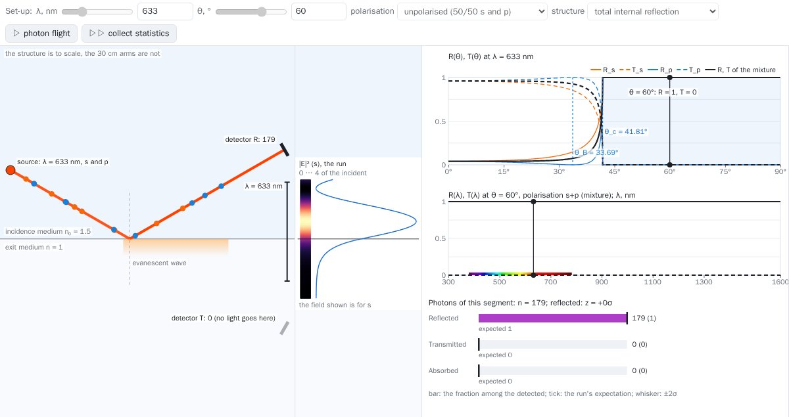
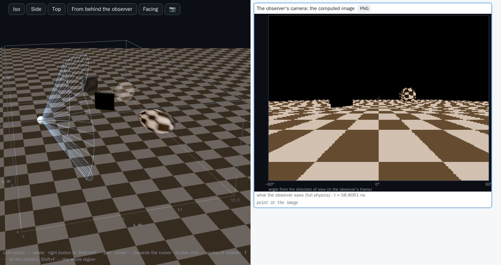
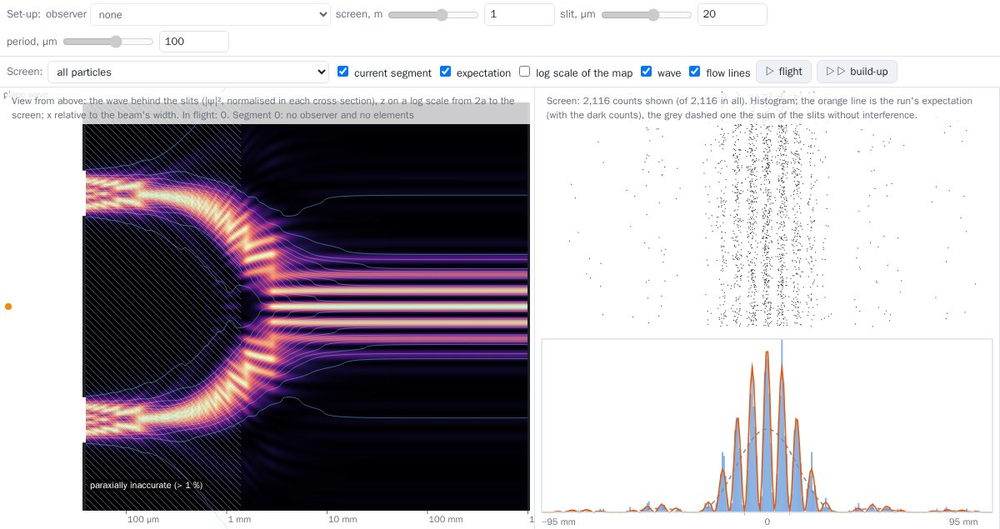
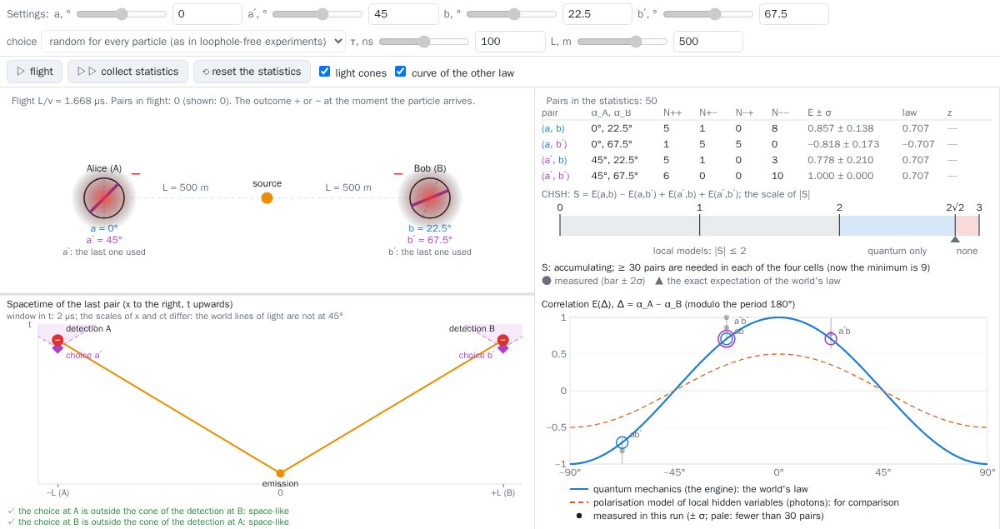
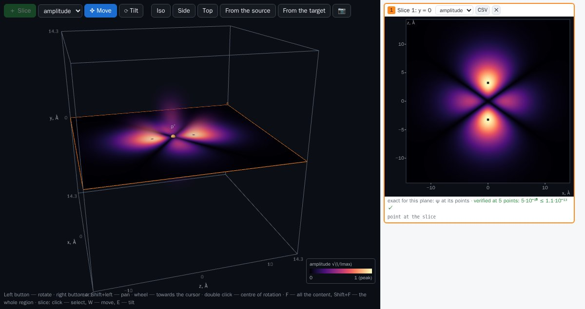
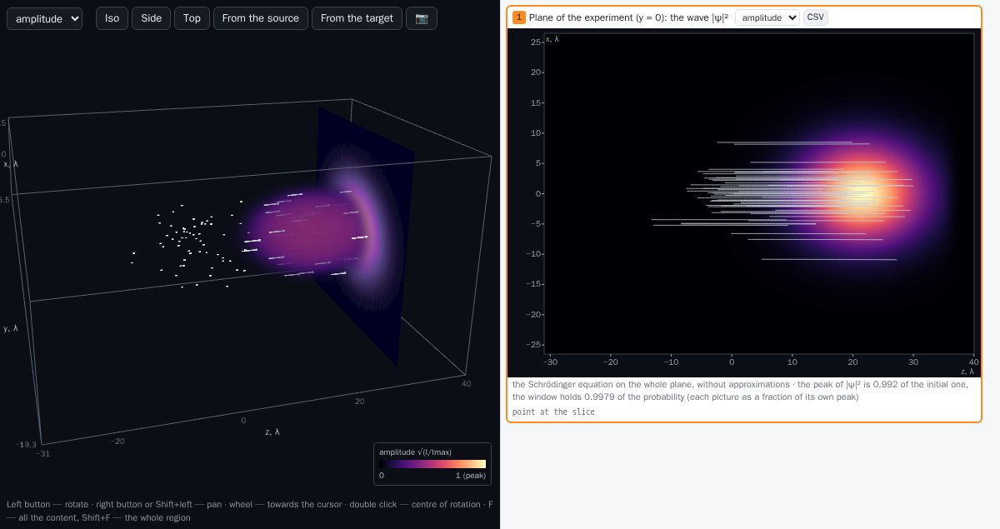
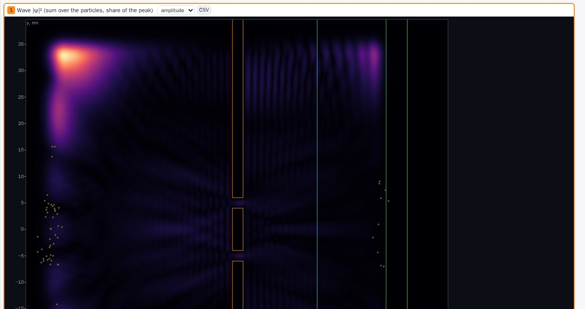
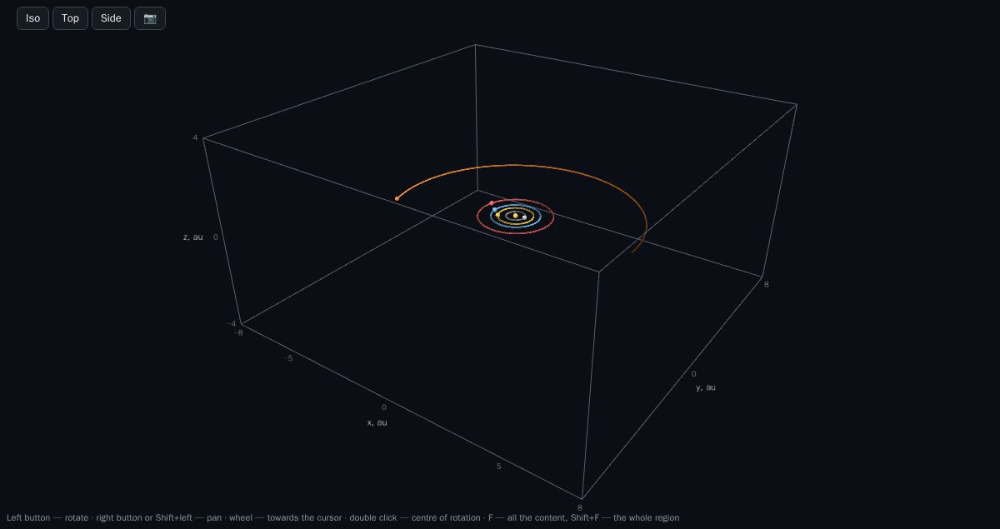

# lfphys

**English** | [Русский](README.ru.md)

[](LICENSE.md)

lfphys is a physics engine and a set of interactive visualizations built on it. The engine, a Python package, keeps
three kinds of physics apart: a **core** of established physics, where every function is tested against a closed form
or an independent second method; the **approximations, interpretations and phenomenological models** that physicists
use widely, each stating where it departs from the core; and **declared alternatives** for "what if" worlds. The
visualizations run in a browser and compute what you see: an interference pattern, an orbit or a rainbow appears
because the run computed it, not because it was drawn, and every run shows its own checks, computed values next to
independent references. There are 17 prepared **demonstrations**, from Young's experiment and the rainbow to the shadow
of a spinning black hole, and 4 **laboratories**, where you build a scene by hand and the world computes it live.

> The player speaks English (the default) and Russian: the switch **EN | RU** in the top bar of every page changes the
> language of the interface, its help, the preset names and every message of the run. Each visualization's README
> (linked in the tables below) and the guide to the player exist in both languages.

<a href="docs/images/u42-m87.jpg"></a>
<a href="docs/images/u44-rainbow.jpg"></a>

## Contents

* [Quick start](#quick-start)
* [Demonstrations by audience](#demonstrations-by-audience): [School](#school) · [University](#university) · [Research](#research) · [Laboratories](#laboratories)
* [What is computed and how it is checked](#what-is-computed-and-how-it-is-checked)
* [Coverage and roadmap](#coverage-and-roadmap)
* [Documentation](#documentation)
* [Licence and citation](#licence-and-citation)

## Quick start

```bash
git clone https://github.com/ildar-idrisov/lfphys.git
cd lfphys

# with an NVIDIA GPU and the NVIDIA Container Toolkit
docker compose -f visualizations/docker/docker-compose.yml up -d --build viz

# without a GPU
docker compose -f visualizations/docker/docker-compose.yml --profile cpu up -d --build viz-cpu
```

Open <http://localhost:8479>, choose a demonstration and its scenario, and press **▶ Start**. The player opens;
**⏺** records (computes the world further), and the slider goes back through the history. The switch
**Demonstrations | Laboratories** at the top of the catalogue opens the laboratories.

| requirement | |
|---|---|
| Docker | Docker Engine with the Compose plugin v2 (`docker compose`) |
| disk | about 3.3 GB for the image; most of it is NVIDIA's CUDA libraries from PyPI, which only the GPU path uses. Run records go to `visualizations/runs/`, up to a quota of 5 GB; a run nobody opened for 3 days is removed unless marked ☆ (the period is set in the catalogue) |
| memory | the server's container is limited to 6 GB; each running world gets at most 60 % of it. A machine with 8 GB of RAM or more is advisable |
| CPU | each run computes in its own process with 2 threads; at most 3 runs compute at once |
| GPU (optional) | an NVIDIA GPU with a driver for CUDA 12 (version 525 or newer) and the [NVIDIA Container Toolkit](https://docs.nvidia.com/datacenter/cloud-native/container-toolkit/latest/install-guide.html); the server uses one GPU, device 0 |

**With or without a GPU.** The same code runs in both cases and gives the same checks; only the speed differs. With a
GPU, the heavy kernels move to it where measurement shows a gain: wave propagation by the angular spectrum, the ray
tracers of u39 and u42, the 2-D/3-D Schrödinger solver, lattice Boltzmann flow, molecular-dynamics pair forces and the
FDTD solver (measured, for example, ×26–29 for the Schrödinger solver on 1024²–2048² grids and ×8–155 for lattice
Boltzmann flow: `lfphys/README.md`, "CPU and GPU"). Checks are always computed in double precision. Without a GPU most
worlds still run at their default speed. The clearest exception is the flow of p04: in the Kármán-street scenario a
step took 13 ms on an 8-core desktop CPU and 0.19 ms on an RTX 2080 Ti, so without a GPU the street forms about 30 times
slower than the default speed. The exact two-slit world r12 computes slower than its default speed on either device,
and its pattern takes several minutes to form. The page **⚙ Devices** (`/settings`) shows what runs where and lets
you choose the device and the precision per kernel.

**Settings.** Optional; a fresh clone works without them. Copy the template and edit it:

```bash
cp visualizations/docker/.env.example visualizations/docker/.env
```

* `UID`, `GID`: the owner of the clone (`id -u`, `id -g`) when it is not 1000:1000. The server writes the run
  records into `visualizations/runs/` as this user.
* `VIZ_PORT`: another port (8479 by default). `VIZ_PORT=127.0.0.1:8479` keeps the server reachable from this machine
  only.
* `VIZ_CPUS`: a CPU limit for the container (0, the default, means none).
* `LFPHYS_GPU_PCI`: on a host with several GPUs, paste GPU 0's bus id from
  `nvidia-smi --query-gpu=pci.bus_id --format=csv`; the engine then refuses any other device.

The server listens on all of the machine's addresses, so other computers on the local network can open
`http://<this machine's address>:8479`. It has no login: anyone who can reach the port can start runs. Keep it on a
trusted network, or bind it to `127.0.0.1` as above.

**Stop and start again.**

```bash
docker compose -f visualizations/docker/docker-compose.yml stop viz         # or: stop viz-cpu
docker compose -f visualizations/docker/docker-compose.yml start viz        # or: start viz-cpu
docker compose -f visualizations/docker/docker-compose.yml --profile cpu down   # remove the container
```

On stop the server suspends its runs and each world saves its state; a suspended run continues from it when you open
it and press ⏺. The records stay in `visualizations/runs/` after `down`. The server restarts with Docker unless you
stopped it.

**Tests and the engine as a library.**

```bash
docker compose -f visualizations/docker/docker-compose.yml run --rm viz-test   # visualizations and server
docker run --rm --user "$(id -u):$(id -g)" -v "$PWD":/lf -w /lf/lfphys lfphys-viz \
    python3 -m pytest -q -p no:cacheprovider                                  # the engine
docker run --rm --user "$(id -u):$(id -g)" -v "$PWD":/lf -e PYTHONPATH=/lf/lfphys lfphys-viz \
    python3 -c "from lfphys import registry; print(len(registry.catalogue()), 'modules')"
```

A research project uses the engine as an external library: `import lfphys` with `lfphys/` of this repository on
`PYTHONPATH`.

## Demonstrations by audience

Each world belongs to exactly one audience (`AGENTS.md` §3 rule 14). Each card gives a picture of a recorded run, the
visualization's name (linked to its README with the model, the checks and the approximations), what you will see, its
anchors (the university courses; for research, the question it studies, marked as a hypothesis until it is reproduced,
and the prior art), links to watch its recordings on the public site, the number of its scenarios and the same topic
at other levels. A local server computes every scenario live. A recording marked *(modified physics)* shows a world
with a deliberately changed law; the player's top bar flags such a world with the badge **MODIFIED PHYSICS: …**. The
section below is generated from the registry by `visualizations/site/readme.py`; edit the worlds' `VIZ`, not this
text.

<!-- BEGIN generated: catalogue (visualizations/site/readme.py); do not edit -->

### School

Grades 7–11: the ordinary lab experiment, computed and guided step by step.

**Ready: 0 of 45**

*Planned demonstrations, by section:*

**Mechanics** · 12

* S01 · Straight-line motion: uniform and uniformly accelerated (grades 7, 9, 10) · *next in the plan*
* S02 · Free fall and Galileo's experiments (grades 9, 10) · *next in the plan*
* S03 · Motion of a body thrown horizontally and at an angle (grades 7, 10) · *next in the plan*
* S04 · Motion in a circle (grades 9, 10)
* S05 · Newton's laws (grades 9, 10)
* S06 · The elastic force, Hooke's law, weight and weightlessness (grades 7, 9, 10)
* S07 · Friction; a block on an inclined plane (grades 7, 9, 10)
* S08 · The lever, pulleys, the inclined plane; the moment of a force (grades 7, 9, 10)
* S09 · Work, kinetic and potential energy, the conservation law (grades 7, 9, 10) · *next in the plan*
* S10 · Momentum, collisions, jet propulsion (grades 9, 10)
* S11 · Universal gravitation, satellites, the first cosmic velocity (grades 9, 10). Already there at another level: [u34 · Orbits and clocks: general relativity and Newton](visualizations/u34_orbits/README.md) (University); [p01 · Space and gravity](visualizations/p01_gravity/README.md) (Laboratories)
* S12 · The pendulum and the mass on a spring; damping, forced oscillations, resonance (grades 9, 11)

**Liquids and gases** · 2

* S15 · Pressure in liquids and gases: Pascal's law, communicating vessels, the hydraulic press, atmospheric pressure (grades 7)
* S16 · Archimedes' principle; floating bodies (grades 7)

**Oscillations and waves** · 2

* S13 · Mechanical waves: the rope and the ripple tank (grades 9, 11)
* S14 · Sound: pitch, loudness, resonance, the Doppler effect (grades 9, 11)

**Heat and molecular physics** · 5

* S17 · Brownian motion and diffusion (grades 7, 8, 10)
* S18 · Heat transfer, quantity of heat, the heat balance equation (grades 8, 10)
* S19 · Melting, boiling, evaporation, humidity (grades 8, 10)
* S20 · The gas laws: isotherm, isobar, isochore (grades 8, 10)
* S21 · The first law of thermodynamics and heat engines (grades 8, 10)

**Electricity and magnetism** · 12

* S22 · Electric charges and the electric field (grades 8, 10)
* S23 · The capacitor (grades 10)
* S24 · Current, voltage, Ohm's law, the resistance of a conductor (grades 8, 10)
* S25 · Series, parallel and mixed connection (grades 8, 10)
* S26 · Work and power of a current, the Joule–Lenz law, a lamp, a heater (grades 8, 10)
* S27 · EMF and internal resistance; Ohm's law for a complete circuit (grades 10)
* S28 · Current in various media: metals, the semiconductor diode, an electrolyte (grades 8, 10)
* S29 · The magnetic field of magnets and currents; Oersted's experiment; the electromagnet (grades 8, 11)
* S30 · The Ampère force, the electric motor, the Lorentz force (grades 8, 11)
* S31 · Electromagnetic induction; Lenz's rule; the generator (grades 8, 11)
* S32 · The oscillating circuit, alternating current, resonance, the transformer (grades 11)
* S33 · Electromagnetic waves: emission, reflection, polarisation, the scale of waves (grades 9, 11)

**Optics** · 5

* S34 · Reflection of light; plane and spherical mirrors (grades 9, 11)
* S35 · Refraction of light, total internal reflection, the light guide (grades 9, 11). Already there at another level: [u35 · Optical bench: boundaries and coatings](visualizations/u35_optics_bench/README.md) (University)
* S36 · Lenses, image construction, optical instruments, the eye (grades 9, 11)
* S37 · Dispersion of light, the spectrum, colour; the rainbow (grades 9, 11). Already there at another level: [u44 · Mie scattering by a drop: the rainbow and the glory](visualizations/u44_mie_scattering/README.md) (University)
* S38 · Interference and diffraction of light; the diffraction grating; polarisation (grades 9, 11). Already there at another level: [u32 · The double-slit experiment](visualizations/u32_double_slit/README.md) (University); [u38 · Wave in 3-D: diffraction by an aperture](visualizations/u38_wave_3d/README.md) (University); [r12 · Double slit (long slits, 3-D): the exact Schrödinger equation and Bohm trajectories](visualizations/r12_double_slit_2d/README.md) (Research)

**The theory of relativity** · 1

* S39 · Foundations of special relativity: the relativity of simultaneity, time dilation, length contraction, E = mc² (grades 11). Already there at another level: [u31 · Light over large distances](visualizations/u31_light_travel/README.md) (University); [u39 · What a fast observer sees](visualizations/u39_fast_observer/README.md) (University)

**Quantum physics** · 1

* S40 · The photoelectric effect: Stoletov's experiments, the laws, Einstein's equation (grades 11)

**Atomic physics** · 2

* S41 · Rutherford's experiment and the model of the atom (grades 9, 11)
* S42 · Line spectra, energy levels, Bohr's postulates (grades 9, 11). Already there at another level: [u40 · The hydrogen atom in 3-D: orbitals](visualizations/u40_hydrogen_3d/README.md) (University)

**Nuclear physics** · 2

* S43 · Radioactivity: α, β, γ, the half-life, the background (grades 9, 11)
* S44 · Nuclear reactions, binding energy, fission and fusion (grades 9, 11)

**Astrophysics and cosmology** · 1

* S45 · The expansion of the Universe: Hubble's law (grades 11)

### University

The experiments of the university courses, computed from the laws.

**Optics** · 4

| | |
|---|---|
| <a href="docs/images/u35_optics_bench.jpg"></a> | **[u35 · Optical bench: boundaries and coatings](visualizations/u35_optics_bench/README.md)**<br>Photons hit a boundary one by one and split in the fractions that Maxwell's equations give.<br>*Courses:* Hecht, Optics, ch. 4, 9; Sivukhin, General Course of Physics, vol. IV: Optics, ch. V<br>▷ Watch on the site: [Total internal reflection: glass 1.5 → air, θ = 60° beyond the critical angle](https://ildar-idrisov.github.io/lfphys/run.html?rec=u35_optics_bench/tir) · [Glass n = 1.5 in air at Brewster's angle (unpolarised light: only s is reflected)](https://ildar-idrisov.github.io/lfphys/run.html?rec=u35_optics_bench/brewster) · [Surface plasmon resonance (Kretschmann): prism 1.5, metal 50 nm (n = 0.2 + 3.3i), air, p (illustrative)](https://ildar-idrisov.github.io/lfphys/run.html?rec=u35_optics_bench/spr)<br>Scenarios in the player: 9<br>Same topic at other levels: S35 · Refraction of light, total internal reflection, the light guide (School, planned) |
| <a href="docs/images/u38_wave_3d.jpg"></a> | **[u38 · Wave in 3-D: diffraction by an aperture](visualizations/u38_wave_3d/README.md)**<br>Light passes two slits of finite length: the 3-D field behind them, slices at any angle, the energy current.<br>*Courses:* Halliday, Resnick & Walker, Fundamentals of Physics, ch. 36; Hecht, Optics, ch. 10<br>▷ Watch on the site: [Two slits of finite length: the whole volume](https://ildar-idrisov.github.io/lfphys/run.html?rec=u38_wave_3d/double)<br>Scenarios in the player: 5<br>Same topic at other levels: S38 · Interference and diffraction of light; the diffraction grating; polarisation (School, planned) |
| <a href="docs/images/u43_optical_vortices.jpg"></a> | **[u43 · Optical vortices: Laguerre–Gauss beams, orbital angular momentum, the rotational Doppler effect](visualizations/u43_optical_vortices/README.md)**<br>Light with helical fronts: twisted energy flow, angular momentum per photon, and the beat from a rotating disc.<br>*Courses:* Allen, Beijersbergen, Spreeuw & Woerdman, Phys. Rev. A 45, 8185 (1992); Hecht, Optics<br>▷ Watch on the site: [LG₀³, σ = +1: three helical fronts, the exact model, a rotating disc](https://ildar-idrisov.github.io/lfphys/run.html?rec=u43_optical_vortices/lg3) · [Tight focusing: l = 1, σ = −1, w0 = 0.6 λ: the longitudinal field and the spin-orbit splitting](https://ildar-idrisov.github.io/lfphys/run.html?rec=u43_optical_vortices/tight) · [A Dove prism rotates: a frequency shift 2\|l\|f for the beam l = 2](https://ildar-idrisov.github.io/lfphys/run.html?rec=u43_optical_vortices/dove)<br>Scenarios in the player: 9 |
| <a href="docs/images/u44_mie_scattering.jpg"></a> | **[u44 · Mie scattering by a drop: the rainbow and the glory](visualizations/u44_mie_scattering/README.md)**<br>Sunlight on water drops: the rainbow, its supernumerary bows and the glory from the exact Mie series.<br>*Courses:* Bohren & Huffman, Absorption and Scattering of Light by Small Particles; Hecht, Optics<br>▷ Watch on the site: [Rainbow: drops of radius 0.15 mm ± 2 % in sunlight: the primary and secondary bows, Alexander's band, the supernumerary bows](https://ildar-idrisov.github.io/lfphys/run.html?rec=u44_mie_scattering/rainbow) · [Supernumerary bows: nearly equal drops of radius 0.1 mm ± 0.5 %](https://ildar-idrisov.github.io/lfphys/run.html?rec=u44_mie_scattering/supernumerary) · [Glory: cloud drops of radius 8 µm ± 10 %, coloured rings around the antisolar point](https://ildar-idrisov.github.io/lfphys/run.html?rec=u44_mie_scattering/glory)<br>Scenarios in the player: 7<br>Same topic at other levels: S37 · Dispersion of light, the spectrum, colour; the rainbow (School, planned) |

**The theory of relativity** · 3

| | |
|---|---|
| <a href="docs/images/u31_light_travel.jpg"></a> | **[u31 · Light over large distances](visualizations/u31_light_travel/README.md)**<br>Light leaves the Sun and reaches the Earth about 8 minutes later; light cones, deflection, simultaneity.<br>*Courses:* Taylor & Wheeler, Spacetime Physics; Hartle, Gravity: An Introduction to Einstein's General Relativity; Halliday, Resnick & Walker, Fundamentals of Physics, ch. 37; Sivukhin, General Course of Physics, vol. IV: Optics, ch. IX<br>▷ Watch on the site: [Sun → Earth (standard physics)](https://ildar-idrisov.github.io/lfphys/run.html?rec=u31_light_travel/sun_earth) · [Measuring c: at rest, moving along the light, against it (SR) *(modified physics)*](https://ildar-idrisov.github.io/lfphys/run.html?rec=u31_light_travel/measure_c) · [Black hole of 10 M☉: deflection, shadow, two images](https://ildar-idrisov.github.io/lfphys/run.html?rec=u31_light_travel/lensing)<br>Scenarios in the player: 10<br>Same topic at other levels: S39 · Foundations of special relativity: the relativity of simultaneity, time dilation, length contraction, E = mc² (School, planned) |
| <a href="docs/images/u34_orbits.jpg"></a> | **[u34 · Orbits and clocks: general relativity and Newton](visualizations/u34_orbits/README.md)**<br>An orbit near a black hole turns into a rosette, and the body's clock runs slower than a distant one.<br>*Courses:* Hartle, Gravity: An Introduction to Einstein's General Relativity, ch. 9, 10; Taylor, Wheeler & Bertschinger, Exploring Black Holes<br>▷ Watch on the site: [Black hole 10 M☉: a rosette (periapsis 20M)](https://ildar-idrisov.github.io/lfphys/run.html?rec=u34_orbits/rosette) · [Mercury at the Sun (weak field, 43″ per century)](https://ildar-idrisov.github.io/lfphys/run.html?rec=u34_orbits/mercury) · [Plunge inside the ISCO (5.5M, speed −0.5 %)](https://ildar-idrisov.github.io/lfphys/run.html?rec=u34_orbits/plunge)<br>Scenarios in the player: 7<br>Same topic at other levels: S11 · Universal gravitation, satellites, the first cosmic velocity (School, planned); [p01 · Space and gravity](visualizations/p01_gravity/README.md) (Laboratories) |
| <a href="docs/images/u39_fast_observer.jpg"></a> | **[u39 · What a fast observer sees](visualizations/u39_fast_observer/README.md)**<br>A ball flying past at 0.9 c still looks round: the cube turns, colours shift, the view crowds forward.<br>*Courses:* Terrell (1959) and Penrose (1959): the invisibility of the Lorentz contraction; The Feynman Lectures on Physics, vol. I, ch. 34<br>▷ Watch on the site: [A cube and a ball fly past at β = 0.9: Terrell rotation, the ball stays a circle](https://ildar-idrisov.github.io/lfphys/run.html?rec=u39_fast_observer/terrell) · [Flight down a street at β = 0.9: aberration, blue ahead, brightness](https://ildar-idrisov.github.io/lfphys/run.html?rec=u39_fast_observer/city)<br>Scenarios in the player: 7<br>Same topic at other levels: S39 · Foundations of special relativity: the relativity of simultaneity, time dilation, length contraction, E = mc² (School, planned) |

**Quantum physics** · 3

| | |
|---|---|
| <a href="docs/images/u32_double_slit.jpg"></a> | **[u32 · The double-slit experiment](visualizations/u32_double_slit/README.md)**<br>Particles land one by one; the fringes build up hit by hit and vanish under a which-path mark.<br>*Courses:* The Feynman Lectures on Physics, vol. III, ch. 1; Griffiths & Schroeter, Introduction to Quantum Mechanics; Halliday, Resnick & Walker, Fundamentals of Physics, ch. 35, 38; Hecht, Optics, ch. 9<br>▷ Watch on the site: [Photons 633 nm, two slits (Young, one photon at a time)](https://ildar-idrisov.github.io/lfphys/run.html?rec=u32_double_slit/young) · [Quantum eraser: H/V marks + 45° analyser](https://ildar-idrisov.github.io/lfphys/run.html?rec=u32_double_slit/eraser) · [Electrons: the Aharonov–Bohm effect (flux ½ h/e)](https://ildar-idrisov.github.io/lfphys/run.html?rec=u32_double_slit/aharonov_bohm)<br>Scenarios in the player: 19<br>Same topic at other levels: S38 · Interference and diffraction of light; the diffraction grating; polarisation (School, planned); [r12 · Double slit (long slits, 3-D): the exact Schrödinger equation and Bohm trajectories](visualizations/r12_double_slit_2d/README.md) (Research); R01 · Time-dependent Aharonov–Bohm flux in a real double slit (Research, planned); R02 · A delayed which-path mark and its erasure with massive particles in a spatial double slit (Research, planned); R05 · The pulsed scalar (electric) Aharonov–Bohm effect: numerics for an experiment's design (Research, planned); R08 · A graded which-path mark and the crossing of Bohm trajectories (Research, planned); R09 · A time-modulated slit (Research, planned) |
| <a href="docs/images/u33_quantum_1d.jpg"></a> | **[u33 · A quantum particle in one dimension](visualizations/u33_quantum_1d/README.md)**<br>An electron's wave meets a barrier: part tunnels through, and single detections follow the computed odds.<br>*Courses:* Griffiths & Schroeter, Introduction to Quantum Mechanics, ch. 2; Halliday, Resnick & Walker, Fundamentals of Physics, ch. 39; Young & Freedman, University Physics, ch. 40<br>▷ Watch on the site: [Electron tunnelling through a 1 eV × 0.6 nm barrier](https://ildar-idrisov.github.io/lfphys/run.html?rec=u33_quantum_1d/tunnel) · [The same through Bohm's eyes: trajectories](https://ildar-idrisov.github.io/lfphys/run.html?rec=u33_quantum_1d/bohm)<br>Scenarios in the player: 9 |
| <a href="docs/images/u37_bell_test.jpg"></a> | **[u37 · The Bell test with entangled pairs](visualizations/u37_bell_test/README.md)**<br>Entangled pairs reach two distant stations; the CHSH parameter exceeds 2, the bound of any local theory.<br>*Courses:* Sakurai & Napolitano, Modern Quantum Mechanics, ch. 3; Griffiths & Schroeter, Introduction to Quantum Mechanics, ch. 12; Bell, Speakable and Unspeakable in Quantum Mechanics<br>▷ Watch on the site: [Photons \|Φ+⟩, quantum mechanics: optimal CHSH angles 0°, 45° / 22.5°, 67.5°, random choice](https://ildar-idrisov.github.io/lfphys/run.html?rec=u37_bell_test/chsh) · [Photons, local hidden variables: a polarisation model (modification) *(modified physics)*](https://ildar-idrisov.github.io/lfphys/run.html?rec=u37_bell_test/local_model) · [The curve E(Δ): photons, fixed settings a = b = 0°; move b](https://ildar-idrisov.github.io/lfphys/run.html?rec=u37_bell_test/scan)<br>Scenarios in the player: 6 |

**Atomic physics** · 1

| | |
|---|---|
| <a href="docs/images/u40_hydrogen_3d.jpg"></a> | **[u40 · The hydrogen atom in 3-D: orbitals](visualizations/u40_hydrogen_3d/README.md)**<br>The orbitals of hydrogen in 3-D: clouds, nodes, ring currents and a superposition swaying at the Bohr frequency.<br>*Courses:* Griffiths & Schroeter, Introduction to Quantum Mechanics, ch. 4; Young & Freedman, University Physics, ch. 41; Sivukhin, General Course of Physics, vol. V: Atomic and Nuclear Physics<br>▷ Watch on the site: [3d_z²: lobes along z and a ring](https://ildar-idrisov.github.io/lfphys/run.html?rec=u40_hydrogen_3d/3dz2) · [2p, m = +1 complex: a doughnut and a ring current](https://ildar-idrisov.github.io/lfphys/run.html?rec=u40_hydrogen_3d/ring_current) · [1s + 2p_z: the cloud sways along z at the Bohr frequency (a superposition)](https://ildar-idrisov.github.io/lfphys/run.html?rec=u40_hydrogen_3d/superposition)<br>Scenarios in the player: 10<br>Same topic at other levels: S42 · Line spectra, energy levels, Bohr's postulates (School, planned) |

**Particle physics** · 2

| | |
|---|---|
| <a href="docs/images/u36_qcd.jpg"></a> | **[u36 · QCD: asymptotic freedom and quarkonium](visualizations/u36_qcd/README.md)**<br>The strong coupling weakens at short distances; a quark model gives charmonium levels near the measured ones.<br>*Courses:* Griffiths, Introduction to Elementary Particles; Review of Particle Physics (Particle Data Group)<br>▷ Watch on the site: [Asymptotic freedom and charmonium (PDG 2024, Cornell model)](https://ildar-idrisov.github.io/lfphys/run.html?rec=u36_qcd/charmonium) · [Bottomonium](https://ildar-idrisov.github.io/lfphys/run.html?rec=u36_qcd/bottomonium)<br>Scenarios in the player: 4 |
| <a href="docs/images/u41_quarkonium_3d.jpg"></a> | **[u41 · Quarkonium in 3-D: wave functions](visualizations/u41_quarkonium_3d/README.md)**<br>Charmonium and bottomonium in 3-D: the quark pair's clouds, their nodes, and level splittings compared with experiment.<br>*Courses:* Griffiths, Introduction to Elementary Particles, ch. 5<br>▷ Watch on the site: [cc̄ 2S (ψ(2S)): one radial node](https://ildar-idrisov.github.io/lfphys/run.html?rec=u41_quarkonium_3d/cc_2s) · [bb̄ 1S (Υ(1S)): a tighter cloud, heavier quarks](https://ildar-idrisov.github.io/lfphys/run.html?rec=u41_quarkonium_3d/bb_1s) · [cc̄ 1S + 1P_z: the pair sways at the transition frequency (a superposition)](https://ildar-idrisov.github.io/lfphys/run.html?rec=u41_quarkonium_3d/superposition)<br>Scenarios in the player: 10 |

**Astrophysics and cosmology** · 1

| | |
|---|---|
| <a href="docs/images/u42_kerr_shadow.jpg"></a> | **[u42 · The shadow of a Kerr black hole and its photon rings](visualizations/u42_kerr_shadow/README.md)**<br>A rotating black hole with a disc of gas: the shadow and photon rings, traced ray by ray, compared with EHT.<br>*Courses:* Hartle, Gravity: An Introduction to Einstein's General Relativity, ch. 15; Chandrasekhar, The Mathematical Theory of Black Holes; Event Horizon Telescope Collaboration, ApJ Letters 875 (2019)<br>▷ Watch on the site: [M87*: a = 0.9, inclination 163° (as EHT for a &gt; 0), Cunningham's disc: the shadow, the lensing ring, the photon ring](https://ildar-idrisov.github.io/lfphys/run.html?rec=u42_kerr_shadow/m87) · [The disc edge-on (θ = 90°), a = 0.99: the shadow is flattened, the rings are asymmetric](https://ildar-idrisov.github.io/lfphys/run.html?rec=u42_kerr_shadow/edge_on) · [What if: the Johannsen metric with α₁₃ = 3, a larger shadow, compared with EHT *(modified physics)*](https://ildar-idrisov.github.io/lfphys/run.html?rec=u42_kerr_shadow/whatif)<br>Scenarios in the player: 6<br>Same topic at other levels: R10 · Non-Kerr photon rings: a reproduction benchmark (Research, planned) |

### Research

Set-ups not computed before, to study the harder laws; every novelty is a hypothesis.

**The theory of relativity** · 1

| | |
|---|---|
| <a href="docs/images/r11_thomas_3d.jpg"></a> | **[r11 · Thomas–Wigner precession in 3-D](visualizations/r11_thomas_3d/README.md)**<br>A craft's manoeuvre in 3-D: back at rest, its gyroscopes are turned by the holonomy of the loop.<br>*Question:* How does the turn of a craft's gyroscopes depend on the shape of its loop in velocity space, beyond planar manoeuvres and per unit of rapidity spent? · **Status: hypothesis**<br>*Prior art:* Aravind, Am. J. Phys. 65, 634 (1997); [Rhodes & Semon, Am. J. Phys. 72, 943 (2004)](https://arxiv.org/abs/gr-qc/0501070); [O'Donnell & Visser, Eur. J. Phys. 32, 1033 (2011)](https://arxiv.org/abs/1102.2001); [Berry & Visser (2020)](https://arxiv.org/abs/2002.10659); [Palge & Pfeifer, Phys. Rev. A 109, 032206 (2024)](https://arxiv.org/abs/2310.08121); Osserman, Bull. Amer. Math. Soc. 84, 1182 (1978)<br>▷ Watch on the site: [Thomas precession: uniform circular motion, γ = 1.34](https://ildar-idrisov.github.io/lfphys/run.html?rec=r11_thomas_3d/thomas) · [The seam of a ball on the sphere of velocities (non-planar, 96 burns)](https://ildar-idrisov.github.io/lfphys/run.html?rec=r11_thomas_3d/seam) · [Ordinary space: the trajectory and the gyroscopes in Thomas precession](https://ildar-idrisov.github.io/lfphys/run.html?rec=r11_thomas_3d/lab)<br>Scenarios in the player: 8<br>Same topic at other levels: U27 · Minkowski diagrams and the twin paradox (University, planned) |

**Quantum physics** · 2

| | |
|---|---|
| <a href="docs/images/r12_double_slit_2d.jpg"></a> | **[r12 · Double slit (long slits, 3-D): the exact Schrödinger equation and Bohm trajectories](visualizations/r12_double_slit_2d/README.md)**<br>The exact wave passes two thick slits; Bohm trajectories coloured by their slit build the pattern.<br>*Question:* Where does the paraxial theory of the double slit fail for real slits of finite thickness, and how do a path mark and the Aharonov–Bohm flux change the pattern and the Bohm trajectories? · **Status: hypothesis**<br>*Prior art:* [Das, Deckert, Kellers, Krekels & Struyve, Ann. Phys. 479, 170054 (2025)](https://arxiv.org/abs/2211.13362); [Sanz & Borondo, Eur. Phys. J. D 44, 319 (2007)](https://arxiv.org/abs/quant-ph/0310096); [Xiao, Wiseman et al., Sci. Adv. 5, eaav9547 (2019)](https://arxiv.org/abs/1805.02059); Dürr, Nonn & Rempe, Phys. Rev. Lett. 81, 5705 (1998); [Macdougall, Singleton & Vagenas, Phys. Lett. A 379, 1689 (2015)](https://arxiv.org/abs/1505.01510)<br>▷ Watch on the site: [Narrow slits a = 2λ: diffraction to large angles, the paraxial theory fails](https://ildar-idrisov.github.io/lfphys/run.html?rec=r12_double_slit_2d/narrow) · [Path mark: the spin in slit B turned by 180°: the fringes almost fade, the trajectories cross the axis](https://ildar-idrisov.github.io/lfphys/run.html?rec=r12_double_slit_2d/mark180)<br>Scenarios in the player: 7<br>Same topic at other levels: [u32 · The double-slit experiment](visualizations/u32_double_slit/README.md) (University); S38 · Interference and diffraction of light; the diffraction grating; polarisation (School, planned) |
| <a href="docs/images/r13_arrival_times_2d.jpg"></a> | **[r13 · Particle arrival time: the rules in 2-D](visualizations/r13_arrival_times_2d/README.md)**<br>Several rules of the arrival time on one run: they agree far from the source and diverge near it.<br>*Question:* When does a particle arrive at a detector? Where do the rules of the arrival time agree, and where do they diverge: near the source, for a train of packets, under backflow, behind two slits? · **Status: hypothesis**<br>*Prior art:* [Ayatollah Rafsanjani et al., Commun. Phys. 6, 195 (2023)](https://arxiv.org/abs/2301.02641); [Das & Struyve, Phys. Rev. A 104, 042214 (2021)](https://arxiv.org/abs/2105.14744); [Das, Deckert, Kellers, Krekels & Struyve, Ann. Phys. 479, 170054 (2025)](https://arxiv.org/abs/2211.13362); [Cavendish & Das, Phys. Rev. A 112, 062217 (2025)](https://journals.aps.org/pra/abstract/10.1103/332p-4nl1); [Jozani & Tumulka, Phys. Rev. Research 8, 033072 (2026)](https://arxiv.org/abs/2603.22044); [Paterek & Goussev, Phys. Rev. Lett. 136, 090202 (2026)](https://arxiv.org/abs/2511.10155)<br>▷ Watch on the site: [One packet: far from the source all the rules almost agree](https://ildar-idrisov.github.io/lfphys/run.html?rec=r13_arrival_times_2d/gauss) · [Close to the source (σz = 1λ, L = 5λ): the rules diverge](https://ildar-idrisov.github.io/lfphys/run.html?rec=r13_arrival_times_2d/near)<br>Scenarios in the player: 5 |

### Laboratories

Free benches: build a scene, and the engine computes it live.

*Runs only with a local server* ([Quick start](#quick-start)).

**Liquids and gases** · 1

| | |
|---|---|
| <a href="docs/images/p04_fluids.jpg"></a> | **[p04 · Fluids](visualizations/p04_fluids/README.md)**<br>Build a flow past bodies and wings and watch the vortices, the lift and the drag.<br>Scenarios in the player: 7 |

**Heat and molecular physics** · 1

| | |
|---|---|
| <a href="docs/images/p03_molecules.jpg"></a> | **[p03 · Particles and molecules](visualizations/p03_molecules/README.md)**<br>Build matter from atoms and watch temperature, pressure and phases arise.<br>Scenarios in the player: 6 |

**Quantum physics** · 1

| | |
|---|---|
| <a href="docs/images/p02_quantum.jpg"></a> | **[p02 · Quantum particles](visualizations/p02_quantum/README.md)**<br>Build an experiment of wave packets, barriers, slits and fields and watch the wave.<br>Scenarios in the player: 7 |

**Astrophysics and cosmology** · 1

| | |
|---|---|
| <a href="docs/images/p01_gravity.jpg"></a> | **[p01 · Space and gravity](visualizations/p01_gravity/README.md)**<br>Build a system of stars, planets and black holes and watch gravity move it.<br>Scenarios in the player: 7<br>Same topic at other levels: [u34 · Orbits and clocks: general relativity and Newton](visualizations/u34_orbits/README.md) (University); S11 · Universal gravitation, satellites, the first cosmic velocity (School, planned) |

*Planned benches:*

* p05 · Optics and waves: sources, slits, lenses, mirrors, gratings, screens (batch B9)
* p06 · Electricity and magnetism: charges, currents, magnets, conductors; fields and radiation (batch B9)
* p07 · Relativity: observers, clocks, rods, rockets: what each of them sees (batch B9)

<!-- END generated -->

In a laboratory the scene is not prepared: you build it from a palette, change it at any moment, and the world computes
what follows in real time. The catalogue's switch **Laboratories** opens them; each starts from a scenario or from a
scene file saved earlier.

* **Palette and objects**: add bodies, packets, atoms, walls, obstacles, detectors and probes at the current moment;
  copy or delete them; the inspector changes an object's parameters live and shows its computed state.
* **Live laws**: the laws the engine can change at the current moment (a viscosity, a time step, an interaction model,
  the grid) change at once; other laws start a new world, which can take the scene and its state along.
* **Drag and throw**: drag an object to move it; Shift-drag throws it with the speed of your hand.
* **Instruments**: every measurable quantity with its value at the history cursor; tick one to plot it over the
  record, export to CSV.
* **Parameter sweeps**: the same experiment from the current moment repeated for a list of values of a law or an
  object's parameter, in a separate process; a table, a plot and a CSV.
* **Scene files and recording**: save a scene to a file and start from it; the record keeps the last 10 minutes of
  computing (at most 1 GB), or everything from the moment you press "● Keep the record".
* Conservation laws are checked as the world runs.

## What is computed and how it is checked

* **Layers.** The engine's core holds established physics only; approximations, interpretations, phenomenological
  models and declared alternatives sit outside it, each stating where it disagrees with the core
  ([`lfphys/LAYERS.md`](lfphys/LAYERS.md)). Every module carries a passport (layer, statement, validity, basis,
  conflicts); the player's panel "Physics of this world" lists the modules a world uses, inside and outside the core.
* **Computed, not drawn.** Every visible consequence comes from the run's own computation; closed forms of the known
  theory appear only as references in the checks. Consequences appear when the world's time reaches them.
* **Checks in every run.** The panel "Checks: computed ↔ reference" shows each quantity computed in the run next to its
  reference (✓ or ✗): a closed form, an independent method or a measured value. A world with a changed law is flagged
  "MODIFIED PHYSICS: …" in the player's top bar, an approximation "APPROXIMATION: …".
* **Tests.** About 1,600 test functions: each engine function against a closed form or a second method, with
  certified interval references (Arb ball arithmetic) for key quantities; each visualization and the server.
* **Reviews.** New physics is reviewed by a reviewer other than its author, and each finding is answered in a
  response: fixed, rejected with a reason, or deferred to `STATUS.md`. The 32 processed reviews so far are internal
  (run within the project) and are kept with their responses in [`reviews/archive/`](reviews/archive/).
* **Third-party libraries, for comparison only.** 2,961 comparisons with CRunDec (rundec), KerrGeoPy, tmm, QuTiP,
  Astropy and miepython: no failures, 19 known disagreements recorded with their numbers
  ([`lfphys/tests/external/RESULTS.md`](lfphys/tests/external/RESULTS.md)); a one-off comparison with the FDTD solver
  Meep ([`lfphys/sources/comparison_2026-11-04_meep.md`](lfphys/sources/comparison_2026-11-04_meep.md)).

This is a research tool: the tests check the stated cases within the stated ranges, not every problem. Open problems
are listed in [`STATUS.md`](STATUS.md).

## Coverage and roadmap

The collection is strongest in optics, quantum physics and relativity, where it reaches from school topics to research
questions. The first half of a school course has no demonstrations yet. The main gaps, in order of their weight in
school and university courses, and what the engine already has for them:

| section | now | main gaps | already in the engine |
|---|---|---|---|
| mechanics | orbits (p01, u34) | kinematics and projectiles, Newton's laws with friction, energy, collisions, rotation | exact elastic collisions of disks and spheres (`core.md.hard`), N bodies with mergers (`core.gravity.nbody`); rigid bodies need a new module |
| oscillations and waves | diffraction (u32, u38, r12), the quantum oscillator (u33) | pendulum and spring, damped and driven oscillations, resonance; standing waves, sound, the Doppler effect | a 2-D/3-D Maxwell solver (`core.em.fdtd`), not yet used by any visualization |
| electricity and magnetism | none | field lines and potential, capacitors, DC and AC circuits, fields of currents, induction | fields and radiation of moving point charges (`core.em.charges`, not yet used); a laboratory is planned (`lfphys/PLAN.md` P15.5); circuits need a new solver |
| optics | u32, u35, u38, u43, u44 | lenses, mirrors and image formation, prisms, gratings, polarisation | Snell's law and ray-transfer matrices (`theories.approx.ray_optics`); a laboratory is planned (P15.2) |
| thermal physics | p03 | named gas-law and heat-engine scenarios with a P–V plot | the piston, heat baths, heat and work counters and sweeps of p03 |
| relativity | u31, u34, r11, u39, u42, p01 | time dilation and the twin paradox, spacetime diagrams, relativistic collisions | `core.relativity`, `core.worldlines`, `core.lorentz`; a laboratory is planned (P15.6) |
| quantum and atomic physics | u32, u33, u37, r12, r13, u40, p02 | the photoelectric effect, Compton scattering, black-body spectrum, line spectra, Stern–Gerlach, Rabi oscillations | Compton scattering (`core.quantum.compton`), the two-level atom (`core.quantum.two_level`), both not yet used; Planck's law, hydrogen levels and dipole matrix elements |
| nuclear physics | none | decay and half-life, binding energy, fission and fusion | none |
| astrophysics and cosmology | u31, u42, p01 | the Hubble law and the expansion history | the FLRW background with Planck 2018 parameters (`core.cosmology.flrw`), not yet used |

Where a module exists, a demonstration still has to be designed, built, tested and reviewed; the order of the work is
the author's decision. Plans: [`lfphys/PLAN.md`](lfphys/PLAN.md); open items: [`STATUS.md`](STATUS.md).

## Documentation

* [`visualizations/README.md`](visualizations/README.md): the guide to the server and the player, every world and its
  controls.
* Each world's README, with its model, checks, approximations and tests: u31–u44 and p01–p04, linked in the tables
  above.
* [`visualizations/RULES.md`](visualizations/RULES.md): the rules every visualization follows (physics, causality,
  modified laws, the 3-D environment, the laboratories, the interface's languages) and the server's API.
* [`lfphys/README.md`](lfphys/README.md): the engine's catalogue of modules, CPU and GPU, certified references;
  [`lfphys/LAYERS.md`](lfphys/LAYERS.md): the layers; [`lfphys/PLAN.md`](lfphys/PLAN.md): the development plan.
* [`STATUS.md`](STATUS.md): open problems and plans. [`reviews/`](reviews/README.md): the reviews and their
  responses. [`AGENTS.md`](AGENTS.md): the rules for work in this repository. [`LANGUAGES.md`](LANGUAGES.md): the
  project's languages.

## Licence and citation

lfphys is **source-available, not open source**. The code is under the
[lfphys Research Licence 1.0](LICENSE.md): use for noncommercial research, study and teaching is free; any commercial
use, by anyone, needs a separate written agreement ([`COMMERCIAL.md`](COMMERCIAL.md)). The documentation and the
author's figures are under CC BY-NC-SA 4.0 ([`LICENSE-DOCS.txt`](LICENSE-DOCS.txt)), with additional permissions for
scholarly publications ([`PUBLICATIONS.md`](PUBLICATIONS.md)). Your results are yours; a publication of results
obtained substantially with lfphys must cite it with its version, as in [`CITATION.cff`](CITATION.cff) (the player
shows the version on its page "Licence"). Third-party components keep their own licences ([`NOTICE`](NOTICE)).
Contributions: [`CONTRIBUTING.md`](CONTRIBUTING.md) and [`CLA.md`](CLA.md). No warranty: [`LICENSE.md`](LICENSE.md) §8.

Questions and commercial use: [idrisov.sci@gmail.com](mailto:idrisov.sci@gmail.com).

Copyright (c) 2026 Ildar Idrisov.
