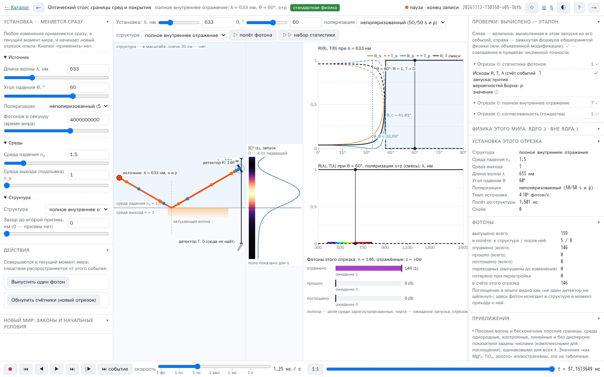
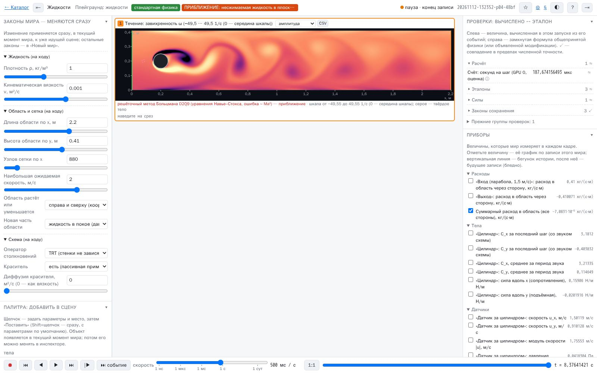
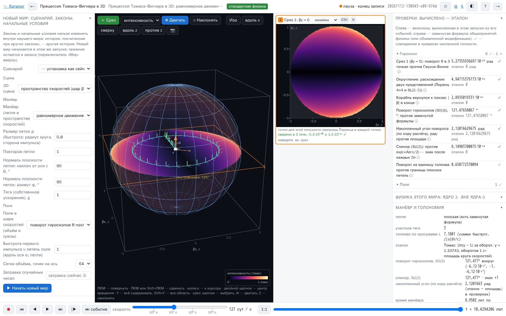
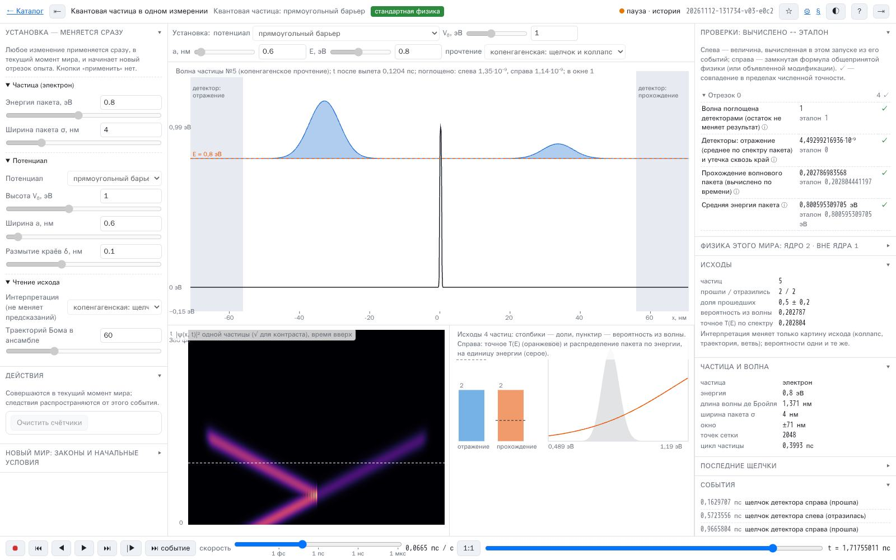
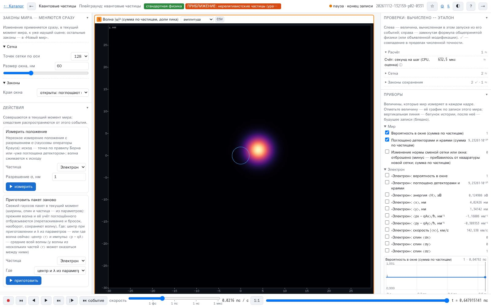
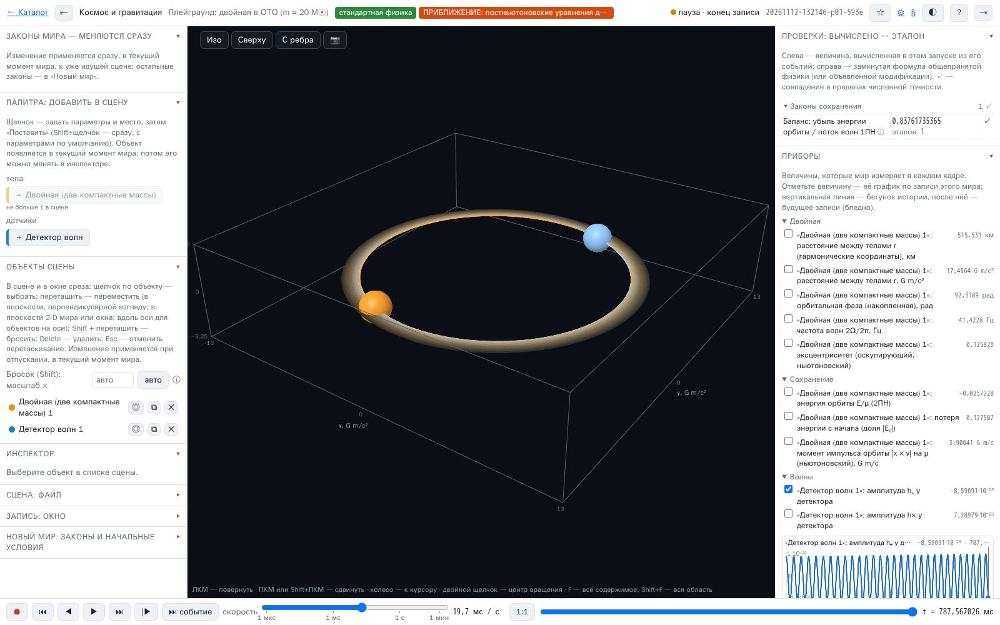
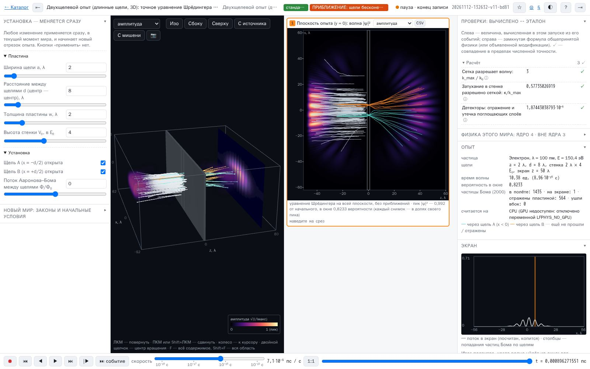

# lfphys

**English** | [Русский](README.ru.md)

[](LICENSE.md)

lfphys is a physics engine and a set of interactive visualizations built on it. The engine, a Python package, keeps
three kinds of physics apart: a **core** of established physics, where every function is tested against a closed form
or an independent second method; the **approximations, interpretations and phenomenological models** that physicists
use widely, each stating where it departs from the core; and **declared alternatives** for "what if" worlds. The
visualizations run in a browser and compute what you see: an interference pattern, an orbit or a rainbow appears
because the run computed it, not because it was drawn, and every run shows its own checks, computed values next to
independent references. There are 17 prepared **demonstrations**, from Young's experiment and the rainbow to the shadow
of a spinning black hole, and 4 **laboratories**, where you build a scene by hand and the world computes it live.

> The player speaks English (the default) and Russian: the switch **EN | RU** in the top bar of every page changes the
> language of the interface, its help, the preset names and every message of the run. Each visualization's README
> (linked in the tables below) and the guide to the player exist in both languages.

<a href="docs/images/u42-m87.jpg"></a>
<a href="docs/images/u44-rainbow.jpg"></a>

## Contents

* [Quick start](#quick-start)
* [Demonstrations for school students](#for-school-students)
* [Demonstrations for university students](#for-university-students)
* [Demonstrations for researchers](#for-researchers)
* [Laboratories](#laboratories)
* [What is computed and how it is checked](#what-is-computed-and-how-it-is-checked)
* [Coverage and roadmap](#coverage-and-roadmap)
* [Documentation](#documentation)
* [Licence and citation](#licence-and-citation)

## Quick start

```bash
git clone https://github.com/ildar-idrisov/lfphys.git
cd lfphys

# with an NVIDIA GPU and the NVIDIA Container Toolkit
docker compose -f visualizations/docker/docker-compose.yml up -d --build viz

# without a GPU
docker compose -f visualizations/docker/docker-compose.yml --profile cpu up -d --build viz-cpu
```

Open <http://localhost:8479>, choose a demonstration and its scenario, and press **▶ Start**. The player opens;
**⏺** records (computes the world further), and the slider goes back through the history. The switch
**Demonstrations | Laboratories** at the top of the catalogue opens the laboratories.

| requirement | |
|---|---|
| Docker | Docker Engine with the Compose plugin v2 (`docker compose`) |
| disk | about 3.3 GB for the image; most of it is NVIDIA's CUDA libraries from PyPI, which only the GPU path uses. Run records go to `visualizations/runs/`, up to a quota of 5 GB; a run nobody opened for 3 days is removed unless marked ☆ (the period is set in the catalogue) |
| memory | the server's container is limited to 6 GB; each running world gets at most 60 % of it. A machine with 8 GB of RAM or more is advisable |
| CPU | each run computes in its own process with 2 threads; at most 3 runs compute at once |
| GPU (optional) | an NVIDIA GPU with a driver for CUDA 12 (version 525 or newer) and the [NVIDIA Container Toolkit](https://docs.nvidia.com/datacenter/cloud-native/container-toolkit/latest/install-guide.html); the server uses one GPU, device 0 |

**With or without a GPU.** The same code runs in both cases and gives the same checks; only the speed differs. With a
GPU, the heavy kernels move to it where measurement shows a gain: wave propagation by the angular spectrum, the ray
tracers of u39 and u42, the 2-D/3-D Schrödinger solver, lattice Boltzmann flow, molecular-dynamics pair forces and the
FDTD solver (measured, for example, ×26–29 for the Schrödinger solver on 1024²–2048² grids and ×8–155 for lattice
Boltzmann flow: `lfphys/README.md`, "CPU and GPU"). Checks are always computed in double precision. Without a GPU most
worlds still run at their default speed. The clearest exception is the flow of p04: in the Kármán-street scenario a
step took 13 ms on an 8-core desktop CPU and 0.19 ms on an RTX 2080 Ti, so without a GPU the street forms about 30 times
slower than the default speed. The exact two-slit world r12 computes slower than its default speed on either device,
and its pattern takes several minutes to form. The page **⚙ Devices** (`/settings`) shows what runs where and lets
you choose the device and the precision per kernel.

**Settings.** Optional; a fresh clone works without them. Copy the template and edit it:

```bash
cp visualizations/docker/.env.example visualizations/docker/.env
```

* `UID`, `GID`: the owner of the clone (`id -u`, `id -g`) when it is not 1000:1000. The server writes the run
  records into `visualizations/runs/` as this user.
* `VIZ_PORT`: another port (8479 by default). `VIZ_PORT=127.0.0.1:8479` keeps the server reachable from this machine
  only.
* `VIZ_CPUS`: a CPU limit for the container (0, the default, means none).
* `LFPHYS_GPU_PCI`: on a host with several GPUs, paste GPU 0's bus id from
  `nvidia-smi --query-gpu=pci.bus_id --format=csv`; the engine then refuses any other device.

The server listens on all of the machine's addresses, so other computers on the local network can open
`http://<this machine's address>:8479`. It has no login: anyone who can reach the port can start runs. Keep it on a
trusted network, or bind it to `127.0.0.1` as above.

**Stop and start again.**

```bash
docker compose -f visualizations/docker/docker-compose.yml stop viz         # or: stop viz-cpu
docker compose -f visualizations/docker/docker-compose.yml start viz        # or: start viz-cpu
docker compose -f visualizations/docker/docker-compose.yml --profile cpu down   # remove the container
```

On stop the server suspends its runs and each world saves its state; a suspended run continues from it when you open
it and press ⏺. The records stay in `visualizations/runs/` after `down`. The server restarts with Docker unless you
stopped it.

**Tests and the engine as a library.**

```bash
docker compose -f visualizations/docker/docker-compose.yml run --rm viz-test   # visualizations and server
docker run --rm --user "$(id -u):$(id -g)" -v "$PWD":/lf -w /lf/lfphys lfphys-viz \
    python3 -m pytest -q -p no:cacheprovider                                  # the engine
docker run --rm --user "$(id -u):$(id -g)" -v "$PWD":/lf -e PYTHONPATH=/lf/lfphys lfphys-viz \
    python3 -c "from lfphys import registry; print(len(registry.catalogue()), 'modules')"
```

A research project uses the engine as an external library: `import lfphys` with `lfphys/` of this repository on
`PYTHONPATH`.

## Demonstrations by audience

Each card gives a picture of a run, the visualization's name (linked to its README with the model, the checks and the
approximations), what you will see, the physics sections, and the scenarios (presets) that suit this audience. A
demonstration that serves several audiences appears in each group with that group's presets. *Enrichment* marks topics
beyond a typical school curriculum that are still accessible to upper-school students. A preset whose name ends in
"(modification)", or one marked *(modified)* after its name, runs a world with a deliberately changed law; the
player's top bar flags such a world with the badge **MODIFIED PHYSICS: …** and the catalogue with "modified physics".

### For school students

School courses begin with mechanics, electricity and magnetism; this collection does not cover them yet (see
[Coverage and roadmap](#coverage-and-roadmap)). What it has for school is heat and molecules, light, the atom,
relativity and gravitation, mostly the later chapters of a course. The curriculum references are examples of where the
topic is taught.

**Gravitation and orbits**

| | |
|---|---|
| <a href="docs/images/p01-inner.jpg"></a> | **[p01 · Space and gravity](visualizations/p01_gravity/README.md)** (laboratory)<br>Build a planetary system and watch Newton's law move it, body by body; energy, momentum and angular momentum are checked as it runs.<br>*Mechanics: gravitation · Astronomy* · IB D.1, AQA 3.7.2<br>Presets: "The Sun and the Earth (circular orbit of 1 au)"; "The Sun, Mercury, Venus, the Earth, Mars, Jupiter (circular orbits)" |
| <a href="docs/images/u34-newton.jpg"></a> | **[u34 · Orbits and clocks: general relativity and Newton](visualizations/u34_orbits/README.md)** · *enrichment*<br>Newton's orbit closes into an ellipse; the ghost of the same start under general relativity does not. The player flags this world as modified physics, since its standard law is general relativity.<br>*Mechanics: gravitation · Relativity*<br>Preset: "Newton: a closed ellipse (ghost: GR)" |

**Heat and molecules**

| | |
|---|---|
| <a href="docs/images/p03-maxwell.jpg"></a> | **[p03 · Particles and molecules](visualizations/p03_molecules/README.md)** (laboratory)<br>A gas computed atom by atom: start every atom with the same speed and the Maxwell distribution appears by itself; a piston does work and a wall exchanges heat, and the first law balances; a crystal melts when heated.<br>*Thermal and molecular physics* · IB B.1, B.3, B.4, AP Physics 2 Unit 9, AQA 3.6.2<br>Presets: "Argon gas started with equal speeds: the Maxwell distribution sets in by itself"; "Gas under a piston: compression by the piston and heat exchange with a wall (the first law)"; "A 2-D crystal (ρσ² = 0.85) is heated by a thermostat to 120 K: the order parameter ψ6 vanishes, the atoms start to diffuse — melting" |

**Fluids**

| | |
|---|---|
| <a href="docs/images/p04-airfoil.jpg"></a> | **[p04 · Fluids](visualizations/p04_fluids/README.md)** (laboratory) · *enrichment*<br>Flow past a wing and a cylinder, computed by the lattice Boltzmann method; dye shows the stream, and drag and lift are measured.<br>*Fluids* · AP Physics 1 Unit 8<br>Presets: "NACA 2412 wing profile at an angle of attack of 8°: a cascade of profiles…"; "Water: flow past a cylinder of D = 1 mm in a 22 × 4.1 mm channel, Re = 20…" |

**Light**

| | |
|---|---|
| <a href="docs/images/u35-tir.jpg"></a> | **[u35 · Optical bench: boundaries and coatings](visualizations/u35_optics_bench/README.md)**<br>Photons one by one at a glass–air boundary: beyond the critical angle every one is reflected, and an evanescent wave appears behind the boundary; a quarter-wave coating cuts the reflection.<br>*Optics* · IB C.3, AQA 3.3.2<br>Presets: "Total internal reflection: glass 1.5 → air, θ = 60° beyond the critical angle"; "Anti-reflection of glass by a λ/4 layer with n_f = 1.38 (like MgF₂, illustrative), λ₀ = 550 nm" |
| <a href="docs/images/u44-rainbow.jpg"></a> | **[u44 · Mie scattering by a drop: the rainbow and the glory](visualizations/u44_mie_scattering/README.md)**<br>Sunlight on a cloud of water drops, summed wavelength by wavelength from the exact scattering by one drop: the primary and secondary bows, Alexander's dark band between them.<br>*Optics: refraction and dispersion* · AQA 3.3.2<br>Preset: "Rainbow: drops of radius 0.15 mm ± 2 % in sunlight: the primary and secondary bows, Alexander's band, the supernumerary bows" |
| <a href="docs/images/u32-young.jpg"></a> | **[u32 · The double-slit experiment](visualizations/u32_double_slit/README.md)**<br>Young's experiment with single photons: each lands at one point, and the fringes build up hit by hit.<br>*Optics · Quantum physics* · IB C.3, AQA 3.3.2 and 3.2.2<br>Preset: "Photons 633 nm, two slits (Young, one photon at a time)" |

**Relativity and astronomy**

| | |
|---|---|
| <a href="docs/images/u31-sun-earth.jpg"></a> | **[u31 · Light over large distances](visualizations/u31_light_travel/README.md)**<br>A flash leaves the Sun and reaches the Earth 8 min 17 s later, on a map and on a spacetime diagram; observers moving along and against the light measure the same speed c.<br>*Relativity · Astronomy* · IB A.5 (HL), AQA 3.12 (option)<br>Presets: "Sun → Earth (standard physics)"; "Measuring c: at rest, moving along the light, against it (SR)" |
| <a href="docs/images/u39-city.jpg"></a> | **[u39 · What a fast observer sees](visualizations/u39_fast_observer/README.md)** · *enrichment*<br>The camera image of an observer near the speed of light, traced ray by ray with the light's travel time: the scene crowds forward, turns blue and brightens ahead.<br>*Relativity · Optics*<br>Presets: "Flight down a street at β = 0.9: aberration, blue ahead, brightness"; "The scene at rest (β = 0): an ordinary picture, a check of the tracer" |
| <a href="docs/images/u42-m87.jpg"></a> | **[u42 · The shadow of a Kerr black hole and its photon rings](visualizations/u42_kerr_shadow/README.md)** · *enrichment*<br>Why the Event Horizon Telescope saw a dark disc in a bright ring: every pixel is a light ray traced back from the observer.<br>*Relativity: black holes · Astronomy*<br>Presets: "No rotation (a = 0): the shadow is a circle of radius √27 M"; "M87*: a = 0.9, inclination 163° (as EHT for a > 0)…" |

**Atoms and quanta**

| | |
|---|---|
| <a href="docs/images/u40-2pz.jpg"></a> | **[u40 · The hydrogen atom in 3-D: orbitals](visualizations/u40_hydrogen_3d/README.md)**<br>Orbitals from the exact solution of the Schrödinger equation: their shapes and nodes, the energy levels and the radial distribution.<br>*Atomic physics* · IB E.1, AQA 3.2.2<br>Presets: "1s: the ground state of hydrogen"; "2p_z: a dumbbell along z, the nodal plane z = 0"; "3d_z²: lobes along z and a ring" |
| <a href="docs/images/p02-double-slit.jpg"></a> | **[p02 · Quantum particles](visualizations/p02_quantum/README.md)** (laboratory) · *enrichment*<br>An electron's wave passes two slits and interferes; the detector registers single particles.<br>*Quantum physics* · AQA 3.2.2<br>Preset: "Double slit: an electron, a wall with two slits, a detector screen, Bohm particles" |

### For university students

**Mechanics and gravitation**

| | |
|---|---|
| <a href="docs/images/u34-rosette.jpg"></a> | **[u34 · Orbits and clocks: general relativity and Newton](visualizations/u34_orbits/README.md)**<br>One body on an orbit computed from the exact geodesic equation: the periapsis advance is measured on the orbit and compared with the exact elliptic integral and with the post-Newtonian estimate; the body's clock against a distant one.<br>*Mechanics · General relativity*<br>Presets: "Mercury at the Sun (weak field, 43″ per century)"; "Black hole 10 M☉: a rosette (periapsis 20M)"; "Radial fall from rest at 20M (cycloid)" |
| <a href="docs/images/p01-inner.jpg"></a> | **[p01 · Space and gravity](visualizations/p01_gravity/README.md)** (laboratory)<br>Newtonian N bodies with close encounters and mergers, computed by a time-symmetric Hermite scheme.<br>*Mechanics: gravitation, chaos*<br>Presets: "Pythagorean three-body problem (Burrau): masses 3, 4, 5 at rest — close encounters"; "A Newtonian black hole of 1000 M☉ and stars: orbits and capture" |

**Fluids, heat and statistical physics**

| | |
|---|---|
| <a href="docs/images/p04-karman.jpg"></a> | **[p04 · Fluids](visualizations/p04_fluids/README.md)** (laboratory)<br>Viscous flow by the lattice Boltzmann method: a Poiseuille profile, a vortex street, drag and lift coefficients, the Strouhal number.<br>*Fluids*<br>Presets: "Channel flow (Poiseuille, Re ≈ 2) and a plate across it: the profile upstream against the parabola"; "Kármán vortex street behind a cylinder, Re = 100…" |
| <a href="docs/images/p03-molecules.jpg"></a> | **[p03 · Particles and molecules](visualizations/p03_molecules/README.md)** (laboratory)<br>Molecular dynamics: equipartition among the modes of molecules, liquid–vapour coexistence, the radial distribution function g(r), pressure from the virial and from the walls.<br>*Thermal and statistical physics · Condensed matter*<br>Presets: "Diatomic molecules start with translation only: collisions hand energy to rotation and vibration (equipartition sets in)"; "Liquid and vapour in a volume at 90 K in a field: … the density profile along the height" |

**Waves and optics**

| | |
|---|---|
| <a href="docs/images/u35-tir.jpg"></a> | **[u35 · Optical bench](visualizations/u35_optics_bench/README.md)**<br>Fresnel coefficients and multilayers by characteristic matrices decide each photon's fate; the photon counts converge to R, T, A.<br>*Optics*<br>Presets: "Glass n = 1.5 in air at Brewster's angle (unpolarised light: only s is reflected)"; "Frustrated total reflection: a 200 nm gap to a second prism (photon tunnelling)"; "Fabry–Pérot: a film n = 2.3, 2 µm thick, in air (illustrative)" |
| <a href="docs/images/u38-circle.jpg"></a> | **[u38 · Wave in 3-D: diffraction by an aperture](visualizations/u38_wave_3d/README.md)**<br>Fresnel diffraction behind apertures in a full 3-D scene with slice planes at any angle; the accuracy of each world and slice is measured.<br>*Waves · Optics*<br>Presets: "Circular aperture: dips and peaks of intensity on the axis"; "Gaussian beam, w = 1.5 µm: divergence (checked against the integral)"; "Two slits of finite length: the whole volume" |
| <a href="docs/images/u44-rainbow.jpg"></a> | **[u44 · Mie scattering by a drop](visualizations/u44_mie_scattering/README.md)**<br>The exact Mie series against Descartes' rays and Airy's theory: supernumerary bows, and why small drops give a white fogbow.<br>*Optics: scattering*<br>Presets: "Supernumerary bows: nearly equal drops of radius 0.1 mm ± 0.5 %"; "Fogbow: drops of radius 15 µm ± 15 %, a wide white bow"; "Large drops of radius 0.3 mm ± 10 %: the supernumerary bows are washed out…" |
| <a href="docs/images/u43-lg3.jpg"></a> | **[u43 · Optical vortices](visualizations/u43_optical_vortices/README.md)**<br>Laguerre–Gauss beams: helical wavefronts, energy flow spiralling around the axis, orbital and spin angular momentum per photon measured from the field; a rotating disc shifts the frequency.<br>*Optics: beams, angular momentum of light*<br>Presets: "LG₀³, σ = +1: three helical fronts, the exact model, a rotating disc"; "LG₂¹: three rings, fronts with phase jumps at the nodes"; "A “fork” hologram, l = 1: the order m carries the charge m·l"; "Control: a Gaussian beam without a vortex (l = 0): no beat" |

**Relativity**

| | |
|---|---|
| <a href="docs/images/u31-lensing.jpg"></a> | **[u31 · Light over large distances](visualizations/u31_light_travel/README.md)**<br>Relativity of simultaneity, clock synchronisation, light bending and delay near a black hole; flashes and the observers' speeds are set during the run.<br>*Special and general relativity*<br>Presets: "The Andromeda paradox: pedestrians at 1.4 m/s"; "Measuring c: clocks synchronised in the lab frame (SR)"; "Black hole of 10 M☉: deflection, shadow, two images" |
| <a href="docs/images/u39-terrell.jpg"></a> | **[u39 · What a fast observer sees](visualizations/u39_fast_observer/README.md)**<br>Why the Lorentz contraction is invisible and a rotation (Terrell–Penrose) is seen instead; Doppler colour and the searchlight effect, from ray tracing with the light's travel time.<br>*Special relativity · Optics*<br>Presets: "A cube and a ball fly past at β = 0.9: Terrell rotation, the ball stays a circle"; "For comparison: an instantaneous snapshot (the Lorentz contraction that is not seen)"; "A train at β = 0.8 passing posts: stretching and shortening" |
| <a href="docs/images/r11-thomas.jpg"></a> | **[r11 · Thomas–Wigner precession in 3-D](visualizations/r11_thomas_3d/README.md)**<br>A craft flies a loop and comes back to rest with its gyroscopes turned, with no torque on them.<br>*Special relativity*<br>Presets: "Thomas precession: uniform circular motion, γ = 1.34"; "Ordinary space: the trajectory and the gyroscopes in Thomas precession" |
| <a href="docs/images/u42-edge.jpg"></a> | **[u42 · The shadow of a Kerr black hole](visualizations/u42_kerr_shadow/README.md)**<br>Photon orbits and the shadow's edge against Bardeen's formula; the images of the disc n = 0, 1, 2.<br>*General relativity*<br>Presets: "The disc edge-on (θ = 90°), a = 0.99: the shadow is flattened, the rings are asymmetric"; "A narrow ring of gas at 6 M: its images n = 0, 1, 2 are seen" |

**Quantum physics**

| | |
|---|---|
| <a href="docs/images/u33-tunnel.jpg"></a> | **[u33 · A quantum particle in one dimension](visualizations/u33_quantum_1d/README.md)**<br>An electron packet at a barrier, a step, a well or in a trap: the exact time-dependent solution, its transmission against the stationary one, and detectors that click.<br>*Quantum physics*<br>Presets: "Electron tunnelling through a 1 eV × 0.6 nm barrier"; "Resonant tunnelling: a double barrier"; "Step: reflection at E > V₀"; "A packet in a harmonic trap (coherent state)" |
| <a href="docs/images/u32-young.jpg"></a> | **[u32 · The double-slit experiment](visualizations/u32_double_slit/README.md)**<br>Which-path detectors, polarisation marks, the quantum eraser, partial coherence, electrons, neutrons and C₆₀.<br>*Quantum physics · Optics*<br>Presets: "Electrons + which-path detector (θ = 90°, not read)"; "Quantum eraser: H/V marks + 45° analyser"; "Photons: a wide source (partial coherence)"; "Electrons: the Aharonov–Bohm effect (flux ½ h/e)" |
| <a href="docs/images/r12-mark180.jpg"></a> | **[r12 · Double slit (long slits, 3-D)](visualizations/r12_double_slit_2d/README.md)**<br>The time-dependent Schrödinger equation on the whole plane of the experiment, no paraxial approximation: reflection by the plate, the wave in the slits, the pattern as it arrives.<br>*Quantum physics*<br>Presets: "One slit (B closed): the envelope without fringes"; "Slits a = 6λ in a thin high wall: closer to the paraxial theory (a difference ~λ/a)"; "The Aharonov–Bohm effect: a flux Φ₀/2 between the slits shifts the fringes by half a period" |
| <a href="docs/images/u37-bell.jpg"></a> | **[u37 · The Bell test with entangled pairs](visualizations/u37_bell_test/README.md)**<br>Entangled photons or spins at two stations: coincidences, correlations E and the CHSH parameter S against the bounds 2 and 2√2; the settings are chosen outside each other's light cone.<br>*Quantum physics*<br>Presets: "Photons \|Φ+⟩, quantum mechanics: optimal CHSH angles 0°, 45° / 22.5°, 67.5°, random choice"; "Spin-½ singlet, quantum mechanics: optimal angles 0°, 90° / 45°, 135°, random choice"; "The curve E(Δ): photons, fixed settings a = b = 0°; move b" |
| <a href="docs/images/p02-trap.jpg"></a> | **[p02 · Quantum particles](visualizations/p02_quantum/README.md)** (laboratory)<br>Wave packets in 2-D and 3-D in a scene of barriers, traps and fields you build; position measurements as actions.<br>*Quantum physics*<br>Presets: "Tunnelling: a packet hitting a thin barrier higher than its energy"; "Harmonic trap: a displaced packet oscillates (energy conserved), a position measurement"; "An electron in a 100 T magnetic field: a circular orbit, spin along the field"; "3-D: an electron scatters off a ball" |

**Atomic and particle physics**

| | |
|---|---|
| <a href="docs/images/u40-m1.jpg"></a> | **[u40 · The hydrogen atom in 3-D](visualizations/u40_hydrogen_3d/README.md)**<br>Real orbitals are standing waves without current; complex ones with m ≠ 0 carry a ring current; a superposition of two levels oscillates at the Bohr frequency.<br>*Atomic physics · Quantum physics*<br>Presets: "2p_x real: a standing wave, no current"; "2p, m = +1 complex: a doughnut and a ring current"; "1s + 2p_z: the cloud sways along z at the Bohr frequency (a superposition)" |
| <a href="docs/images/u36-qcd.jpg"></a> | **[u36 · QCD: asymptotic freedom and quarkonium](visualizations/u36_qcd/README.md)**<br>The strong coupling α_s runs from 1 GeV to 10 TeV (one to four loops, quark thresholds); charmonium and bottomonium levels in the Cornell model against measured ones.<br>*Particle physics*<br>Presets: "Asymptotic freedom and charmonium (PDG 2024, Cornell model)"; "Bottomonium" |
| <a href="docs/images/u41-1p.jpg"></a> | **[u41 · Quarkonium in 3-D](visualizations/u41_quarkonium_3d/README.md)**<br>Wave functions of a heavy quark pair in the Cornell model, a heavy-quark analogue of the hydrogen atom; the model's level splittings against the Particle Data Group values.<br>*Particle physics*<br>Presets: "cc̄ 1S (J/ψ, η_c without spin): a cloud without nodes"; "cc̄ 1P (χ_c, h_c), p_z"; "cc̄ 2S (ψ(2S)): one radial node"; "bb̄ 1S (Υ(1S)): a tighter cloud, heavier quarks" |

### For researchers

**General relativity and black holes**

| | |
|---|---|
| <a href="docs/images/u42-m87.jpg"></a> | **[u42 · The shadow of a Kerr black hole and its photon rings](visualizations/u42_kerr_shadow/README.md)**<br>The shadow's size against the EHT measurements of M87* and Sgr A*; the photon ring's demagnification against the Lyapunov exponent; a Johannsen metric as a declared alternative.<br>*General relativity · Astrophysics*<br>Presets: "M87*: a = 0.9, inclination 163° (as EHT for a > 0)…"; "Sgr A*: a = 0.5, inclination 30°, compared with EHT 2022"; "What if: the Johannsen metric with α₁₃ = 3, a larger shadow, compared with EHT" *(modified)* |
| <a href="docs/images/u34-rosette.jpg"></a> | **[u34 · Orbits and clocks](visualizations/u34_orbits/README.md)**<br>Exact geodesics against the weak-field (PPN) expansion on the same orbit, the instability inside the ISCO, equatorial Kerr orbits.<br>*General relativity*<br>Presets: "Neutron star: strong precession"; "Black hole: a circular orbit near the ISCO (6.2M)"; "Plunge inside the ISCO (5.5M, speed −0.5 %)" |
| <a href="docs/images/p01-inspiral.jpg"></a> | **[p01 · Space and gravity](visualizations/p01_gravity/README.md)** (laboratory)<br>A post-Newtonian binary with radiation reaction and the wave signal h₊, h× at a detector; bodies, light rays and clocks around a Kerr–Newman black hole.<br>*General relativity · Gravitational waves*<br>Presets: "GR: a binary of 10 + 10 M☉ from a separation of 20 G m/c² and a wave detector (inspiral)"; "GR: an eccentric binary of 30 + 10 M☉ (e = 0.5), periastron precession"; "Near a black hole (a = 0.9): bodies on orbits, light rays, observers' clocks" |

**Special relativity and the history of its tests**

| | |
|---|---|
| <a href="docs/images/r11-seam.jpg"></a> | **[r11 · Thomas–Wigner precession in 3-D](visualizations/r11_thomas_3d/README.md)**<br>The holonomy of a manoeuvre in SO(3) and SU(2), velocity-space geometry and the isoperimetric bound on the rotation per unit of fuel; planar and non-planar loops.<br>*Special relativity · Lorentz group*<br>Presets: "Three burns: the Wigner angle = the area of the triangle of velocities"; "Circle through rest: equality in the isoperimetric bound"; "SU(2): the gyroscopes are back (a rotation by 2π), the spinor changed its sign"; "The seam of a ball on the sphere of velocities (non-planar, 96 burns)" |
| <a href="docs/images/u39-terrell.jpg"></a> | **[u39 · What a fast observer sees](visualizations/u39_fast_observer/README.md)**<br>Light-time ray tracing of moving bodies, each photon Lorentz-transformed, the light as a black body at the Doppler-shifted temperature.<br>*Special relativity*<br>Presets: "A sky of 4000 K at β = 0.9: the dipole, the stars crowd forward"; "The same at β = 0.99"; "The scene at rest (β = 0): an ordinary picture, a check of the tracer" |
| <a href="docs/images/u31-sun-earth.jpg"></a> | **[u31 · Light over large distances](visualizations/u31_light_travel/README.md)**<br>The same measurements in worlds with other laws of light: an ether, ballistic (Ritz) light, Newtonian corpuscles.<br>*Special relativity · History of physics*<br>Presets: "Measuring c in a world with an ether (modification)"; "Measuring c with ballistic light (modification)"; "An arm across the motion (Michelson–Morley), ether (modification)"; "Newtonian corpuscles at a black hole (modification)" |

**Optics and electromagnetic waves**

| | |
|---|---|
| <a href="docs/images/u32-vector.jpg"></a> | **[u32 · The double-slit experiment](visualizations/u32_double_slit/README.md)**<br>Vector diffraction by slits in a perfectly conducting screen of finite thickness (TE and TM) against the scalar model; a three-slit test of the Born rule.<br>*Electromagnetic waves · Quantum foundations*<br>Presets: "Vector diffraction: 0.5 µm slits in a 0.2 µm conducting screen, polarisation D"; "Three slits: a test of the Born rule (Sorkin)" |
| <a href="docs/images/u43-tight.jpg"></a> | **[u43 · Optical vortices](visualizations/u43_optical_vortices/README.md)**<br>The exact vector beam against the paraxial model under tight focusing: the longitudinal field and the spin–orbit split of angular momentum, which depends on its definition; the rotational Doppler effect.<br>*Optics · Angular momentum of light*<br>Presets: "Tight focusing: l = 1, σ = −1, w0 = 0.6 λ: the longitudinal field and the spin-orbit splitting"; "The same in the paraxial model (an approximation): what it does not see"; "A Dove prism rotates: a frequency shift 2\|l\|f for the beam l = 2"; "Linear polarisation, l = 1: J_z = l on average, zero spin" |
| <a href="docs/images/u44-glory.jpg"></a> | **[u44 · Mie scattering by a drop](visualizations/u44_mie_scattering/README.md)**<br>The glory, the near field of a small drop, an absorbing sphere; the Debye series against Descartes and Airy, checked against Wiscombe's published values.<br>*Optics: Mie theory*<br>Presets: "Glory: cloud drops of radius 8 µm ± 10 %, coloured rings around the antisolar point"; "Near field: a drop of radius 1 µm in light of 550 nm, the focus inside and behind the drop"; "An absorbing sphere of radius 2 µm, n = 1.6 + 0.05i: the inner rays die out, no rainbow" |
| <a href="docs/images/u35-spr.jpg"></a> | **[u35 · Optical bench](visualizations/u35_optics_bench/README.md)**<br>Thin metal films and the surface plasmon resonance by Abelès matrices, with the field \|E\|² inside the layers.<br>*Optics*<br>Presets: "Metal film 30 nm, n = 0.2 + 3.3i (like gold at 633 nm, illustrative) on glass"; "Surface plasmon resonance (Kretschmann): prism 1.5, metal 50 nm (n = 0.2 + 3.3i), air, p (illustrative)" |
| <a href="docs/images/u38-double.jpg"></a> | **[u38 · Wave in 3-D](visualizations/u38_wave_3d/README.md)**<br>Full 3-D modelling against a chosen 2-D slice computed by a simplified model; the method's accuracy measured per world and per slice.<br>*Computational optics*<br>Presets: "Two slits: slices only, y = c by the reduced 2-D model (approximation)"; "Square aperture, grid 512: slices only" |

**Quantum foundations**

| | |
|---|---|
| <a href="docs/images/r12-narrow.jpg"></a> | **[r12 · Double slit (long slits, 3-D)](visualizations/r12_double_slit_2d/README.md)**<br>Where paraxial theory fails (narrow slits, large angles); how a which-path mark kills the fringes; Bohm trajectories labelled by their slit.<br>*Quantum foundations*<br>Presets: "Narrow slits a = 2λ: diffraction to large angles, the paraxial theory fails"; "Path mark: the spin in slit B turned by 180°: the fringes almost fade, the trajectories cross the axis"; "A partial mark: a turn by 90°, visibility cos 45°"; "An observer at slit B: a path detector (θ = 180°) for a ⁴He atom without spin: the fringes almost fade" |
| <a href="docs/images/r13-near.jpg"></a> | **[r13 · Particle arrival time: the rules in 2-D](visualizations/r13_arrival_times_2d/README.md)**<br>Quantum mechanics does not fix the arrival time; the run computes it by the quantum flux, Bohm's first arrivals, Aharonov–Bohm–Kijowski, semiclassical and absorbing-boundary rules and detector models, and shows where they agree and where they differ.<br>*Quantum foundations*<br>Presets: "One packet: far from the source all the rules almost agree"; "Close to the source (σz = 1λ, L = 5λ): the rules diverge"; "A train of 4 packets: the exponential rules damp the later peaks (Das & Struyve 2021)"; "Backflow: the flux through the plane is negative in places, Bohm's first arrivals are not"; "Through two slits: the joint distribution of the place and the time of arrival (Das et al. 2024)" |
| <a href="docs/images/u37-bell.jpg"></a> | **[u37 · The Bell test](visualizations/u37_bell_test/README.md)**<br>Quantum mechanics (S up to 2√2) against local hidden-variable models (\|S\| ≤ 2) on the same events; the locality loophole when the choice comes too early.<br>*Quantum foundations*<br>Presets: "Photons, local hidden variables: a polarisation model (modification)"; "Spin-½ singlet, local hidden variables: Bell's sign model (modification)"; "Photons: the choice made 5 µs before arrival (cτ > 2L), the locality loophole is open" |
| <a href="docs/images/u33-bohm.jpg"></a> | **[u33 · A quantum particle in one dimension](visualizations/u33_quantum_1d/README.md)**<br>One computation read three ways: a click and a collapse, Bohm trajectories, Everett's branches; the statistics are the same.<br>*Quantum foundations · Interpretations*<br>Presets: "The same through Bohm's eyes: trajectories"; "The same by Everett: branches" |
| <a href="docs/images/u32-vector.jpg"></a> | **[u32 · The double-slit experiment](visualizations/u32_double_slit/README.md)**<br>Changed laws as named parameters: a Born-rule exponent, enhanced GRW collapse, a forced choice of slit.<br>*Quantum foundations*<br>Presets: "Three slits with P ∝ \|ψ\|^2.4 (modification)"; "C60 with enhanced GRW collapse (modification)"; "Forced choice of a slit (modification)" |
| <a href="docs/images/p02-trap.jpg"></a> | **[p02 · Quantum particles](visualizations/p02_quantum/README.md)** (laboratory)<br>Which-path markers, Aharonov–Bohm flux tubes, decoherence by an environment, Bohm points, parameter sweeps.<br>*Quantum foundations*<br>Presets: "Which-path marker in the upper slit: the fringes almost vanish (visibility 0.94 → 0.18)"; "Aharonov–Bohm: a flux tube h/2e in the wall between the slits shifts the fringes by half a period" |

**Atoms, QCD, molecular and fluid benchmarks**

| | |
|---|---|
| <a href="docs/images/u41-1p.jpg"></a> | **[u41 · Quarkonium in 3-D](visualizations/u41_quarkonium_3d/README.md)** and **[u40 · The hydrogen atom in 3-D](visualizations/u40_hydrogen_3d/README.md)**<br>What a fitted model predicts (splittings) and what it does not (absolute masses); high-n states and hydrogen-like ions.<br>*Particle and atomic physics*<br>Presets: u41 "cc̄ 1S + 1P_z: the pair sways at the transition frequency (a superposition)"; u40 "n = 10, l = 3, m = 1: a large cloud, 6 radial nodes", "The ion He⁺, 3d_xy: the cloud is smaller by a factor Z = 2" |
| <a href="docs/images/u36-qcd.jpg"></a> | **[u36 · QCD](visualizations/u36_qcd/README.md)**<br>How much the higher loops matter, and a world with another coupling.<br>*Particle physics*<br>Presets: "One loop only: how much the higher orders matter"; "What if α_s(M_Z) = 0.15 (a changed coupling)" *(modified)* |
| <a href="docs/images/p03-molecules.jpg"></a> | **[p03 · Particles and molecules](visualizations/p03_molecules/README.md)** and **[p04 · Fluids](visualizations/p04_fluids/README.md)** (laboratories)<br>Published benchmarks inside the laboratories: the hard-disk equation of state; the DFG cylinder benchmarks and Ghia's cavity.<br>*Statistical mechanics · Fluid dynamics*<br>Presets: p03 "Hard disks: the pressure against the equation of state (Kolafa and Rottner)"; p04 "Flow past a cylinder, Re = 20 (the DFG 2D-1 set-up…)", "Lid-driven cavity, Re = 100 (centre-line profiles against the tables of Ghia, Ghia, Shin 1982)" |

### Laboratories

In a laboratory the scene is not prepared: you build it from a palette, change it at any moment, and the world computes
what follows in real time. The catalogue's switch **Laboratories** opens them; each starts from a scenario or from a
scene file saved earlier.

* **Palette and objects**: add bodies, packets, atoms, walls, obstacles, detectors and probes at the current moment;
  copy or delete them; the inspector changes an object's parameters live and shows its computed state.
* **Live laws**: the laws the engine can change at the current moment (a viscosity, a time step, an interaction model,
  the grid) change at once; other laws start a new world, which can take the scene and its state along.
* **Drag and throw**: drag an object to move it; Shift-drag throws it with the speed of your hand.
* **Instruments**: every measurable quantity with its value at the history cursor; tick one to plot it over the
  record, export to CSV.
* **Parameter sweeps**: the same experiment from the current moment repeated for a list of values of a law or an
  object's parameter, in a separate process; a table, a plot and a CSV.
* **Scene files and recording**: save a scene to a file and start from it; the record keeps the last 10 minutes of
  computing (at most 1 GB), or everything from the moment you press "● Keep the record".
* Conservation laws are checked as the world runs.

| | |
|---|---|
| <a href="docs/images/p01-inspiral.jpg"></a> | **[p01 · Space and gravity](visualizations/p01_gravity/README.md)**<br>Stars, planets, Newtonian black holes and test bodies (Newton's N bodies with mergers); a general-relativistic binary radiating gravitational waves, with a detector; bodies, light rays and observers with clocks at a Kerr–Newman black hole.<br>All presets: Sun and Earth · inner planets and Jupiter · Pythagorean three-body problem · black hole and stars · Kerr black hole with bodies, rays and clocks · GR binary inspiral · eccentric GR binary |
| <a href="docs/images/p02-double-slit.jpg"></a> | **[p02 · Quantum particles](visualizations/p02_quantum/README.md)**<br>Wave packets of electrons, neutrons and atoms (with spin) in a plane or a volume; barriers, wells, walls with slits, traps, magnetic fields, Aharonov–Bohm tubes, detectors, which-path marks, an environment; position measurements; Bohm particles.<br>All presets: double slit · which-path mark · Aharonov–Bohm · tunnelling · harmonic trap · electron in 100 T · 3-D scattering by a sphere |
| <a href="docs/images/p03-maxwell.jpg"></a> | **[p03 · Particles and molecules](visualizations/p03_molecules/README.md)**<br>Gases, crystals, atoms and molecules with bonds and angles; mirror, soft and thermal walls, a piston, thermostats, a field, thermometers; temperature, pressure, heat and work, the Maxwell distribution, g(r).<br>All presets: Maxwell distribution · melting · gas under a piston · liquid and vapour · diatomic molecules · hard disks |
| <a href="docs/images/p04-karman.jpg"></a> | **[p04 · Fluids](visualizations/p04_fluids/README.md)**<br>2-D flow by the lattice Boltzmann method: cylinders, rectangles, NACA profiles, inlets and outlets, moving walls, dye, velocity probes; drag and lift, mass and momentum balances; viscosity, grid and domain changed live.<br>All presets: cylinder Re = 20 (DFG 2D-1) · Kármán street Re = 100 (DFG 2D-2) · lid-driven cavity · channel with a plate · water cylinder · air cylinder · NACA 2412 cascade |

## What is computed and how it is checked

* **Layers.** The engine's core holds established physics only; approximations, interpretations, phenomenological
  models and declared alternatives sit outside it, each stating where it disagrees with the core
  ([`lfphys/LAYERS.md`](lfphys/LAYERS.md)). Every module carries a passport (layer, statement, validity, basis,
  conflicts); the player's panel "Physics of this world" lists the modules a world uses, inside and outside the core.
* **Computed, not drawn.** Every visible consequence comes from the run's own computation; closed forms of the known
  theory appear only as references in the checks. Consequences appear when the world's time reaches them.
* **Checks in every run.** The panel "Checks: computed ↔ reference" shows each quantity computed in the run next to its
  reference (✓ or ✗): a closed form, an independent method or a measured value. A world with a changed law is flagged
  "MODIFIED PHYSICS: …" in the player's top bar, an approximation "APPROXIMATION: …".
* **Tests.** About 1,600 test functions: each engine function against a closed form or a second method, with
  certified interval references (Arb ball arithmetic) for key quantities; each visualization and the server.
* **Reviews.** New physics is reviewed by a reviewer other than its author, and each finding is answered in a
  response: fixed, rejected with a reason, or deferred to `STATUS.md`. The 32 processed reviews so far are internal
  (run within the project) and are kept with their responses in [`reviews/archive/`](reviews/archive/).
* **Third-party libraries, for comparison only.** 2,961 comparisons with CRunDec (rundec), KerrGeoPy, tmm, QuTiP,
  Astropy and miepython: no failures, 19 known disagreements recorded with their numbers
  ([`lfphys/tests/external/RESULTS.md`](lfphys/tests/external/RESULTS.md)); a one-off comparison with the FDTD solver
  Meep ([`lfphys/sources/comparison_2026-11-04_meep.md`](lfphys/sources/comparison_2026-11-04_meep.md)).

This is a research tool: the tests check the stated cases within the stated ranges, not every problem. Open problems
are listed in [`STATUS.md`](STATUS.md).

## Coverage and roadmap

The collection is strongest in optics, quantum physics and relativity, where it reaches from school topics to research
questions. The first half of a school course has no demonstrations yet. The main gaps, in order of their weight in
school and university courses, and what the engine already has for them:

| section | now | main gaps | already in the engine |
|---|---|---|---|
| mechanics | orbits (p01, u34) | kinematics and projectiles, Newton's laws with friction, energy, collisions, rotation | exact elastic collisions of disks and spheres (`core.md.hard`), N bodies with mergers (`core.gravity.nbody`); rigid bodies need a new module |
| oscillations and waves | diffraction (u32, u38, r12), the quantum oscillator (u33) | pendulum and spring, damped and driven oscillations, resonance; standing waves, sound, the Doppler effect | a 2-D/3-D Maxwell solver (`core.em.fdtd`), not yet used by any visualization |
| electricity and magnetism | none | field lines and potential, capacitors, DC and AC circuits, fields of currents, induction | fields and radiation of moving point charges (`core.em.charges`, not yet used); a laboratory is planned (`lfphys/PLAN.md` P15.5); circuits need a new solver |
| optics | u32, u35, u38, u43, u44 | lenses, mirrors and image formation, prisms, gratings, polarisation | Snell's law and ray-transfer matrices (`theories.approx.ray_optics`); a laboratory is planned (P15.2) |
| thermal physics | p03 | named gas-law and heat-engine scenarios with a P–V plot | the piston, heat baths, heat and work counters and sweeps of p03 |
| relativity | u31, u34, r11, u39, u42, p01 | time dilation and the twin paradox, spacetime diagrams, relativistic collisions | `core.relativity`, `core.worldlines`, `core.lorentz`; a laboratory is planned (P15.6) |
| quantum and atomic physics | u32, u33, u37, r12, r13, u40, p02 | the photoelectric effect, Compton scattering, black-body spectrum, line spectra, Stern–Gerlach, Rabi oscillations | Compton scattering (`core.quantum.compton`), the two-level atom (`core.quantum.two_level`), both not yet used; Planck's law, hydrogen levels and dipole matrix elements |
| nuclear physics | none | decay and half-life, binding energy, fission and fusion | none |
| astrophysics and cosmology | u31, u42, p01 | the Hubble law and the expansion history | the FLRW background with Planck 2018 parameters (`core.cosmology.flrw`), not yet used |

Where a module exists, a demonstration still has to be designed, built, tested and reviewed; the order of the work is
the author's decision. Plans: [`lfphys/PLAN.md`](lfphys/PLAN.md); open items: [`STATUS.md`](STATUS.md).

## Documentation

* [`visualizations/README.md`](visualizations/README.md): the guide to the server and the player, every world and its
  controls.
* Each world's README, with its model, checks, approximations and tests: u31–u44 and p01–p04, linked in the tables
  above.
* [`visualizations/RULES.md`](visualizations/RULES.md): the rules every visualization follows (physics, causality,
  modified laws, the 3-D environment, the laboratories, the interface's languages) and the server's API.
* [`lfphys/README.md`](lfphys/README.md): the engine's catalogue of modules, CPU and GPU, certified references;
  [`lfphys/LAYERS.md`](lfphys/LAYERS.md): the layers; [`lfphys/PLAN.md`](lfphys/PLAN.md): the development plan.
* [`STATUS.md`](STATUS.md): open problems and plans. [`reviews/`](reviews/README.md): the reviews and their
  responses. [`AGENTS.md`](AGENTS.md): the rules for work in this repository. [`LANGUAGES.md`](LANGUAGES.md): the
  project's languages.

## Licence and citation

lfphys is **source-available, not open source**. The code is under the
[lfphys Research Licence 1.0](LICENSE.md): use for noncommercial research, study and teaching is free; any commercial
use, by anyone, needs a separate written agreement ([`COMMERCIAL.md`](COMMERCIAL.md)). The documentation and the
author's figures are under CC BY-NC-SA 4.0 ([`LICENSE-DOCS.txt`](LICENSE-DOCS.txt)), with additional permissions for
scholarly publications ([`PUBLICATIONS.md`](PUBLICATIONS.md)). Your results are yours; a publication of results
obtained substantially with lfphys must cite it with its version, as in [`CITATION.cff`](CITATION.cff) (the player
shows the version on its page "Licence"). Third-party components keep their own licences ([`NOTICE`](NOTICE)).
Contributions: [`CONTRIBUTING.md`](CONTRIBUTING.md) and [`CLA.md`](CLA.md). No warranty: [`LICENSE.md`](LICENSE.md) §8.

Questions and commercial use: [idrisov.sci@gmail.com](mailto:idrisov.sci@gmail.com).

Copyright (c) 2026 Ildar Idrisov.
