# lfphys

[English](README.md) | **Русский**

[](LICENSE.md)

lfphys — физический движок и набор интерактивных визуализаций на нём. Движок (пакет Python) держит раздельно три вида
физики: **ядро** — только общепринятая физика, каждая функция проверена замкнутой формулой или вторым, независимым
методом; **приближения, интерпретации и феноменологические модели**, которыми физики широко пользуются, — каждая
говорит, где расходится с ядром; **объявленные альтернативы** для миров «что если». Визуализации открываются в браузере
и считают то, что вы видите: интерференционная картина, орбита или радуга появляются потому, что их посчитал запуск, а
не потому, что их нарисовали, и каждый запуск показывает свои проверки — посчитанное значение рядом с независимым
эталоном. В наборе 17 готовых **демонстраций** — от опыта Юнга и радуги до тени вращающейся чёрной дыры — и 4
**лаборатории**, где сцену собираете вы, а мир рассчитывает её вживую.

> Плеер говорит по-английски (по умолчанию) и по-русски: переключатель **EN | RU** в верхней строке каждой страницы
> меняет язык интерфейса, справки, названий сценариев и всех сообщений запуска. README каждой визуализации (ссылки в
> таблицах ниже) и руководство по серверу и плееру
> ([`visualizations/README.ru.md`](visualizations/README.ru.md)) есть на обоих языках.

<a href="docs/images/u42-m87.jpg">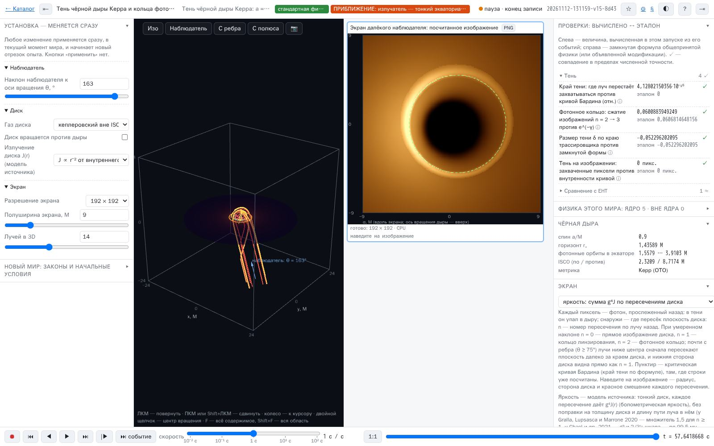</a>
<a href="docs/images/u44-rainbow.jpg"></a>

## Содержание

* [Быстрый старт](#быстрый-старт)
* [Демонстрации для школьников](#для-школьников)
* [Демонстрации для студентов](#для-студентов)
* [Демонстрации для исследователей](#для-исследователей)
* [Лаборатории](#лаборатории)
* [Что считается и как проверяется](#что-считается-и-как-проверяется)
* [Охват и планы](#охват-и-планы)
* [Документация](#документация)
* [Лицензия и цитирование](#лицензия-и-цитирование)

## Быстрый старт

```bash
git clone https://github.com/ildar-idrisov/lfphys.git
cd lfphys

# с видеокартой NVIDIA и NVIDIA Container Toolkit
docker compose -f visualizations/docker/docker-compose.yml up -d --build viz

# без видеокарты
docker compose -f visualizations/docker/docker-compose.yml --profile cpu up -d --build viz-cpu
```

Откройте <http://localhost:8479>, выберите демонстрацию и сценарий и нажмите **▶ Запустить**. Откроется плеер: **⏺**
ведёт запись (мир считается дальше), бегунок внизу возвращает к любому моменту истории. Переключатель **Лаборатории**
вверху каталога открывает лаборатории.

| что нужно | |
|---|---|
| Docker | Docker Engine с плагином Compose v2 (`docker compose`) |
| диск | около 3,3 ГБ на образ; большую часть занимают библиотеки CUDA от NVIDIA из PyPI, нужные только для видеокарты. Записи запусков лежат в `visualizations/runs/`, квота — 5 ГБ; запуск, который не открывали 3 дня, удаляется, если не отмечен ☆ (срок задаётся в каталоге) |
| память | контейнеру сервера отведено не больше 6 ГБ, каждому идущему миру — не больше 60 % от этого. Лучше, чтобы на машине было от 8 ГБ памяти |
| процессор | каждый запуск считается в своём процессе в 2 потока; одновременно считают не больше трёх запусков |
| видеокарта (не обязательна) | NVIDIA с драйвером для CUDA 12 (версии 525 или новее) и [NVIDIA Container Toolkit](https://docs.nvidia.com/datacenter/cloud-native/container-toolkit/latest/install-guide.html); сервер берёт одну карту — устройство 0 |

**С видеокартой и без.** Код и проверки в обоих случаях одни и те же, отличается только скорость. С видеокартой на неё
уходят тяжёлые ядра там, где это измеримо быстрее: распространение волны методом углового спектра, трассировщики лучей
u39 и u42, решатель уравнения Шрёдингера в 2D и 3D, решёточный метод Больцмана, парные силы молекулярной динамики,
решатель FDTD (например, ×26–29 для уравнения Шрёдингера на сетках 1024²–2048² и ×8–155 для течений —
`lfphys/README.md`, раздел «CPU and GPU»). Проверки всегда считаются в двойной точности. Без видеокарты большинство миров
всё равно идёт со своей скоростью по умолчанию. Заметнее всего разница в течениях p04: в сценарии с дорожкой Кармана
шаг занял 13 мс на 8-ядерном настольном процессоре и 0,19 мс на RTX 2080 Ti, так что без видеокарты дорожка
складывается примерно в 30 раз медленнее заданной скорости. Точный двухщелевой опыт r12 на любом устройстве считает
медленнее своей скорости по умолчанию, и картина складывается за несколько минут. Страница **⚙ Устройства**
(`/settings`) показывает, что где считается, и позволяет выбрать устройство и точность для каждого ядра.

**Настройки.** Не обязательны: свежий клон работает и без них. Скопируйте шаблон и поправьте его:

```bash
cp visualizations/docker/.env.example visualizations/docker/.env
```

* `UID`, `GID` — владелец клона (`id -u`, `id -g`), если это не 1000:1000: от его имени сервер пишет записи запусков в
  `visualizations/runs/`.
* `VIZ_PORT` — другой порт (по умолчанию 8479). `VIZ_PORT=127.0.0.1:8479` оставляет сервер доступным только с этой
  машины.
* `VIZ_CPUS` — ограничение процессора для контейнера (0 — без ограничения, по умолчанию).
* `LFPHYS_GPU_PCI` — на машине с несколькими видеокартами вставьте адрес шины карты 0 из
  `nvidia-smi --query-gpu=pci.bus_id --format=csv`: тогда движок откажется от любого другого устройства.

Сервер слушает все адреса машины, так что с других компьютеров локальной сети он открывается по
`http://<адрес этой машины>:8479`. Входа по паролю нет: кто дотянулся до порта, тот может запускать миры. Держите
сервер в доверенной сети или привяжите его к `127.0.0.1`, как выше.

**Остановить и запустить снова.**

```bash
docker compose -f visualizations/docker/docker-compose.yml stop viz         # или: stop viz-cpu
docker compose -f visualizations/docker/docker-compose.yml start viz        # или: start viz-cpu
docker compose -f visualizations/docker/docker-compose.yml --profile cpu down   # удалить контейнер
```

При остановке сервер приостанавливает запуски, и каждый мир сохраняет своё состояние; приостановленный запуск
продолжается с него, когда вы откроете его и нажмёте ⏺. После `down` записи остаются в `visualizations/runs/`. Пока вы
сами не остановили сервер, Docker поднимает его снова (в том числе после перезагрузки).

**Тесты и движок как библиотека.**

```bash
docker compose -f visualizations/docker/docker-compose.yml run --rm viz-test   # визуализации и сервер
docker run --rm --user "$(id -u):$(id -g)" -v "$PWD":/lf -w /lf/lfphys lfphys-viz \
    python3 -m pytest -q -p no:cacheprovider                                  # движок
docker run --rm --user "$(id -u):$(id -g)" -v "$PWD":/lf -e PYTHONPATH=/lf/lfphys lfphys-viz \
    python3 -c "from lfphys import registry; print(len(registry.catalogue()), 'modules')"
```

Исследовательский проект подключает движок как внешнюю библиотеку: `import lfphys`, а в `PYTHONPATH` — папка `lfphys/`
этого репозитория.

## Демонстрации по аудиториям

В каждой карточке — снимок запуска, название визуализации (ссылка на её README с моделью, проверками и
приближениями), что вы увидите, разделы физики и сценарии, подходящие этой аудитории. Демонстрация, полезная нескольким
аудиториям, стоит в каждой группе со своими сценариями. Пометка *расширение* — темы за пределами обычной школьной
программы, доступные старшеклассникам. Сценарий, название которого кончается на «(модификация)» или после которого
стоит пометка *(модификация)*, запускает мир с намеренно изменённым законом; плеер помечает такой мир плашкой
**МОДИФИЦИРОВАННАЯ ФИЗИКА: …** в верхней строке, а каталог — пометкой «модифицированная физика».

### Для школьников

Школьный курс начинается с механики, электричества и магнетизма, а этих разделов в наборе пока нет (см.
[Охват и планы](#охват-и-планы)). Для школы здесь есть тепловые явления, свет, атом, относительность и тяготение — в
основном последние главы курса. Ссылки на программу — примеры классов и разделов Федеральной рабочей программы (ФРП),
где тема изучается.

**Тяготение и орбиты**

| | |
|---|---|
| <a href="docs/images/p01-inner.jpg">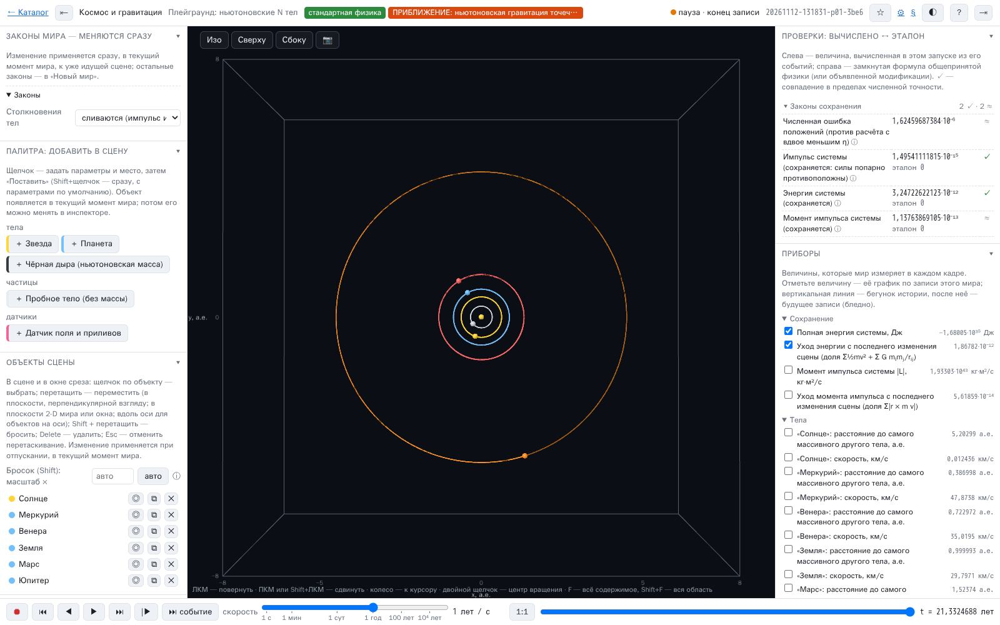</a> | **[p01 · Космос и гравитация](visualizations/p01_gravity/README.ru.md)** (лаборатория)<br>Соберите планетную систему и смотрите, как закон всемирного тяготения двигает её тело за телом; энергия, импульс и момент импульса проверяются по ходу счёта.<br>*Механика: тяготение · Астрономия* · ФРП: 9 кл. «Механические явления», 11 кл. «Элементы астрономии и астрофизики»<br>Сценарии: «Солнце и Земля (круговая орбита 1 а. е.)»; «Солнце, Меркурий, Венера, Земля, Марс, Юпитер (круговые орбиты)» |
| <a href="docs/images/u34-newton.jpg">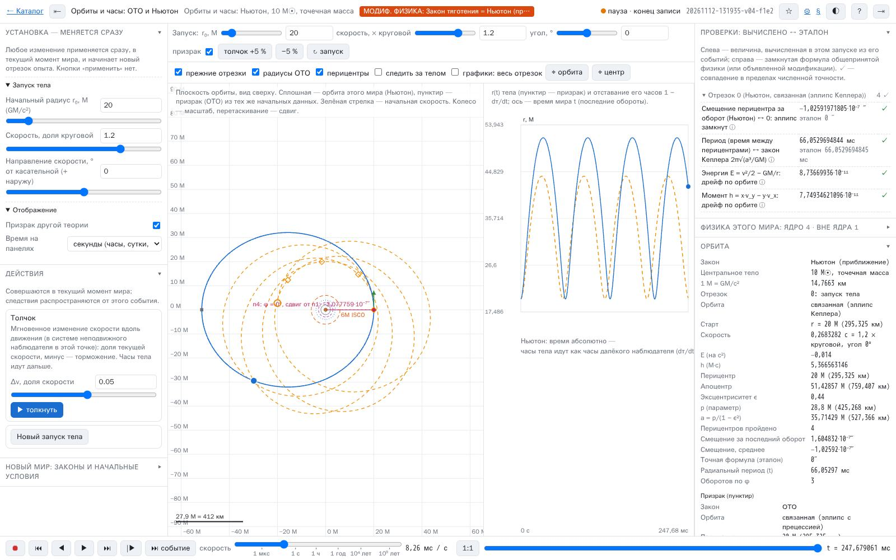</a> | **[u34 · Орбиты и часы: ОТО и Ньютон](visualizations/u34_orbits/README.ru.md)** · *расширение*<br>Орбита Ньютона замыкается в эллипс, а «призрак» — та же орбита по ОТО из тех же начальных данных — нет. Плеер помечает этот мир как модифицированную физику: стандартный закон здесь — ОТО.<br>*Механика: тяготение · Теория относительности*<br>Сценарий: «Ньютон: замкнутый эллипс (призрак — ОТО)» |

**Тепловые явления и молекулы**

| | |
|---|---|
| <a href="docs/images/p03-maxwell.jpg">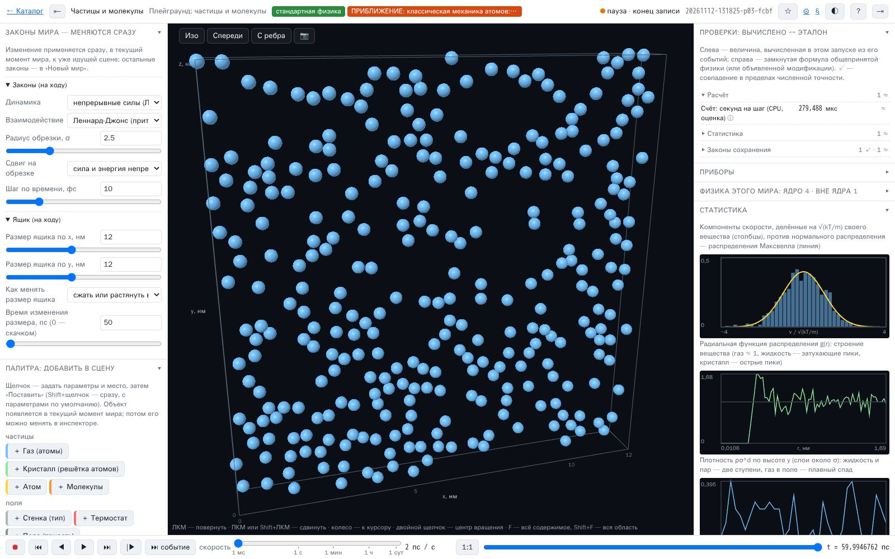</a> | **[p03 · Частицы и молекулы](visualizations/p03_molecules/README.ru.md)** (лаборатория)<br>Газ, посчитанный атом за атомом: пустите все атомы с одной скоростью — распределение Максвелла установится само; поршень совершает работу, стенка отдаёт теплоту, первое начало сходится; кристалл при нагреве плавится.<br>*Молекулярная физика и термодинамика* · ФРП: 8 кл. «Тепловые явления», 10 кл. «Молекулярная физика и термодинамика»<br>Сценарии: «Аргон с одинаковыми начальными скоростями атомов: распределение Максвелла устанавливается само»; «Газ под поршнем: сжатие поршнем и теплообмен со стенкой (первое начало)»; «Двумерный кристалл (ρσ² = 0,85) нагревают термостатом до 120 К: …плавление» |

**Жидкости и газы**

| | |
|---|---|
| <a href="docs/images/p04-airfoil.jpg">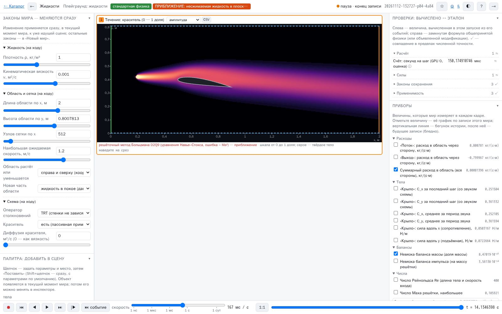</a> | **[p04 · Жидкости](visualizations/p04_fluids/README.ru.md)** (лаборатория) · *расширение*<br>Обтекание крыла и цилиндра, посчитанное решёточным методом Больцмана; краситель показывает струю, сопротивление и подъёмная сила измеряются. В школе (7 кл.) изучают давление и гидростатику, а не течения.<br>*Гидро- и аэродинамика*<br>Сценарии: «Профиль крыла NACA 2412 под углом атаки 8° — решётка профилей…»; «Вода: обтекание цилиндра D = 1 мм в канале 22 × 4,1 мм, Re = 20…» |

**Свет**

| | |
|---|---|
| <a href="docs/images/u35-tir.jpg">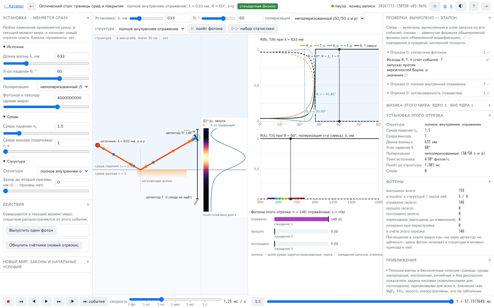</a> | **[u35 · Оптическая скамья: границы сред и покрытия](visualizations/u35_optics_bench/README.ru.md)**<br>Фотоны по одному на границе стекла и воздуха: при углах больше критического отражаются все, а за границей появляется затухающая волна; просветляющий слой в четверть волны гасит отражение.<br>*Оптика* · ФРП: 9 кл. «Световые явления», 11 кл. «Оптика»<br>Сценарии: «Полное внутреннее отражение: стекло 1,5 → воздух, θ = 60° больше критического угла»; «Просветление стекла слоем λ/4 с n_f = 1,38 (как MgF₂, иллюстративно), λ₀ = 550 нм» |
| <a href="docs/images/u44-rainbow.jpg"></a> | **[u44 · Рассеяние Ми на капле: радуга и глория](visualizations/u44_mie_scattering/README.ru.md)**<br>Солнечный свет на облаке капель, сложенный длина волны за длиной волны из точного рассеяния на одной капле: основная и вторичная дуги, тёмная полоса Александра между ними.<br>*Оптика: преломление и дисперсия* · ФРП: 9 кл. «Световые явления»<br>Сценарий: «Радуга: капли радиусом 0,15 мм ± 2 % в солнечном свете — первичная и вторичная дуги, полоса Александра, дополнительные дуги» |
| <a href="docs/images/u32-young.jpg">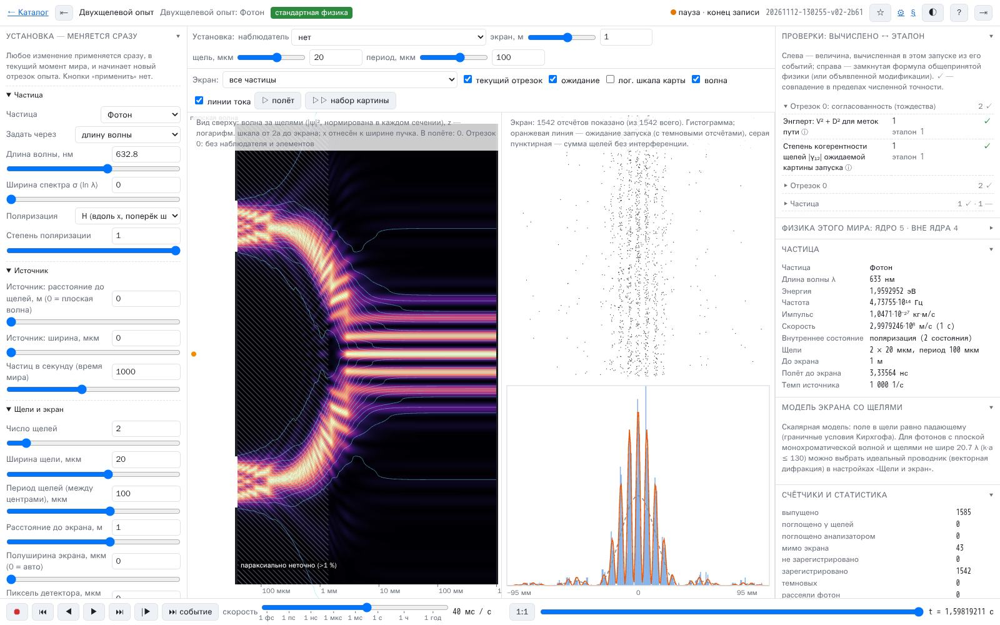</a> | **[u32 · Двухщелевой опыт](visualizations/u32_double_slit/README.ru.md)**<br>Опыт Юнга с одиночными фотонами: каждый попадает в одну точку, а полосы складываются из попаданий.<br>*Оптика · Квантовая физика* · ФРП: 11 кл. «Оптика», «Квантовая физика»<br>Сценарий: «Фотоны 633 нм, две щели (Юнг, по одному фотону)» |

**Теория относительности и астрономия**

| | |
|---|---|
| <a href="docs/images/u31-sun-earth.jpg">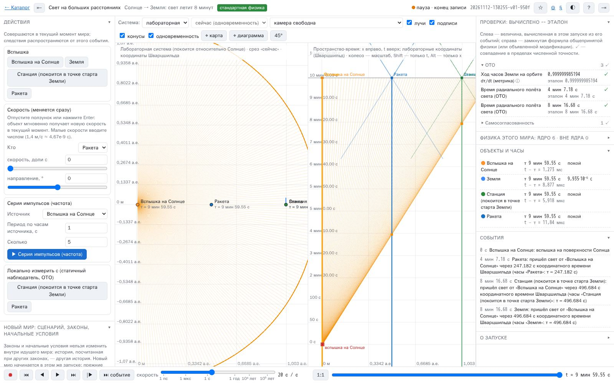</a> | **[u31 · Свет на больших расстояниях](visualizations/u31_light_travel/README.ru.md)**<br>Вспышка на Солнце доходит до Земли за 8 мин 17 с — на карте и на диаграмме пространства-времени; наблюдатели, летящие по ходу света и навстречу, измеряют одну и ту же скорость c.<br>*Теория относительности · Астрономия* · ФРП: 11 кл. «Основы специальной теории относительности»<br>Сценарии: «Солнце → Земля (стандартная физика)»; «Измерение c: покой, по ходу света, навстречу (СТО)» |
| <a href="docs/images/u39-city.jpg">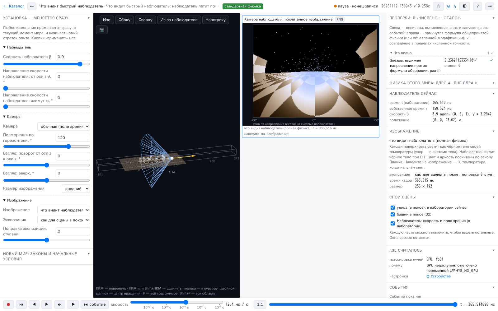</a> | **[u39 · Что видит быстрый наблюдатель](visualizations/u39_fast_observer/README.ru.md)** · *расширение*<br>Снимок камеры наблюдателя при скорости, близкой к световой, посчитанный трассировкой лучей со временем распространения света: сцена стягивается вперёд, синеет и становится ярче.<br>*Теория относительности · Оптика* · ФРП: 11 кл. «Основы СТО»<br>Сценарии: «Полёт по улице при β = 0,9: аберрация, синий цвет впереди, яркость»; «Сцена в покое (β = 0): обычная картинка, проверка трассировщика» |
| <a href="docs/images/u42-m87.jpg"></a> | **[u42 · Тень чёрной дыры Керра и её фотонные кольца](visualizations/u42_kerr_shadow/README.ru.md)** · *расширение*<br>Почему телескоп горизонта событий (EHT) увидел тёмный диск в светлом кольце: каждый пиксель — луч света, прослеженный назад от наблюдателя.<br>*Теория относительности: чёрные дыры · Астрофизика* · ФРП: 11 кл. «Элементы астрономии и астрофизики»<br>Сценарии: «Без вращения (a = 0): тень — круг радиуса √27 M»; «M87*: a = 0,9, наклон 163°…» |

**Атом и кванты**

| | |
|---|---|
| <a href="docs/images/u40-2pz.jpg">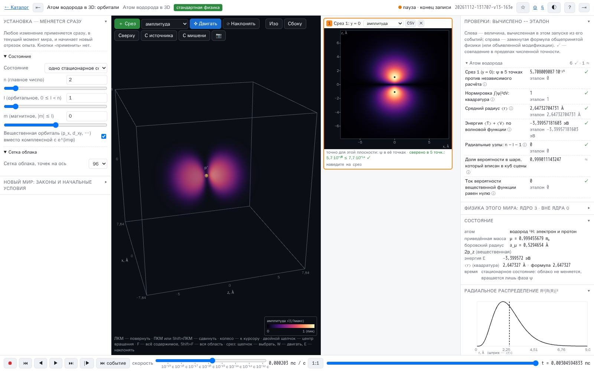</a> | **[u40 · Атом водорода в 3D: орбитали](visualizations/u40_hydrogen_3d/README.ru.md)**<br>Орбитали из точного решения уравнения Шрёдингера: их форма и узлы, уровни энергии, радиальное распределение.<br>*Атомная физика* · ФРП: 9 кл. «Квантовые явления», 11 кл. «Квантовая физика» (строение атома)<br>Сценарии: «1s: основное состояние водорода»; «2p_z: гантель вдоль z, узловая плоскость z = 0»; «3d_z²: лепестки вдоль z и кольцо» |
| <a href="docs/images/p02-double-slit.jpg">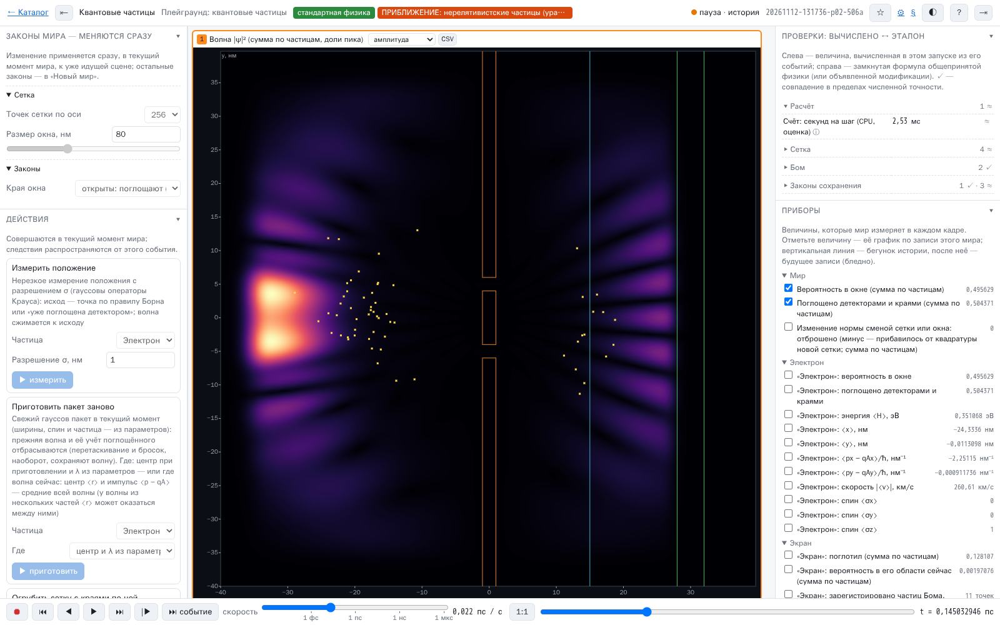</a> | **[p02 · Квантовые частицы](visualizations/p02_quantum/README.ru.md)** (лаборатория) · *расширение*<br>Волна электрона проходит две щели и интерферирует, а детектор регистрирует отдельные частицы.<br>*Квантовая физика* · ФРП: 11 кл., углублённый уровень, «Корпускулярно-волновой дуализм»<br>Сценарий: «Двухщелевой опыт: электрон, стенка с двумя щелями, детектор-экран, частицы Бома» |

### Для студентов

**Механика и тяготение**

| | |
|---|---|
| <a href="docs/images/u34-rosette.jpg">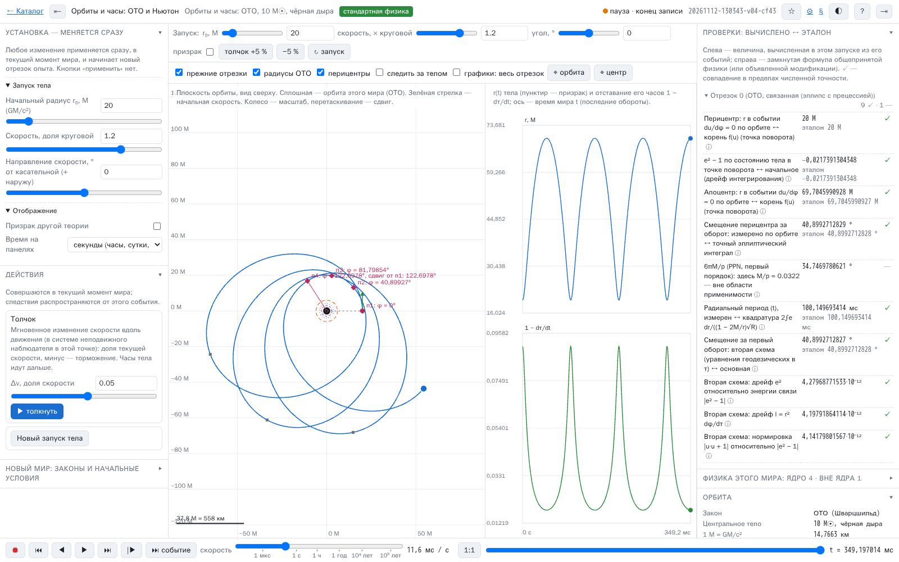</a> | **[u34 · Орбиты и часы: ОТО и Ньютон](visualizations/u34_orbits/README.ru.md)**<br>Одно тело на орбите, рассчитанной из точного уравнения геодезических: смещение перицентра измеряется по самой орбите и сравнивается с точным эллиптическим интегралом и с постньютоновской оценкой; часы тела в сравнении с часами удалённого наблюдателя.<br>*Механика · Общая теория относительности*<br>Сценарии: «Меркурий у Солнца (слабое поле, 43″ за век)»; «Чёрная дыра 10 M☉: розетка (перицентр 20M)»; «Радиальное падение из покоя с 20M (циклоида)» |
| <a href="docs/images/p01-inner.jpg"></a> | **[p01 · Космос и гравитация](visualizations/p01_gravity/README.ru.md)** (лаборатория)<br>Ньютоновская задача N тел с тесными сближениями и слияниями; схема Эрмита, симметричная по времени.<br>*Механика: тяготение, хаос*<br>Сценарии: «Пифагорова задача трёх тел (Буррау): массы 3, 4, 5 в покое — тесные сближения»; «Ньютоновская чёрная дыра массой 1000 M☉ и звёзды: орбиты и захват» |

**Течения, теплота и статистическая физика**

| | |
|---|---|
| <a href="docs/images/p04-karman.jpg">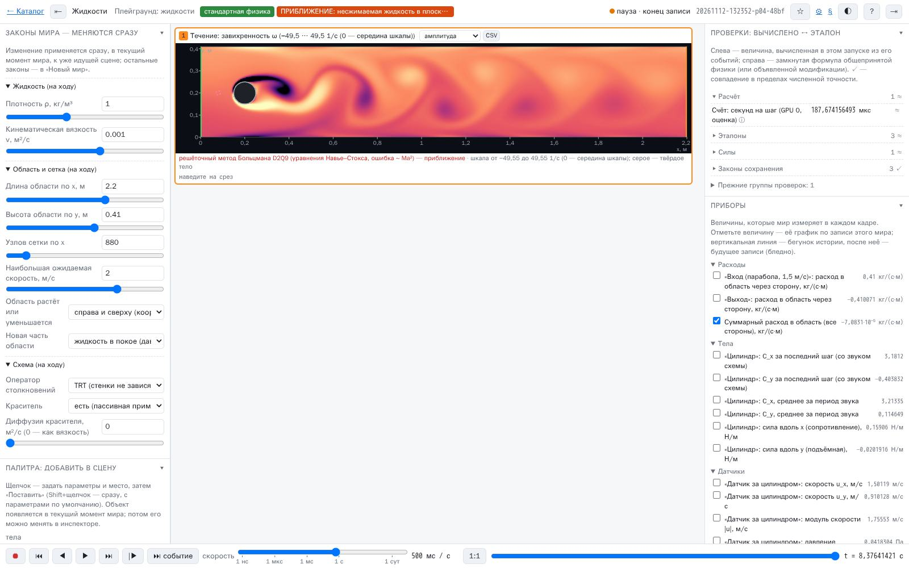</a> | **[p04 · Жидкости](visualizations/p04_fluids/README.ru.md)** (лаборатория)<br>Вязкие течения решёточным методом Больцмана: профиль Пуазейля, вихревая дорожка, коэффициенты сопротивления и подъёмной силы, число Струхаля.<br>*Гидродинамика*<br>Сценарии: «Течение в канале (Пуазейля, Re ≈ 2) и пластина поперёк…»; «Дорожка Кармана за цилиндром, Re = 100…» |
| <a href="docs/images/p03-molecules.jpg">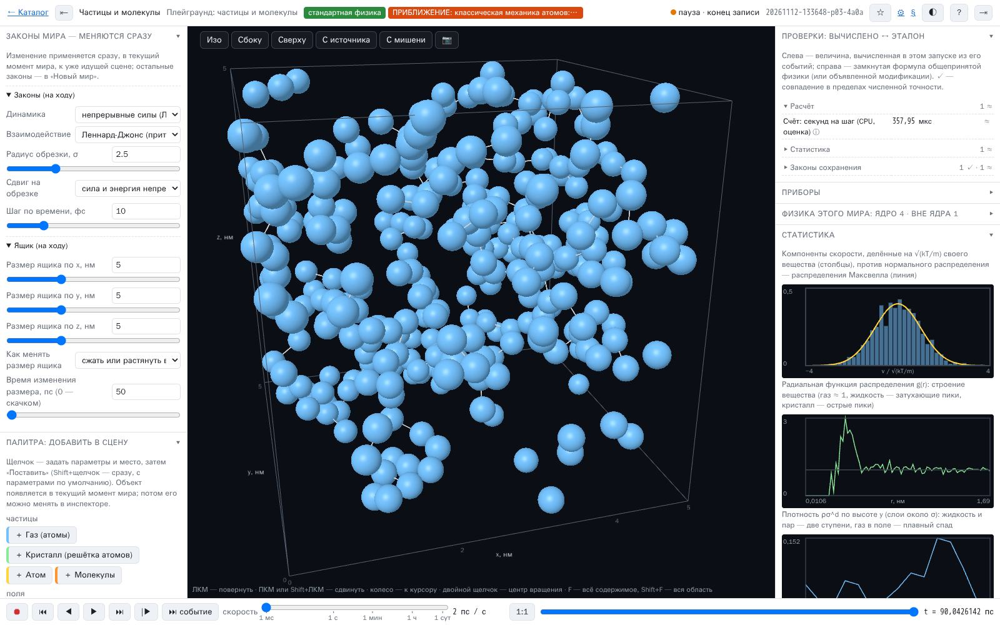</a> | **[p03 · Частицы и молекулы](visualizations/p03_molecules/README.ru.md)** (лаборатория)<br>Молекулярная динамика: равнораспределение энергии по модам молекул, сосуществование жидкости и пара, радиальная функция распределения g(r), давление по вириалу и по стенкам.<br>*Термодинамика и статистическая физика · Конденсированное состояние*<br>Сценарии: «Двухатомные молекулы стартуют только с поступательным движением: … (устанавливается равнораспределение)»; «Жидкость и пар в объёме при 90 К в поле: … профиль плотности по высоте» |

**Волны и оптика**

| | |
|---|---|
| <a href="docs/images/u35-tir.jpg"></a> | **[u35 · Оптическая скамья](visualizations/u35_optics_bench/README.ru.md)**<br>Коэффициенты Френеля и многослойные покрытия (матрицы переноса) решают судьбу каждого фотона; счёт фотонов сходится к R, T, A.<br>*Оптика*<br>Сценарии: «Стекло n = 1,5 в воздухе под углом Брюстера (неполяризованный свет: отражаются только s)»; «Нарушенное полное отражение: зазор 200 нм до второй призмы (туннелирование фотонов)»; «Фабри–Перо: плёнка n = 2,3 толщиной 2 мкм в воздухе (иллюстративно)» |
| <a href="docs/images/u38-circle.jpg">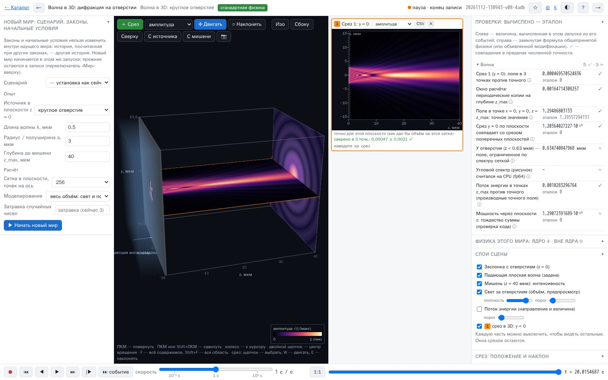</a> | **[u38 · Волна в 3D: дифракция на отверстии](visualizations/u38_wave_3d/README.ru.md)**<br>Дифракция Френеля за отверстиями в полноценной 3D-сцене со срезами под любым углом; точность каждого мира и каждого среза измерена.<br>*Волны · Оптика*<br>Сценарии: «Круглое отверстие: провалы и пики интенсивности на оси»; «Гауссов пучок, w = 1,5 мкм: расходимость (проверка по интегралу)»; «Две щели конечной длины: весь объём» |
| <a href="docs/images/u44-rainbow.jpg"></a> | **[u44 · Рассеяние Ми на капле](visualizations/u44_mie_scattering/README.ru.md)**<br>Точный ряд Ми в сравнении с лучами Декарта и теорией Эйри: дополнительные дуги и почему мелкие капли дают белую туманную радугу.<br>*Оптика: рассеяние*<br>Сценарии: «Дополнительные дуги: почти одинаковые капли радиусом 0,1 мм ± 0,5 %»; «Туманная радуга: капли радиусом 15 мкм ± 15 % — широкая белая дуга»; «Крупные капли радиусом 0,3 мм ± 10 %: дополнительные дуги размыты…» |
| <a href="docs/images/u43-lg3.jpg">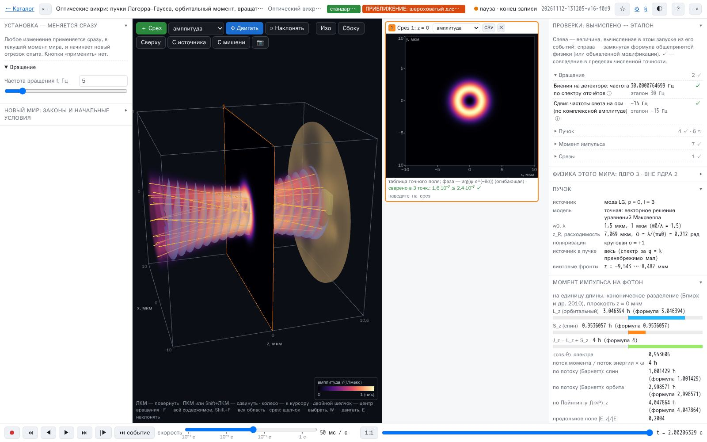</a> | **[u43 · Оптические вихри](visualizations/u43_optical_vortices/README.ru.md)**<br>Пучки Лагерра–Гаусса: винтовые фронты, поток энергии, закрученный вокруг оси, орбитальный и спиновый момент на фотон, измеренные по полю; вращающийся диск сдвигает частоту.<br>*Оптика: пучки, момент импульса света*<br>Сценарии: «LG₀³, σ = +1: три винтовых фронта, точная модель, вращающийся диск»; «LG₂¹: три кольца, фронты со скачками фазы на узлах»; «Голограмма-«вилка», l = 1: порядок m несёт заряд m·l»; «Контроль: гауссов пучок без вихря (l = 0) — биений нет» |

**Теория относительности**

| | |
|---|---|
| <a href="docs/images/u31-lensing.jpg">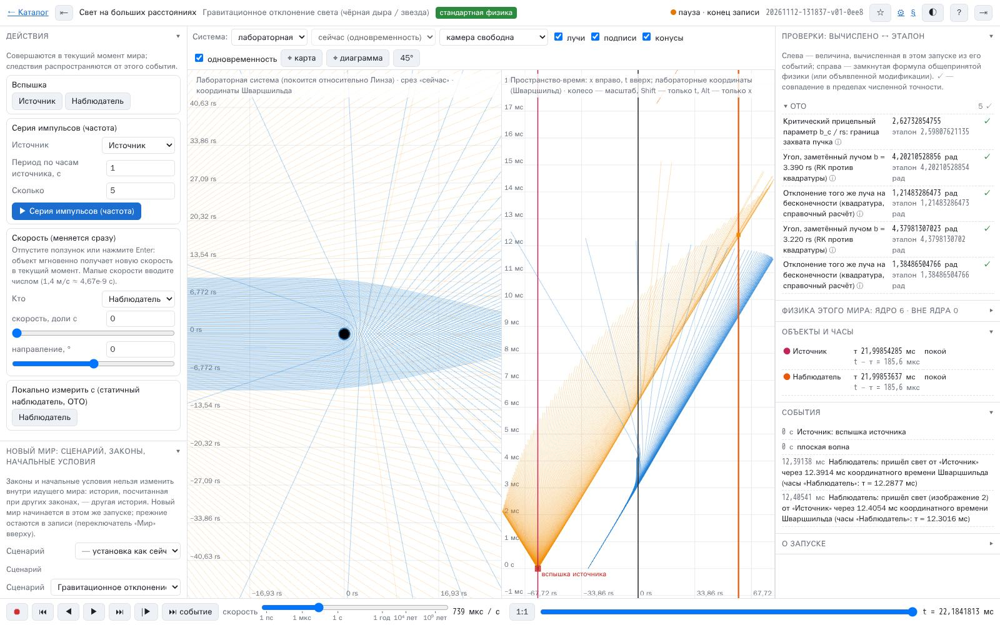</a> | **[u31 · Свет на больших расстояниях](visualizations/u31_light_travel/README.ru.md)**<br>Относительность одновременности, синхронизация часов, отклонение и задержка света у чёрной дыры; вспышки и скорости наблюдателей задаются по ходу опыта.<br>*Специальная и общая теория относительности*<br>Сценарии: «Парадокс Андромеды: пешеходы со скоростью 1,4 м/с»; «Измерение c: часы по лабораторной одновременности (СТО)»; «Чёрная дыра 10 M☉: отклонение, тень, два изображения» |
| <a href="docs/images/u39-terrell.jpg">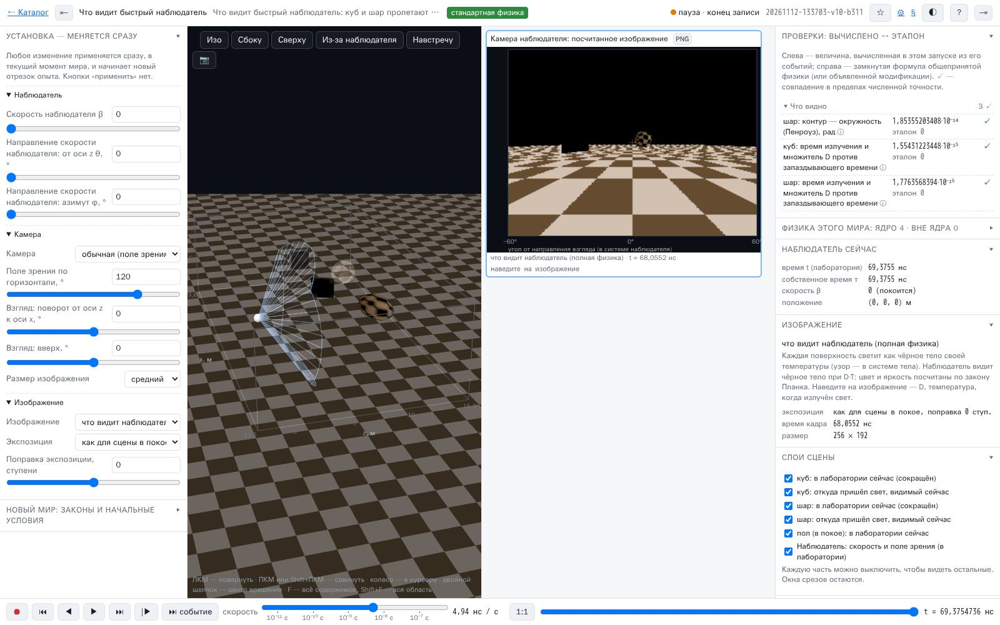</a> | **[u39 · Что видит быстрый наблюдатель](visualizations/u39_fast_observer/README.ru.md)**<br>Почему лоренцево сокращение не видно, а виден поворот (Террелл–Пенроуз); доплеровский цвет и прожекторный эффект — из трассировки лучей со временем света.<br>*Специальная теория относительности · Оптика*<br>Сценарии: «Пролёт куба и шара при β = 0,9: поворот Террелла, шар остаётся кругом»; «Для сравнения: мгновенный снимок (лоренцево сокращение, которого не видно)»; «Поезд проезжает мимо столбов при β = 0,8: удлинение и укорочение» |
| <a href="docs/images/r11-thomas.jpg">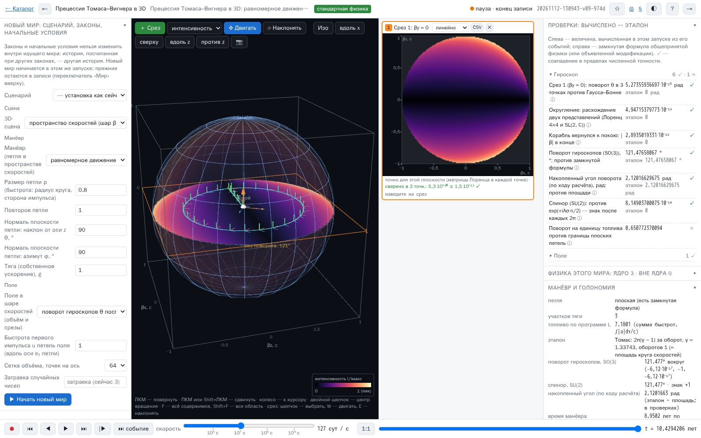</a> | **[r11 · Прецессия Томаса–Вигнера в 3D](visualizations/r11_thomas_3d/README.ru.md)**<br>Корабль облетает петлю и возвращается к покою с повёрнутыми гироскопами, хотя никакие моменты сил на них не действовали.<br>*Специальная теория относительности*<br>Сценарии: «Прецессия Томаса: равномерное движение по окружности, γ = 1,34»; «Обычное пространство: траектория и гироскопы при прецессии Томаса» |
| <a href="docs/images/u42-edge.jpg">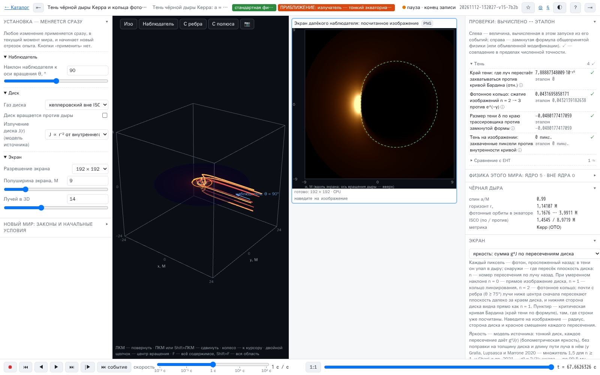</a> | **[u42 · Тень чёрной дыры Керра](visualizations/u42_kerr_shadow/README.ru.md)**<br>Фотонные орбиты и край тени в сравнении с формулой Бардина; изображения диска n = 0, 1, 2.<br>*Общая теория относительности*<br>Сценарии: «Диск с ребра (θ = 90°), a = 0,99: тень сплюснута, кольца несимметричны»; «Узкое кольцо газа на радиусе 6 M: видны его изображения n = 0, 1, 2» |

**Квантовая физика**

| | |
|---|---|
| <a href="docs/images/u33-tunnel.jpg">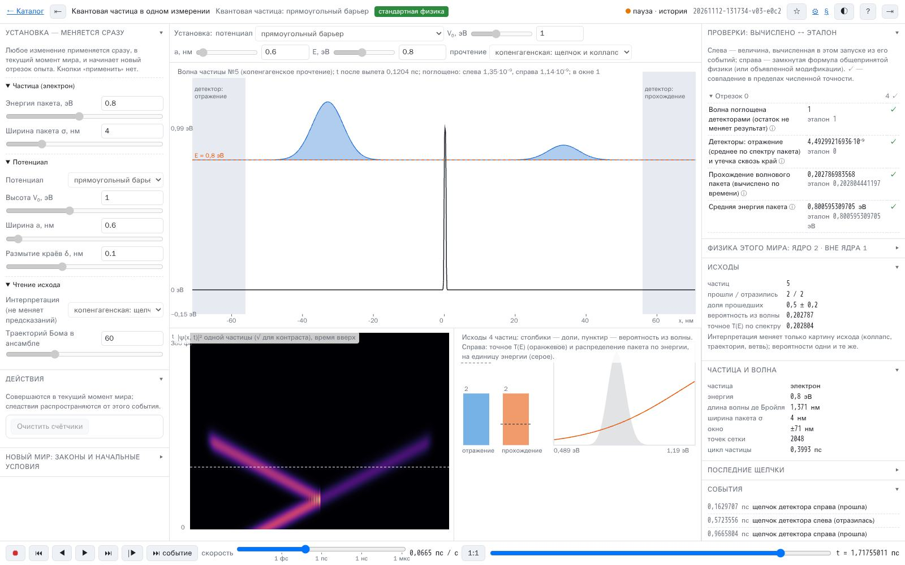</a> | **[u33 · Квантовая частица в одном измерении](visualizations/u33_quantum_1d/README.ru.md)**<br>Пакет электрона у барьера, ступеньки, ямы или в ловушке: точное решение во времени, его прохождение в сравнении со стационарным, детекторы, которые щёлкают.<br>*Квантовая физика*<br>Сценарии: «Туннелирование электрона через барьер 1 эВ × 0,6 нм»; «Резонансное туннелирование: двойной барьер»; «Ступенька: отражение при E > V₀»; «Пакет в гармонической ловушке (когерентное состояние)» |
| <a href="docs/images/u32-young.jpg"></a> | **[u32 · Двухщелевой опыт](visualizations/u32_double_slit/README.ru.md)**<br>Детекторы пути, метки поляризацией, квантовый ластик, частичная когерентность; электроны, нейтроны, C₆₀.<br>*Квантовая физика · Оптика*<br>Сценарии: «Электроны + детектор пути (θ = 90°, не считывается)»; «Квантовый ластик: метки H/V + анализатор 45°»; «Фотоны: широкий источник (частичная когерентность)»; «Электроны: эффект Ааронова–Бома (поток ½ h/e)» |
| <a href="docs/images/r12-mark180.jpg">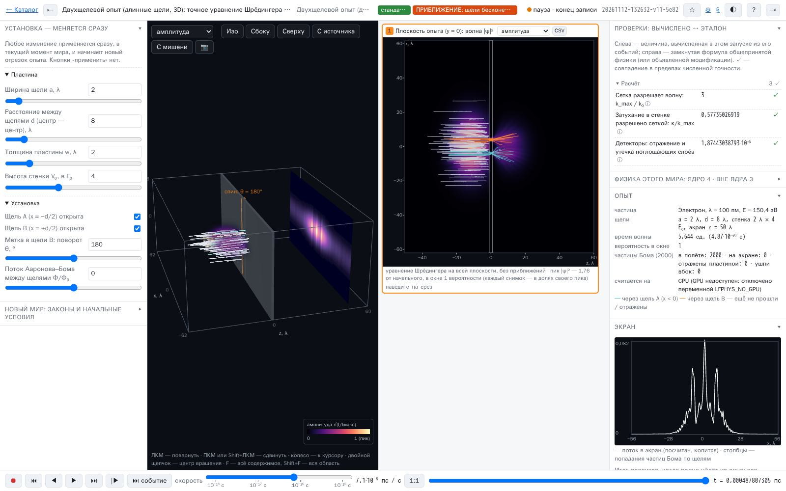</a> | **[r12 · Двухщелевой опыт (длинные щели, 3D)](visualizations/r12_double_slit_2d/README.ru.md)**<br>Нестационарное уравнение Шрёдингера на всей плоскости опыта, без параксиального приближения: отражение пластиной, волна в щелях, картина по мере прихода волны.<br>*Квантовая физика*<br>Сценарии: «Одна щель (B закрыта): огибающая без полос»; «Щели a = 6λ в тонкой высокой стенке: ближе к параксиальной теории (отличие ~λ/a)»; «Эффект Ааронова–Бома: поток Φ₀/2 между щелями сдвигает полосы на полпериода» |
| <a href="docs/images/u37-bell.jpg">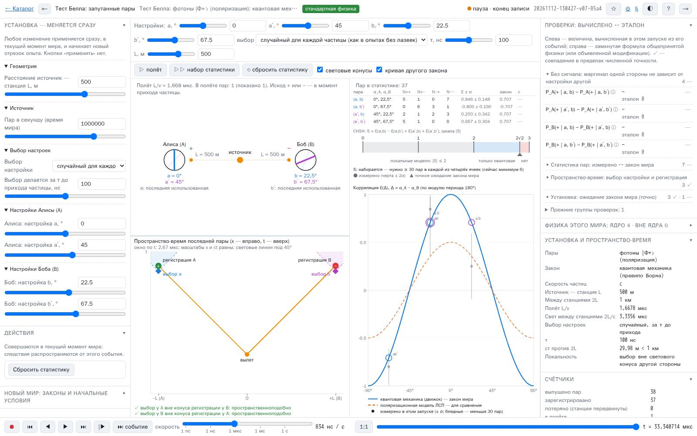</a> | **[u37 · Тест Белла: запутанные пары](visualizations/u37_bell_test/README.ru.md)**<br>Запутанные фотоны или спины на двух станциях: совпадения, корреляции E и параметр CHSH S в сравнении с границами 2 и 2√2; настройки выбираются вне светового конуса другой стороны.<br>*Квантовая физика*<br>Сценарии: «Фотоны \|Φ+⟩, квантовая механика: оптимальные углы CHSH 0°, 45° / 22,5°, 67,5°, случайный выбор»; «Синглет спина ½, квантовая механика: оптимальные углы 0°, 90° / 45°, 135°, случайный выбор»; «Кривая E(Δ): фотоны, фиксированные настройки a = b = 0° — двигайте b» |
| <a href="docs/images/p02-trap.jpg">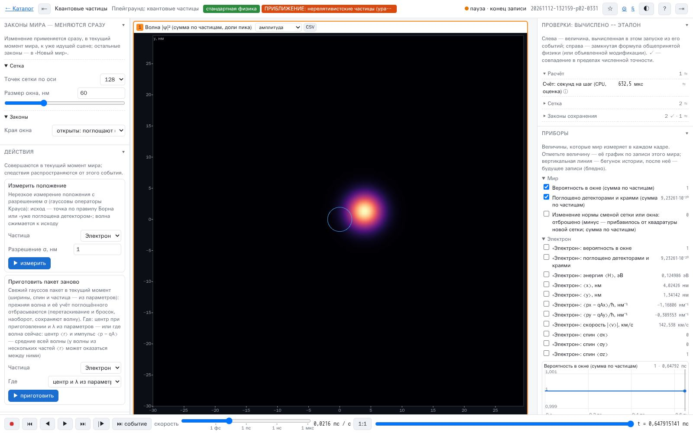</a> | **[p02 · Квантовые частицы](visualizations/p02_quantum/README.ru.md)** (лаборатория)<br>Волновые пакеты в 2D и 3D в сцене из барьеров, ловушек и полей, которую собираете вы; измерение положения — действие.<br>*Квантовая физика*<br>Сценарии: «Туннелирование: пакет налетает на тонкий барьер выше его энергии»; «Гармоническая ловушка: смещённый пакет колеблется (энергия сохраняется), измерение положения»; «Электрон в магнитном поле 100 Тл: круговая орбита, спин вдоль поля»; «3D: электрон рассеивается на шаре» |

**Атомная физика и физика частиц**

| | |
|---|---|
| <a href="docs/images/u40-m1.jpg">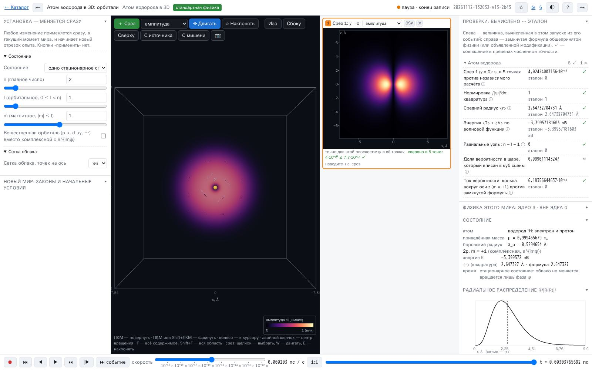</a> | **[u40 · Атом водорода в 3D](visualizations/u40_hydrogen_3d/README.ru.md)**<br>Вещественные орбитали — стоячие волны без тока, комплексные с m ≠ 0 несут кольцевой ток; суперпозиция двух уровней качается с частотой Бора.<br>*Атомная и квантовая физика*<br>Сценарии: «2p_x вещественная: стоячая волна, тока нет»; «2p, m = +1, комплексная: бублик и кольцевой ток»; «1s + 2p_z: облако качается вдоль z с частотой Бора (суперпозиция)» |
| <a href="docs/images/u36-qcd.jpg">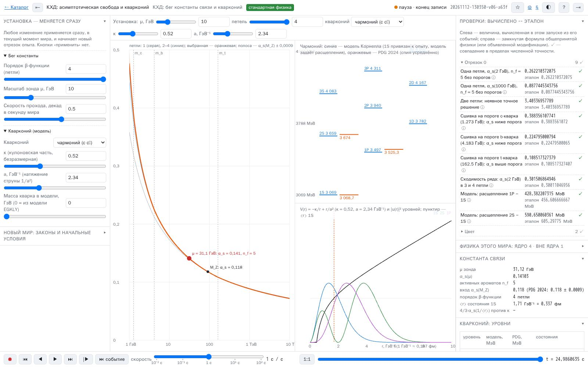</a> | **[u36 · КХД: асимптотическая свобода и кварконий](visualizations/u36_qcd/README.ru.md)**<br>Константа сильного взаимодействия α_s бежит от 1 ГэВ до 10 ТэВ (от одной до четырёх петель, пороги кварков); уровни чармония и боттомония в модели Корнелла в сравнении с измеренными.<br>*Физика элементарных частиц*<br>Сценарии: «Асимптотическая свобода и чармоний (PDG 2024, модель Корнелла)»; «Боттомоний» |
| <a href="docs/images/u41-1p.jpg">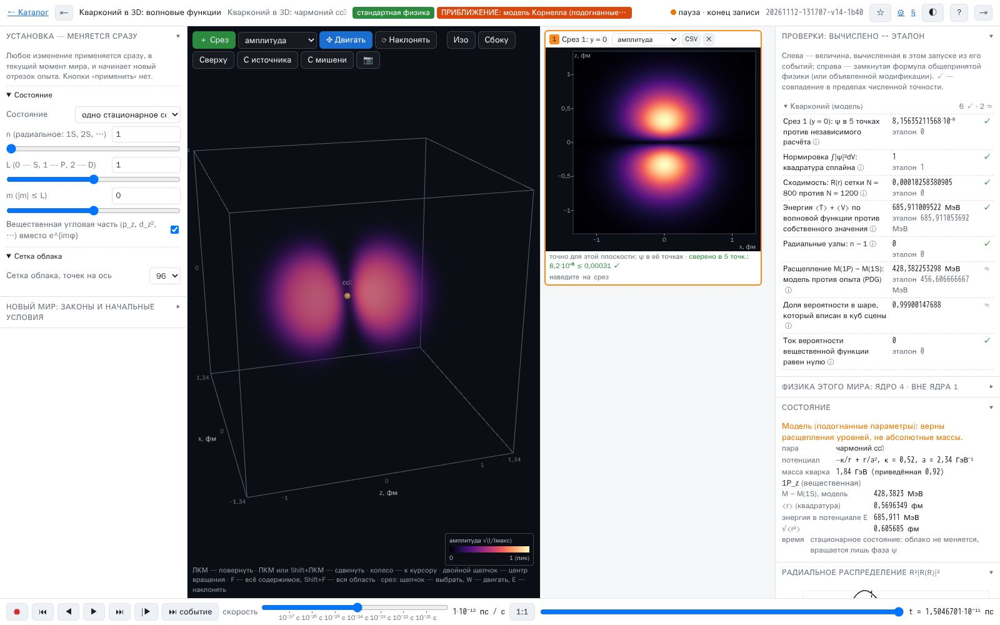</a> | **[u41 · Кварконий в 3D: волновые функции](visualizations/u41_quarkonium_3d/README.ru.md)**<br>Волновые функции пары тяжёлых кварков в модели Корнелла — аналог атома водорода для сильного взаимодействия; расщепления уровней модели в сравнении с данными Particle Data Group.<br>*Физика элементарных частиц*<br>Сценарии: «cc̄ 1S (J/ψ, η_c без спина): облако без узлов»; «cc̄ 1P (χ_c, h_c), p_z»; «cc̄ 2S (ψ(2S)): один радиальный узел»; «bb̄ 1S (Υ(1S)): облако теснее, кварки тяжелее» |

### Для исследователей

**ОТО и чёрные дыры**

| | |
|---|---|
| <a href="docs/images/u42-m87.jpg"></a> | **[u42 · Тень чёрной дыры Керра и её фотонные кольца](visualizations/u42_kerr_shadow/README.ru.md)**<br>Размер тени в сравнении с измерениями EHT для M87* и Sgr A*; сжатие изображений фотонного кольца в сравнении с показателем Ляпунова; метрика Йоханнсена как объявленная альтернатива.<br>*ОТО · Астрофизика*<br>Сценарии: «M87*: a = 0,9, наклон 163° (как у EHT при a > 0)…»; «Sgr A*: a = 0,5, наклон 30°, сравнение с EHT 2022»; «Что, если: метрика Йоханнсена с α₁₃ = 3 — тень больше, сравнение с EHT» *(модификация)* |
| <a href="docs/images/u34-rosette.jpg"></a> | **[u34 · Орбиты и часы](visualizations/u34_orbits/README.ru.md)**<br>Точные геодезические в сравнении с разложением слабого поля (ППН) на одной и той же орбите, неустойчивость внутри ISCO, экваториальные орбиты Керра.<br>*ОТО*<br>Сценарии: «Нейтронная звезда: сильная прецессия»; «Чёрная дыра: круговая орбита у ISCO (6,2M)»; «Падение внутри ISCO (5,5M, скорость −0,5 %)» |
| <a href="docs/images/p01-inspiral.jpg">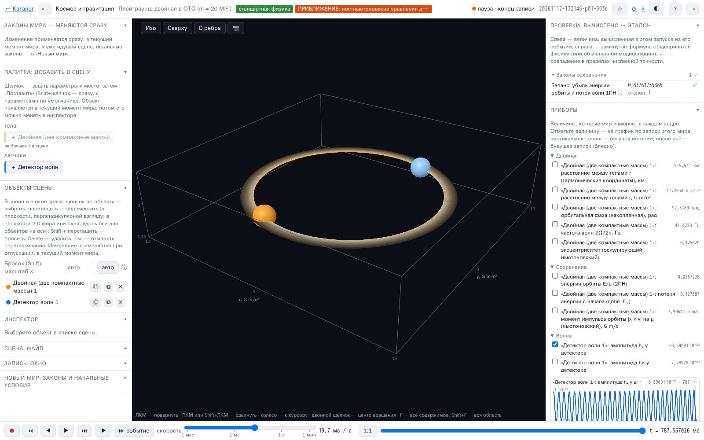</a> | **[p01 · Космос и гравитация](visualizations/p01_gravity/README.ru.md)** (лаборатория)<br>Постньютоновская двойная с реакцией излучения и сигнал h₊, h× у детектора; тела, лучи света и часы у чёрной дыры Керра–Ньюмена.<br>*ОТО · Гравитационные волны*<br>Сценарии: «ОТО: двойная 10 + 10 M☉ с расстояния 20 G m/c² и детектор волн (спиральное сближение)»; «ОТО: эксцентрическая двойная 30 + 10 M☉ (e = 0,5), прецессия перицентра»; «У чёрной дыры (a = 0,9): тела на орбитах, лучи света, часы наблюдателей» |

**СТО и история её проверок**

| | |
|---|---|
| <a href="docs/images/r11-seam.jpg">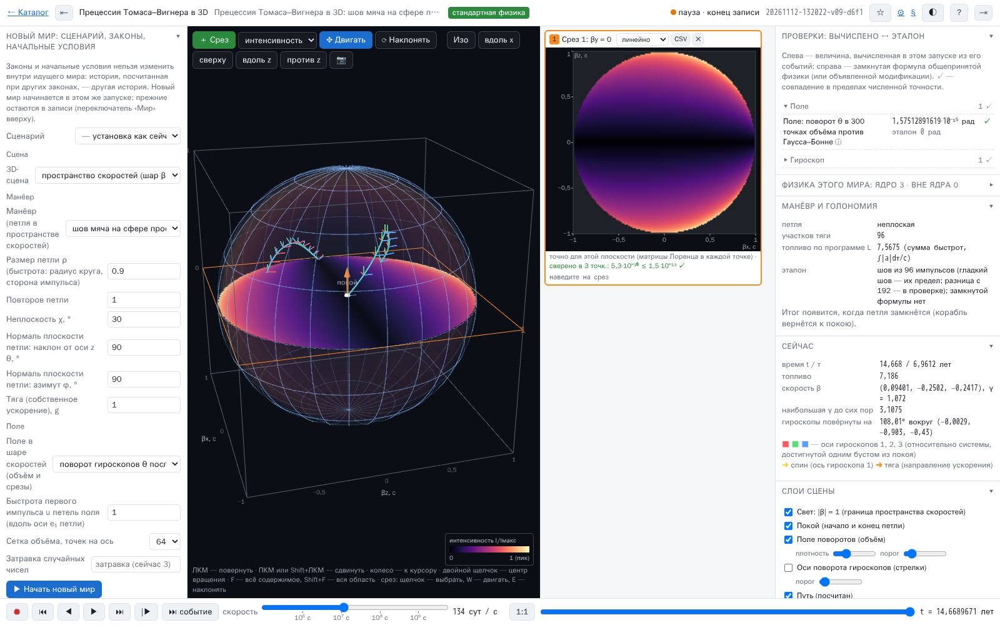</a> | **[r11 · Прецессия Томаса–Вигнера в 3D](visualizations/r11_thomas_3d/README.ru.md)**<br>Голономия манёвра в SO(3) и SU(2), геометрия пространства скоростей и изопериметрическая оценка поворота на единицу топлива; плоские и неплоские петли.<br>*СТО · Группа Лоренца*<br>Сценарии: «Три разгона: угол Вигнера = площадь треугольника скоростей»; «Круг через покой: равенство в изопериметрическом неравенстве»; «SU(2): гироскопы вернулись (поворот на 2π), спинор сменил знак»; «Шов мяча на сфере скоростей (неплоский, 96 разгонов)» |
| <a href="docs/images/u39-terrell.jpg"></a> | **[u39 · Что видит быстрый наблюдатель](visualizations/u39_fast_observer/README.ru.md)**<br>Трассировка лучей со временем света для движущихся тел: каждый фотон преобразован по Лоренцу, свет — чёрное тело при доплеровски сдвинутой температуре.<br>*СТО*<br>Сценарии: «Небо 4 000 К при β = 0,9: диполь, звёзды стягиваются вперёд»; «То же при β = 0,99»; «Сцена в покое (β = 0): обычная картинка, проверка трассировщика» |
| <a href="docs/images/u31-sun-earth.jpg"></a> | **[u31 · Свет на больших расстояниях](visualizations/u31_light_travel/README.ru.md)**<br>Те же измерения в мирах с другими законами света: эфир, баллистический свет Ритца, ньютоновы корпускулы.<br>*СТО · История физики*<br>Сценарии: «Измерение c в мире с эфиром (модификация)»; «Измерение c при баллистическом свете (модификация)»; «Плечо поперёк движения (Майкельсон–Морли), эфир (модификация)»; «Ньютоновы корпускулы у чёрной дыры (модификация)» |

**Оптика и электромагнитные волны**

| | |
|---|---|
| <a href="docs/images/u32-vector.jpg">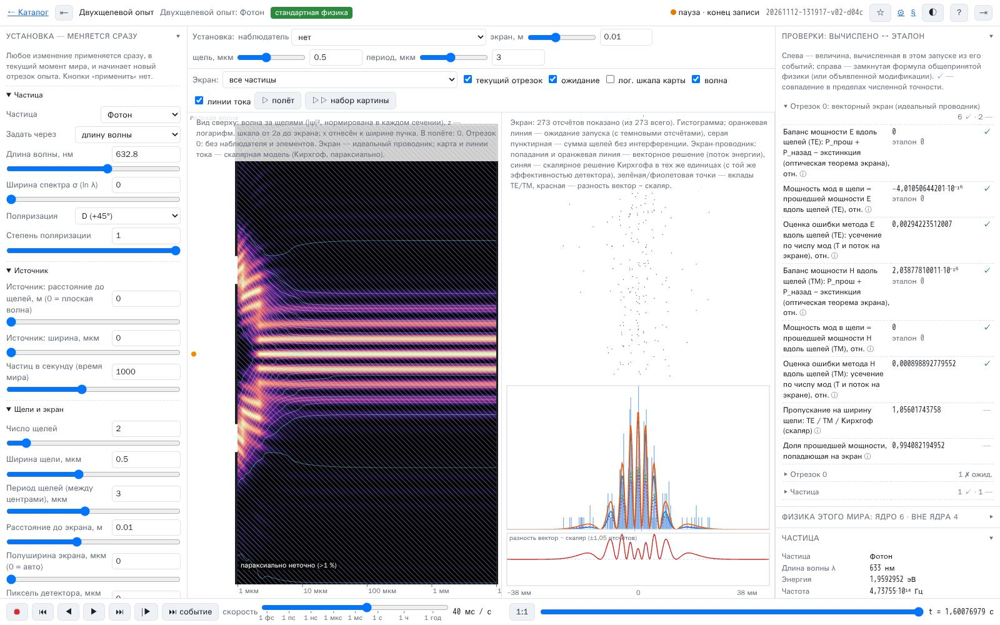</a> | **[u32 · Двухщелевой опыт](visualizations/u32_double_slit/README.ru.md)**<br>Векторная дифракция на щелях в идеально проводящем экране конечной толщины (TE и TM) в сравнении со скалярной моделью; проверка правила Борна на трёх щелях.<br>*Электромагнитные волны · Основания квантовой механики*<br>Сценарии: «Векторная дифракция: щели 0,5 мкм в проводящем экране 0,2 мкм, поляризация D»; «Три щели: проверка правила Борна (Соркин)» |
| <a href="docs/images/u43-tight.jpg">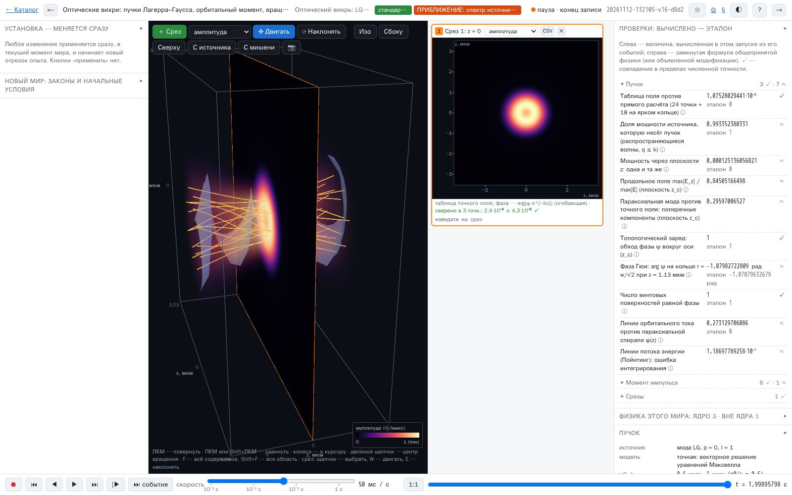</a> | **[u43 · Оптические вихри](visualizations/u43_optical_vortices/README.ru.md)**<br>Точный векторный пучок в сравнении с параксиальной моделью при острой фокусировке: продольное поле и деление момента импульса на спин и орбиту, зависящее от определения; вращательный эффект Доплера.<br>*Оптика · Момент импульса света*<br>Сценарии: «Острая фокусировка: l = 1, σ = −1, w0 = 0,6 λ — продольное поле и спин-орбитальное расщепление»; «То же в параксиальной модели (приближение): чего она не видит»; «Призма Дове вращается: сдвиг частоты 2\|l\|f у пучка l = 2»; «Линейная поляризация, l = 1: J_z = l в среднем, спин нулевой» |
| <a href="docs/images/u44-glory.jpg">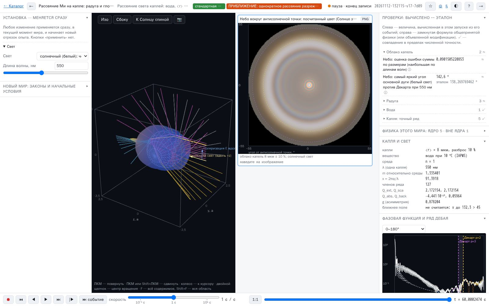</a> | **[u44 · Рассеяние Ми на капле](visualizations/u44_mie_scattering/README.ru.md)**<br>Глория, ближнее поле малой капли, поглощающий шар; ряд Дебая в сравнении с Декартом и Эйри, проверки по опубликованным значениям Уискомба.<br>*Оптика: теория Ми*<br>Сценарии: «Глория: облачные капли радиусом 8 мкм ± 10 % — цветные кольца у антисолнечной точки»; «Ближнее поле: капля радиусом 1 мкм в свете 550 нм — фокус внутри и за каплей»; «Поглощающий шар радиусом 2 мкм, n = 1,6 + 0,05i: внутренние лучи гаснут, радуги нет» |
| <a href="docs/images/u35-spr.jpg">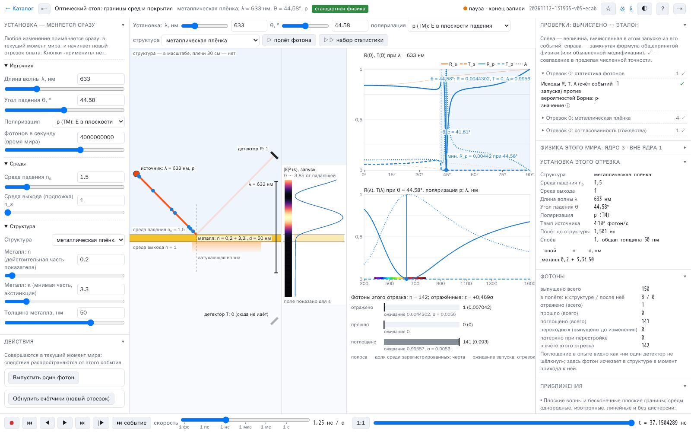</a> | **[u35 · Оптическая скамья](visualizations/u35_optics_bench/README.ru.md)**<br>Тонкие металлические плёнки и плазмонный резонанс по матрицам Абелеса, с полем \|E\|² внутри слоёв.<br>*Оптика*<br>Сценарии: «Металлическая плёнка 30 нм, n = 0,2 + 3,3i (как золото на 633 нм, иллюстративно) на стекле»; «Поверхностный плазмонный резонанс (схема Кречмана): призма 1,5, металл 50 нм (n = 0,2 + 3,3i), воздух, p (иллюстративно)» |
| <a href="docs/images/u38-double.jpg">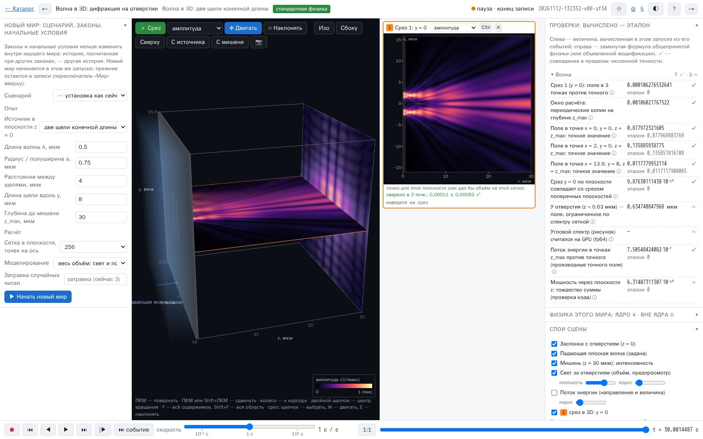</a> | **[u38 · Волна в 3D](visualizations/u38_wave_3d/README.ru.md)**<br>Полное 3D-моделирование в сравнении с выбранным 2D-срезом, рассчитанным по упрощённой модели; точность метода измерена для каждого мира и каждого среза.<br>*Вычислительная оптика*<br>Сценарии: «Две щели: только срезы, y = c по упрощённой 2D-модели (приближение)»; «Квадратное отверстие, сетка 512: только срезы» |

**Основания квантовой механики**

| | |
|---|---|
| <a href="docs/images/r12-narrow.jpg">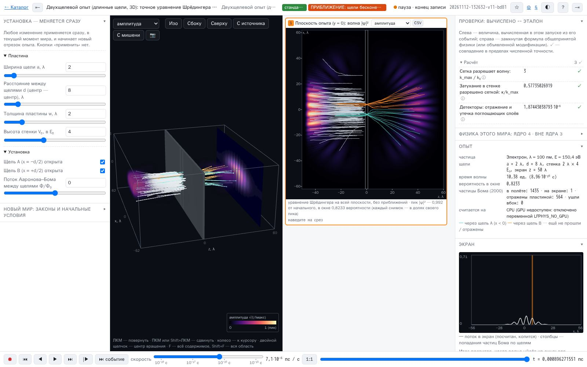</a> | **[r12 · Двухщелевой опыт (длинные щели, 3D)](visualizations/r12_double_slit_2d/README.ru.md)**<br>Где ломается параксиальная теория (узкие щели, большие углы); как метка пути гасит полосы; траектории Бома, помеченные своей щелью.<br>*Основания квантовой механики*<br>Сценарии: «Узкие щели a = 2λ: дифракция на большие углы, параксиальная теория не годится»; «Метка пути: спин в щели B повёрнут на 180° — полосы почти гаснут…»; «Частичная метка: поворот на 90°, видность cos 45°»; «Наблюдатель у щели B: детектор пути (θ = 180°) у атома ⁴He без спина…» |
| <a href="docs/images/r13-near.jpg">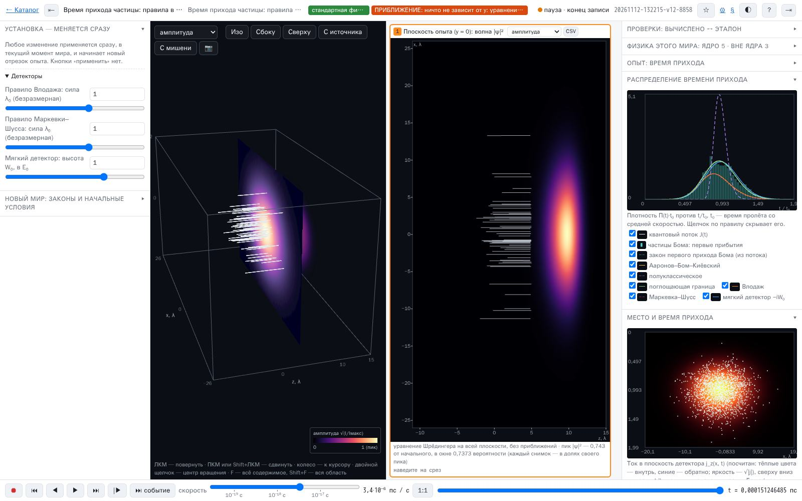</a> | **[r13 · Время прихода частицы: правила в 2D](visualizations/r13_arrival_times_2d/README.ru.md)**<br>Квантовая механика не задаёт время прихода однозначно; запуск считает его по квантовому потоку, первым прибытиям Бома, правилам Ааронова–Бома–Киёвского, полуклассическому, поглощающей границы и по моделям детектора — и показывает, где правила совпадают, а где расходятся.<br>*Основания квантовой механики*<br>Сценарии: «Один пакет: все правила почти совпадают вдали от источника»; «Близко к источнику (σz = 1λ, L = 5λ): правила расходятся»; «Цепочка из 4 пакетов: экспоненциальные правила гасят поздние пики (Das & Struyve 2021)»; «Обратный ток: поток через плоскость местами отрицателен, первые приходы частиц Бома — нет»; «Через две щели: совместное распределение места и времени прихода (Das и др. 2024)» |
| <a href="docs/images/u37-bell.jpg"></a> | **[u37 · Тест Белла](visualizations/u37_bell_test/README.ru.md)**<br>Квантовая механика (S до 2√2) в сравнении с моделями локальных скрытых параметров (\|S\| ≤ 2) на одних и тех же событиях; лазейка локальности, когда выбор сделан слишком рано.<br>*Основания квантовой механики*<br>Сценарии: «Фотоны, локальные скрытые параметры: поляризационная модель (модификация)»; «Синглет спина ½, локальные скрытые параметры: знаковая модель Белла (модификация)»; «Фотоны: выбор за 5 мкс до прихода (cτ > 2L) — лазейка локальности открыта» |
| <a href="docs/images/u33-bohm.jpg">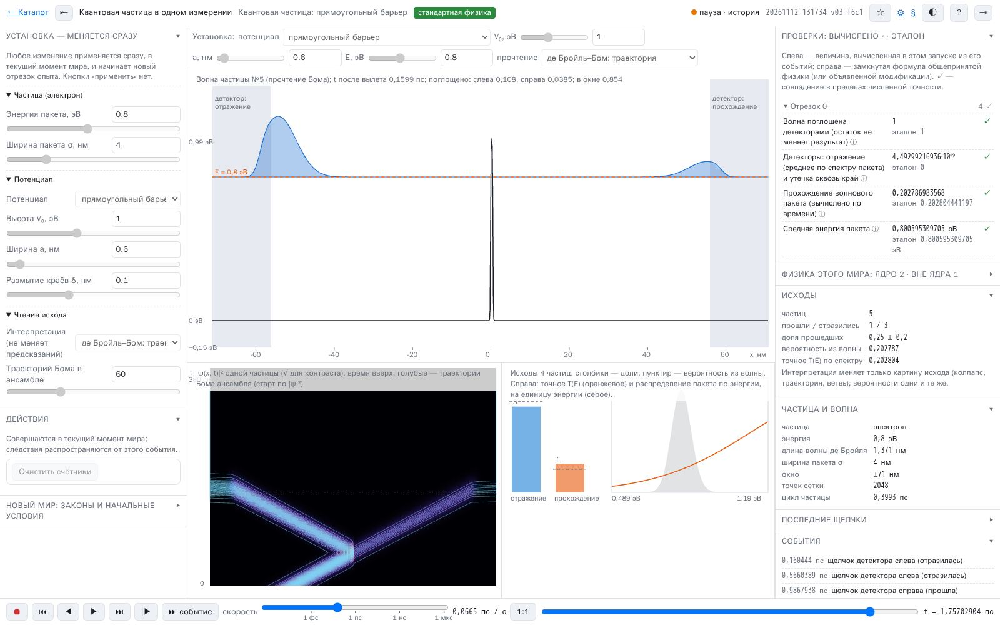</a> | **[u33 · Квантовая частица в одном измерении](visualizations/u33_quantum_1d/README.ru.md)**<br>Один и тот же расчёт в трёх интерпретациях: щелчок и коллапс, траектории Бома, ветви Эверетта; вероятности одни и те же.<br>*Основания квантовой механики · Интерпретации*<br>Сценарии: «То же глазами Бома: траектории»; «То же по Эверетту: ветви» |
| <a href="docs/images/u32-vector.jpg"></a> | **[u32 · Двухщелевой опыт](visualizations/u32_double_slit/README.ru.md)**<br>Изменённые законы как именованные параметры мира: показатель в правиле Борна, усиленный коллапс GRW, принудительный выбор щели.<br>*Основания квантовой механики*<br>Сценарии: «Три щели при P ∝ \|ψ\|^2,4 (модификация)»; «C60 с усиленным коллапсом GRW (модификация)»; «Принудительный выбор щели (модификация)» |
| <a href="docs/images/p02-trap.jpg"></a> | **[p02 · Квантовые частицы](visualizations/p02_quantum/README.ru.md)** (лаборатория)<br>Метки пути, трубки потока Ааронова–Бома, декогеренция от среды, частицы Бома, перебор параметров.<br>*Основания квантовой механики*<br>Сценарии: «Метка пути в верхней щели: полосы почти гаснут (видность 0,94 → 0,18)»; «Ааронов–Бом: трубка магнитного потока h/2e в стенке между щелями сдвигает полосы на полпериода» |

**Атомы, КХД, эталонные задачи молекулярной динамики и течений**

| | |
|---|---|
| <a href="docs/images/u41-1p.jpg"></a> | **[u41 · Кварконий в 3D](visualizations/u41_quarkonium_3d/README.ru.md)** и **[u40 · Атом водорода в 3D](visualizations/u40_hydrogen_3d/README.ru.md)**<br>Что подогнанная модель предсказывает (расщепления) и чего не предсказывает (абсолютные массы); состояния с большим n и водородоподобные ионы.<br>*Физика частиц и атомная физика*<br>Сценарии: u41 «cc̄ 1S + 1P_z: пара качается с частотой перехода (суперпозиция)»; u40 «n = 10, l = 3, m = 1: большое облако, радиальных узлов: 6», «Ион He⁺, 3d_xy: облако меньше в Z раз (Z = 2)» |
| <a href="docs/images/u36-qcd.jpg"></a> | **[u36 · КХД](visualizations/u36_qcd/README.ru.md)**<br>Насколько важны высшие петли и как выглядит мир с другой константой связи.<br>*Физика элементарных частиц*<br>Сценарии: «Только одна петля: насколько важны высшие порядки»; «Что, если α_s(M_Z) = 0,15 (изменённая константа)» *(модификация)* |
| <a href="docs/images/p03-molecules.jpg"></a> | **[p03 · Частицы и молекулы](visualizations/p03_molecules/README.ru.md)** и **[p04 · Жидкости](visualizations/p04_fluids/README.ru.md)** (лаборатории)<br>Опубликованные эталонные задачи прямо в лабораториях: уравнение состояния твёрдых дисков; обтекание цилиндра по постановкам DFG и каверна Ghia.<br>*Статистическая механика · Гидродинамика*<br>Сценарии: p03 «Твёрдые диски: давление в сравнении с уравнением состояния (Колафа и Роттнер)»; p04 «Обтекание цилиндра, Re = 20 (постановка DFG 2D-1…)», «Каверна с подвижной крышкой, Re = 100 (осевые профили в сравнении с таблицами Гиа, Гиа и Шина, 1982)» |

### Лаборатории

В лаборатории сцена не подготовлена заранее: вы собираете её из палитры, меняете в любой момент, а мир считает
последствия в реальном времени. Лаборатории открывает переключатель **Лаборатории** в каталоге; каждый начинается со
сценария или с сохранённого ранее файла сцены.

* **Палитра и объекты**: тела, пакеты, атомы, стенки, препятствия, детекторы и датчики добавляются в текущий момент
  мира; их можно копировать и удалять; инспектор меняет параметры объекта на ходу и показывает его посчитанное
  состояние.
* **Законы на ходу**: то, что движок умеет менять в текущий момент (вязкость, шаг по времени, модель взаимодействия,
  сетку), меняется сразу; остальные законы начинают новый мир, который может забрать с собой сцену и её состояние.
* **Перетаскивание и бросок**: объект перетаскивается мышью; Shift + перетащить — бросок со скоростью руки.
* **Приборы**: каждая измеряемая величина со значением на момент бегунка; отметьте её — появится график по записи;
  выгрузка в CSV.
* **Перебор параметра**: тот же опыт от текущего момента повторяется для списка значений закона или параметра объекта в
  отдельном процессе; результат — таблица, график и CSV.
* **Файл сцены и запись**: сцену можно сохранить в файл и начать из него новый мир; запись держит последние 10 минут
  счёта (не больше 1 ГБ), а после «● Сохранять запись» — всё дальнейшее.
* Законы сохранения проверяются по ходу счёта.

| | |
|---|---|
| <a href="docs/images/p01-inspiral.jpg"></a> | **[p01 · Космос и гравитация](visualizations/p01_gravity/README.ru.md)**<br>Звёзды, планеты, ньютоновские «чёрные дыры» и пробные тела (Ньютон: N тел, слияния); двойная в ОТО с излучением гравитационных волн и детектором; тела, лучи света и наблюдатели с часами у чёрной дыры Керра–Ньюмена.<br>Все сценарии: Солнце и Земля · внутренние планеты и Юпитер · пифагорова задача трёх тел · чёрная дыра и звёзды · тела, лучи и часы у дыры Керра · сближение двойной в ОТО · эксцентрическая двойная в ОТО |
| <a href="docs/images/p02-double-slit.jpg"></a> | **[p02 · Квантовые частицы](visualizations/p02_quantum/README.ru.md)**<br>Волновые пакеты электронов, нейтронов и атомов (со спином) в плоскости или в объёме; барьеры, ямы, стенки со щелями, ловушки, магнитные поля, трубки Ааронова–Бома, детекторы, метки пути, среда; измерение положения; частицы Бома.<br>Все сценарии: двухщелевой опыт · метка пути · Ааронов–Бом · туннелирование · гармоническая ловушка · электрон в поле 100 Тл · рассеяние на шаре в 3D |
| <a href="docs/images/p03-maxwell.jpg"></a> | **[p03 · Частицы и молекулы](visualizations/p03_molecules/README.ru.md)**<br>Газы, кристаллы, атомы и молекулы со связями и углами; зеркальные, мягкие и тепловые стенки, поршень, термостаты, поле, термометры; температура, давление, теплота и работа, распределение Максвелла, g(r).<br>Все сценарии: распределение Максвелла · плавление · газ под поршнем · жидкость и пар · двухатомные молекулы · твёрдые диски |
| <a href="docs/images/p04-karman.jpg"></a> | **[p04 · Жидкости](visualizations/p04_fluids/README.ru.md)**<br>Течение в плоскости решёточным методом Больцмана: цилиндры, прямоугольники, профили NACA, входы и выходы, подвижные стенки, краситель, датчики скорости; сопротивление и подъёмная сила, балансы массы и импульса; вязкость, сетка и размеры области меняются на ходу.<br>Все сценарии: цилиндр Re = 20 (DFG 2D-1) · дорожка Кармана Re = 100 (DFG 2D-2) · каверна с крышкой · канал с пластиной · цилиндр в воде · цилиндр в воздухе · решётка профилей NACA 2412 |

## Что считается и как проверяется

* **Слои.** В ядре движка — только общепринятая физика; приближения, интерпретации, феноменологические модели и
  объявленные альтернативы лежат вне ядра, и каждая говорит, где расходится с ним
  ([`lfphys/LAYERS.md`](lfphys/LAYERS.md)). У каждого модуля есть паспорт (слой, утверждение, область применимости,
  основание, расхождения); панель плеера «Физика этого мира» перечисляет модули, которыми пользуется мир, в ядре и
  вне его.
* **Посчитано, а не нарисовано.** Всё видимое — результат счёта самого запуска; замкнутые формулы известной теории
  появляются только как эталоны в проверках. Следствие появляется, когда до него доходит время мира.
* **Проверки в каждом запуске.** Панель «Проверки: вычислено ↔ эталон» показывает каждую посчитанную в запуске величину
  рядом с её эталоном (✓ или ✗): замкнутой формулой, независимым методом или измеренным значением. Мир с изменённым
  законом помечен в верхней строке плеера плашкой «МОДИФИЦИРОВАННАЯ ФИЗИКА: …», приближение — «ПРИБЛИЖЕНИЕ: …».
* **Тесты.** Около 1600 тестовых функций: каждая функция движка сверяется с замкнутой формулой или вторым методом, для
  ключевых величин — строгие интервальные эталоны (шаровая арифметика Arb); каждая визуализация и сервер.
* **Ревью.** Новую физику проверяет рецензент, который её не писал, и на каждое замечание дан ответ: исправлено,
  отклонено с причиной или отложено в `STATUS.md`. Все 32 обработанных ревью пока внутренние (проведены в рамках
  проекта) и хранятся вместе с ответами в [`reviews/archive/`](reviews/archive/).
* **Сторонние библиотеки — только для сравнения.** 2961 сравнение с CRunDec (rundec), KerrGeoPy, tmm, QuTiP, Astropy и
  miepython: расхождений сверх допуска нет, 19 известных расхождений записаны с числами
  ([`lfphys/tests/external/RESULTS.md`](lfphys/tests/external/RESULTS.md)); разовое сравнение с решателем FDTD Meep
  ([`lfphys/sources/comparison_2026-11-04_meep.md`](lfphys/sources/comparison_2026-11-04_meep.md)).

Это исследовательский инструмент: тесты проверяют заявленные случаи в заявленных пределах, а не любую задачу. Открытые
проблемы собраны в [`STATUS.md`](STATUS.md).

## Охват и планы

Сильнее всего набор в оптике, квантовой физике и теории относительности: там он ведёт от школьных тем до
исследовательских вопросов. Для первой половины школьного курса демонстраций пока нет. Главные пробелы — по их весу в
школьных и вузовских программах — и то, что для них уже есть в движке:

| раздел | сейчас | главные пробелы | что уже есть в движке |
|---|---|---|---|
| механика | орбиты (p01, u34) | кинематика и бросок тела, законы Ньютона с трением, энергия, столкновения, вращение | точные упругие столкновения дисков и шаров (`core.md.hard`), N тел со слияниями (`core.gravity.nbody`); для твёрдых тел нужен новый модуль |
| колебания и волны | дифракция (u32, u38, r12), квантовый осциллятор (u33) | маятник и пружина, затухающие и вынужденные колебания, резонанс; стоячие волны, звук, эффект Доплера | решатель уравнений Максвелла в 2D и 3D (`core.em.fdtd`), ещё не используемый визуализациями |
| электричество и магнетизм | нет | силовые линии и потенциал, конденсаторы, цепи постоянного и переменного тока, поля токов, индукция | поля и излучение движущихся точечных зарядов (`core.em.charges`, ещё не используется); лаборатория запланирована (`lfphys/PLAN.md`, P15.5); для цепей нужен новый решатель |
| оптика | u32, u35, u38, u43, u44 | линзы, зеркала и построение изображений, призмы, решётки, поляризация | закон Снеллиуса и лучевые матрицы (`theories.approx.ray_optics`); лаборатория запланирована (P15.2) |
| тепловые явления | p03 | отдельные сценарии газовых законов и тепловой машины с P–V-диаграммой | поршень, термостаты, счётчики теплоты и работы и свипы p03 |
| теория относительности | u31, u34, r11, u39, u42, p01 | замедление времени и парадокс близнецов, диаграммы пространства-времени, релятивистские столкновения | `core.relativity`, `core.worldlines`, `core.lorentz`; лаборатория запланирована (P15.6) |
| квантовая и атомная физика | u32, u33, u37, r12, r13, u40, p02 | фотоэффект, эффект Комптона, спектр чёрного тела, линейчатые спектры, опыт Штерна–Герлаха, осцилляции Раби | эффект Комптона (`core.quantum.compton`) и двухуровневый атом (`core.quantum.two_level`) — оба ещё не используются; закон Планка, уровни водорода и дипольные матричные элементы |
| ядерная физика | нет | распад и период полураспада, энергия связи, деление и синтез | нет |
| астрофизика и космология | u31, u42, p01 | закон Хаббла и история расширения | фон FLRW с параметрами Planck 2018 (`core.cosmology.flrw`), ещё не используется |

Даже там, где модуль есть, демонстрацию ещё нужно придумать, собрать, проверить и отдать на ревью; порядок работ решает
автор. Планы — [`lfphys/PLAN.md`](lfphys/PLAN.md), открытые вопросы — [`STATUS.md`](STATUS.md).

## Документация

* [`visualizations/README.ru.md`](visualizations/README.ru.md) — руководство по серверу и плееру: все миры, сценарии и
  управление.
* README каждого мира — модель, проверки, приближения и тесты: u31–u44 и p01–p04, ссылки в таблицах выше.
* Документы для разработчиков (на английском):
  * [`visualizations/RULES.md`](visualizations/RULES.md) — правила для всех визуализаций (физика, причинность,
    изменённые законы, 3D-среда, лаборатории, языки интерфейса) и API сервера;
  * [`lfphys/README.md`](lfphys/README.md) — каталог модулей движка, CPU и GPU, строгие эталоны;
    [`lfphys/LAYERS.md`](lfphys/LAYERS.md) — слои; [`lfphys/PLAN.md`](lfphys/PLAN.md) — план разработки;
  * [`STATUS.md`](STATUS.md) — открытые проблемы и планы; [`reviews/`](reviews/README.md) — ревью и ответы на них;
    [`AGENTS.md`](AGENTS.md) — правила работы в репозитории; [`LANGUAGES.md`](LANGUAGES.md) — языки проекта.

## Лицензия и цитирование

Исходный код lfphys **открыт для чтения, но это не open source**. Код распространяется по
[lfphys Research Licence 1.0](LICENSE.md): некоммерческие исследования, учёба и преподавание — свободно; любое
коммерческое использование, кем бы оно ни велось, — только по отдельному письменному соглашению
([`COMMERCIAL.md`](COMMERCIAL.md)). Документация и рисунки автора — по CC BY-NC-SA 4.0
([`LICENSE-DOCS.txt`](LICENSE-DOCS.txt)) с дополнительными разрешениями для научных публикаций
([`PUBLICATIONS.md`](PUBLICATIONS.md)). Ваши результаты принадлежат вам; если в публикации есть результаты, полученные в
основном с помощью lfphys, на него нужно сослаться с версией, как в [`CITATION.cff`](CITATION.cff) (версию плеер
показывает на странице «Лицензия»). Сторонние компоненты — под своими лицензиями ([`NOTICE`](NOTICE)). Участие —
[`CONTRIBUTING.md`](CONTRIBUTING.md) и [`CLA.md`](CLA.md). Без гарантий: [`LICENSE.md`](LICENSE.md), §8.

Вопросы и коммерческое использование: [idrisov.sci@gmail.com](mailto:idrisov.sci@gmail.com).

Copyright (c) 2026 Ildar Idrisov.
