# lfphys

[English](README.md) | **Русский**

[](https://ildar-idrisov.github.io/lfphys/?lang=ru)
[](#лицензия-и-цитирование)

**Физика, которая считается у вас на глазах.** lfphys — физический движок и интерактивные визуализации на нём.
Здесь нет анимаций: картина двух щелей набирается частица за частицей, орбита поворачивается, радуга складывается,
потому что движок решил уравнения именно этого запуска. Рядом с каждым результатом запуск показывает свои проверки по
независимым эталонам: точным решениям, опубликованным таблицам, второму численному методу. Видно, насколько можно
доверять каждому числу.

**[▶ Открыть демонстрации](https://ildar-idrisov.github.io/lfphys/?lang=ru)**: записи настоящих запусков в браузере,
на русском и английском, ничего не нужно устанавливать. Чтобы считать вживую и менять всё, запустите lfphys на своём
компьютере ([быстрый старт](#быстрый-старт)).

**Почему по этому можно учить и исследовать**
* **В ядре только общепринятая физика.** Каждая функция ядра движка проверена точным решением или вторым, независимым
  методом; при каждом изменении проходят более 3000 автоматических тестов.
* **Ничего не скрыто.** Приближения и миры «что если» с изменённым законом всегда помечены — и в интерфейсе, и в
  документации.
* **Каждый запуск проверяет себя.** Рассчитанное значение ↔ эталон, с допуском, прямо на экране.
* **Воспроизводимость.** Каждый запуск и каждая запись называют свою версию и код, так что результат можно
  процитировать и повторить.
* **Для каждого уровня.** Материалы для школьников по программе (готовятся), демонстрации из университетских курсов,
  ещё не изученные исследовательские постановки и свободные лаборатории, где опыт собираете вы.

Движок (пакет Python) держит раздельно три вида физики: **ядро** — только общепринятая физика, каждая функция проверена
аналитическим решением или вторым, независимым методом; **приближения, интерпретации и феноменологические модели**,
которыми физики широко пользуются, — каждая говорит, где расходится с ядром; **объявленные альтернативы** для миров «что
если». Визуализации открываются в браузере. В наборе 17 готовых **демонстраций** — от опыта Юнга и радуги до тени
вращающейся чёрной дыры — и 4 **лаборатории**, где сцену собираете вы, а мир рассчитывает её вживую.

> Плеер говорит по-английски (по умолчанию) и по-русски: переключатель **EN | RU** в верхней строке каждой страницы
> меняет язык интерфейса, справки, названий сценариев и всех сообщений запуска. README каждой визуализации (ссылки в
> таблицах ниже) и руководство по серверу и плееру
> ([`visualizations/README.ru.md`](visualizations/README.ru.md)) есть на обоих языках.

<a href="docs/images/u42-m87.jpg"></a>
<a href="docs/images/u44-rainbow.jpg">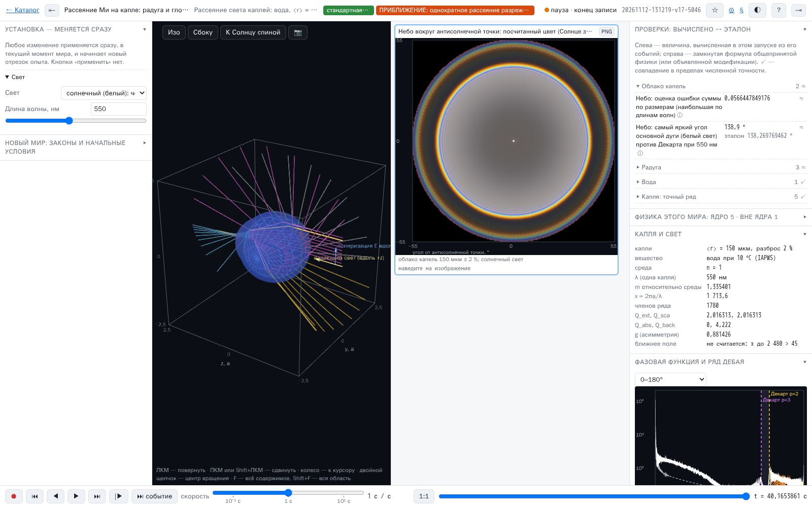</a>

## Содержание

* [Быстрый старт](#быстрый-старт)
* [Демонстрации по аудиториям](#демонстрации-по-аудиториям): [Школа](#школа) · [Университет](#университет) · [Исследования](#исследования) · [Лаборатории](#лаборатории)
* [Что считается и как проверяется](#что-считается-и-как-проверяется)
* [Охват и планы](#охват-и-планы)
* [Документация](#документация)
* [Лицензия и цитирование](#лицензия-и-цитирование)

## Быстрый старт

```bash
git clone https://github.com/ildar-idrisov/lfphys.git
cd lfphys

# с видеокартой NVIDIA и NVIDIA Container Toolkit
docker compose -f visualizations/docker/docker-compose.yml up -d --build viz

# без видеокарты
docker compose -f visualizations/docker/docker-compose.yml --profile cpu up -d --build viz-cpu
```

Откройте <http://localhost:8479>. Начальная страница предлагает четыре аудитории: **Школа**, **Университет**,
**Исследования** и **Лаборатории**. Откройте одну, выберите сценарий в карточке демонстрации и нажмите
**▶ Рассчитать вживую**: откроется плеер, и мир будет считаться у вас на глазах; **⏺** считает его дальше, бегунок внизу
возвращает к любому моменту истории. Если у сценария есть сохранённая запись, **▷ Запись** сразу проигрывает её, ничего
не вычисляя. Лаборатория начинается кнопкой **▶ Начать**. Ваши запуски собраны на странице **Мои запуски** в верхней
строке.

| что нужно | |
|---|---|
| Docker | Docker Engine с плагином Compose v2 (`docker compose`) |
| диск | около 3,3 ГБ на образ; большую часть занимают библиотеки CUDA от NVIDIA из PyPI, нужные только для видеокарты. Записи запусков лежат в `visualizations/runs/`, квота — 5 ГБ; запуск, который не открывали 3 дня, удаляется, если не отмечен ☆ (срок задаётся на странице **Мои запуски**) |
| память | контейнеру сервера отведено не больше 6 ГБ, каждому идущему миру — не больше 60 % от этого. Лучше, чтобы на машине было от 8 ГБ памяти |
| процессор | каждый запуск считается в своём процессе в 2 потока; одновременно считают не больше трёх запусков |
| видеокарта (не обязательна) | NVIDIA с драйвером для CUDA 12 (версии 525 или новее) и [NVIDIA Container Toolkit](https://docs.nvidia.com/datacenter/cloud-native/container-toolkit/latest/install-guide.html); сервер берёт одну карту — устройство 0 |

**С видеокартой и без.** Код и проверки в обоих случаях одни и те же, отличается только скорость. С видеокартой на неё
уходят тяжёлые ядра там, где это измеримо быстрее: распространение волны методом углового спектра, трассировщики лучей
u39 и u42, решатель уравнения Шрёдингера в 2D и 3D, решёточный метод Больцмана, парные силы молекулярной динамики,
решатель FDTD (например, ×26–29 для уравнения Шрёдингера на сетках 1024²–2048² и ×8–155 для течений —
`lfphys/README.md`, раздел «CPU and GPU»). Проверки всегда считаются в двойной точности. Без видеокарты большинство миров
всё равно идёт со своей скоростью по умолчанию. Заметнее всего разница в течениях p04: в сценарии с дорожкой Кармана
шаг занял 13 мс на 8-ядерном настольном процессоре и 0,19 мс на RTX 2080 Ti, так что без видеокарты дорожка
складывается примерно в 30 раз медленнее заданной скорости. Точный двухщелевой опыт r12 на любом устройстве считает
медленнее своей скорости по умолчанию, и картина складывается за несколько минут. Страница **⚙ Устройства**
(`/settings`) показывает, что где считается, и позволяет выбрать устройство и точность для каждого ядра.

**Настройки.** Не обязательны: свежий клон работает и без них. Скопируйте шаблон и поправьте его:

```bash
cp visualizations/docker/.env.example visualizations/docker/.env
```

* `UID`, `GID` — владелец клона (`id -u`, `id -g`), если это не 1000:1000: от его имени сервер пишет записи запусков в
  `visualizations/runs/`.
* `VIZ_PORT` — другой порт (по умолчанию 8479). `VIZ_PORT=127.0.0.1:8479` оставляет сервер доступным только с этой
  машины.
* `VIZ_CPUS` — ограничение процессора для контейнера (0 — без ограничения, по умолчанию).
* `LFPHYS_GPU_PCI` — на машине с несколькими видеокартами вставьте адрес шины карты 0 из
  `nvidia-smi --query-gpu=pci.bus_id --format=csv`: тогда движок откажется от любого другого устройства.

Сервер слушает все адреса машины, так что с других компьютеров локальной сети он открывается по
`http://<адрес этой машины>:8479`. Входа по паролю нет: кто дотянулся до порта, тот может запускать миры. Держите
сервер в доверенной сети или привяжите его к `127.0.0.1`, как выше.

**Остановить и запустить снова.**

```bash
docker compose -f visualizations/docker/docker-compose.yml stop viz         # или: stop viz-cpu
docker compose -f visualizations/docker/docker-compose.yml start viz        # или: start viz-cpu
docker compose -f visualizations/docker/docker-compose.yml --profile cpu down   # удалить контейнер
```

При остановке сервер приостанавливает запуски, и каждый мир сохраняет своё состояние; приостановленный запуск
продолжается с него, когда вы откроете его и нажмёте ⏺. После `down` записи остаются в `visualizations/runs/`. Пока вы
сами не остановили сервер, Docker поднимает его снова (в том числе после перезагрузки).

**Тесты и движок как библиотека.**

```bash
docker compose -f visualizations/docker/docker-compose.yml run --rm viz-test   # визуализации и сервер
docker run --rm --user "$(id -u):$(id -g)" -v "$PWD":/lf -w /lf/lfphys lfphys-viz \
    python3 -m pytest -q -p no:cacheprovider                                  # движок
docker run --rm --user "$(id -u):$(id -g)" -v "$PWD":/lf -e PYTHONPATH=/lf/lfphys lfphys-viz \
    python3 -c "from lfphys import registry; print(len(registry.catalogue()), 'modules')"
```

Исследовательский проект подключает движок как внешнюю библиотеку: `import lfphys`, а в `PYTHONPATH` — папка `lfphys/`
этого репозитория.

**Записи и публичный сайт.** Запись — это однажды сохранённый запуск сценария демонстрации: она проигрывается вперёд и
назад без вычислений. Сделать записи на своей машине (на процессоре; большинство миров — от секунд до двух минут,
точный двухщелевой опыт r12 — около 20 минут):

```bash
docker run --rm --memory=12g -e LFPHYS_NO_GPU=1 --user "$(id -u):$(id -g)" -v "$PWD":/lf -w /lf/visualizations \
    lfphys-viz python3 site/record.py --stale
```

Сервер отдаёт папку `visualizations/recordings/` (её нет в git): в карточке появляется **▷ Запись**, а
`http://localhost:8479/run?rec=<мир>/<запись>` открывает запись напрямую. `--stale` записывает только недостающее или
сделанное другим кодом. Когда публичный сайт опубликован, сервер без локальной копии проигрывает запись с него, но
только сделанную той же версией мира. Публичный сайт (GitHub Pages, `https://ildar-idrisov.github.io/lfphys/`) — тот же
плеер с этими записями, без вычислений: его собирает `visualizations/site/build.py`, а в сеть он выходит только тогда,
когда его опубликует автор. До этого каталог ниже называет записи каждого мира без ссылок, и они проигрываются на
локальном сервере; при публикации в `visualizations/site/site.json` ставится `"published": true`, и `site/readme.py`
добавляет ссылки «Смотреть на сайте». Подробности (на английском):
[`visualizations/site/README.md`](visualizations/site/README.md).

## Демонстрации по аудиториям

Каждый мир относится ровно к одной аудитории (`AGENTS.md`, §3, правило 14). В карточке — снимок записанного запуска,
название визуализации (ссылка на её README с моделью, проверками и приближениями), что вы увидите, привязки
(университетские курсы; для исследований — изучаемый вопрос, помеченный как гипотеза, пока результат не воспроизведён, и
предшествующие работы), её записи (со ссылками на публичный сайт, когда он опубликован), число сценариев и та же тема на других уровнях. У каждой
аудитории указано и то, что для неё запланировано: школьный курс — по разделам, университетские и исследовательские
пункты — в свёрнутом списке под мирами. Локальный сервер считает любой сценарий вживую. Запись с пометкой
*(модифицированная физика)* показывает мир с намеренно изменённым законом; плеер помечает такой мир плашкой
**МОДИФИЦИРОВАННАЯ ФИЗИКА: …** в верхней строке. Раздел ниже собирается из реестра скриптом
`visualizations/site/readme.py`; правьте `VIZ` миров, а не этот текст.

<!-- BEGIN generated: catalogue (visualizations/site/readme.py); do not edit -->

### Школа

7–11 классы: обычный лабораторный опыт, рассчитанный движком, шаг за шагом.

**Готово: 0 из 45**

*Запланированные демонстрации по разделам:*

**Механика** · 12

* S01 · Прямолинейное движение: равномерное и равноускоренное (7, 9, 10 кл.) · *следующая в плане*
* S02 · Свободное падение и опыты Галилея (9, 10 кл.) · *следующая в плане*
* S03 · Движение тела, брошенного горизонтально и под углом (7, 10 кл.) · *следующая в плане*
* S04 · Движение по окружности (9, 10 кл.)
* S05 · Законы Ньютона (9, 10 кл.)
* S06 · Сила упругости, закон Гука, вес и невесомость (7, 9, 10 кл.)
* S07 · Сила трения; брусок на наклонной плоскости (7, 9, 10 кл.)
* S08 · Рычаг, блоки, наклонная плоскость; момент силы (7, 9, 10 кл.)
* S09 · Работа, кинетическая и потенциальная энергия, закон сохранения (7, 9, 10 кл.) · *следующая в плане*
* S10 · Импульс, столкновения, реактивное движение (9, 10 кл.)
* S11 · Всемирное тяготение, спутники, первая космическая скорость (9, 10 кл.). Уже есть на другом уровне: [u34 · Орбиты и часы: ОТО и Ньютон](visualizations/u34_orbits/README.ru.md) (Университет); [p01 · Космос и гравитация](visualizations/p01_gravity/README.ru.md) (Лаборатории)
* S12 · Маятник и груз на пружине; затухание, вынужденные колебания, резонанс (9, 11 кл.)

**Жидкости и газы** · 2

* S15 · Давление в жидкости и газе: закон Паскаля, сообщающиеся сосуды, гидравлический пресс, атмосферное давление (7 кл.)
* S16 · Закон Архимеда; плавание тел (7 кл.)

**Колебания и волны** · 2

* S13 · Механические волны: шнур и волновая ванна (9, 11 кл.)
* S14 · Звук: высота, громкость, резонанс, эффект Доплера (9, 11 кл.)

**Тепловые явления и молекулярная физика** · 5

* S17 · Броуновское движение и диффузия (7, 8, 10 кл.)
* S18 · Теплопередача, количество теплоты, уравнение теплового баланса (8, 10 кл.)
* S19 · Плавление, кипение, испарение, влажность (8, 10 кл.)
* S20 · Газовые законы: изотерма, изобара, изохора (8, 10 кл.)
* S21 · Первый закон термодинамики и тепловые машины (8, 10 кл.)

**Электричество и магнетизм** · 12

* S22 · Электрические заряды и поле (8, 10 кл.)
* S23 · Конденсатор (10 кл.)
* S24 · Сила тока, напряжение, закон Ома, сопротивление проводника (8, 10 кл.)
* S25 · Последовательное, параллельное и смешанное соединение (8, 10 кл.)
* S26 · Работа и мощность тока, закон Джоуля–Ленца, лампа, нагреватель (8, 10 кл.)
* S27 · ЭДС и внутреннее сопротивление; закон Ома для полной цепи (10 кл.)
* S28 · Ток в различных средах: металлы, полупроводниковый диод, электролит (8, 10 кл.)
* S29 · Магнитное поле магнитов и токов; опыт Эрстеда; электромагнит (8, 11 кл.)
* S30 · Сила Ампера, электродвигатель, сила Лоренца (8, 11 кл.)
* S31 · Электромагнитная индукция; правило Ленца; генератор (8, 11 кл.)
* S32 · Колебательный контур, переменный ток, резонанс, трансформатор (11 кл.)
* S33 · Электромагнитные волны: излучение, отражение, поляризация, шкала волн (9, 11 кл.)

**Оптика** · 5

* S34 · Отражение света; плоское и сферические зеркала (9, 11 кл.)
* S35 · Преломление света, полное внутреннее отражение, световод (9, 11 кл.). Уже есть на другом уровне: [u35 · Оптическая скамья: границы сред и покрытия](visualizations/u35_optics_bench/README.ru.md) (Университет)
* S36 · Линзы, построение изображений, оптические приборы, глаз (9, 11 кл.)
* S37 · Дисперсия света, спектр, цвет; радуга (9, 11 кл.). Уже есть на другом уровне: [u44 · Рассеяние Ми на капле: радуга и глория](visualizations/u44_mie_scattering/README.ru.md) (Университет)
* S38 · Интерференция и дифракция света; дифракционная решётка; поляризация (9, 11 кл.). Уже есть на другом уровне: [u32 · Двухщелевой опыт](visualizations/u32_double_slit/README.ru.md) (Университет); [u38 · Волна в 3D: дифракция на отверстии](visualizations/u38_wave_3d/README.ru.md) (Университет); [r12 · Двухщелевой опыт (длинные щели, 3D): точное уравнение Шрёдингера и траектории Бома](visualizations/r12_double_slit_2d/README.ru.md) (Исследования)

**Теория относительности** · 1

* S39 · Основы СТО: относительность одновременности, замедление времени, сокращение длины, E = mc² (11 кл.). Уже есть на другом уровне: [u31 · Свет на больших расстояниях](visualizations/u31_light_travel/README.ru.md) (Университет); [u39 · Что видит быстрый наблюдатель](visualizations/u39_fast_observer/README.ru.md) (Университет)

**Квантовая физика** · 1

* S40 · Фотоэффект: опыты Столетова, законы, уравнение Эйнштейна (11 кл.)

**Атомная физика** · 2

* S41 · Опыт Резерфорда и модель атома (9, 11 кл.)
* S42 · Линейчатые спектры, уровни энергии, постулаты Бора (9, 11 кл.). Уже есть на другом уровне: [u40 · Атом водорода в 3D: орбитали](visualizations/u40_hydrogen_3d/README.ru.md) (Университет)

**Ядерная физика** · 2

* S43 · Радиоактивность: α, β, γ, период полураспада, фон (9, 11 кл.)
* S44 · Ядерные реакции, энергия связи, деление и синтез (9, 11 кл.)

**Астрофизика и космология** · 1

* S45 · Расширение Вселенной: закон Хаббла (11 кл.)

### Университет

Опыты университетских курсов, рассчитанные из законов.

**Оптика** · 4

| | |
|---|---|
| <a href="docs/images/u35_optics_bench.jpg"></a> | **[u35 · Оптическая скамья: границы сред и покрытия](visualizations/u35_optics_bench/README.ru.md)**<br>Фотоны по одному падают на границу и делятся в тех долях, которые дают уравнения Максвелла.<br>*Курсы:* Хехт. Оптика, гл. 4, 9; Сивухин. Общий курс физики, т. IV: Оптика, гл. V<br>▷ Смотреть на сайте: [Полное внутреннее отражение: стекло 1,5 → воздух, θ = 60° больше критического угла](https://ildar-idrisov.github.io/lfphys/run.html?rec=u35_optics_bench/tir&lang=ru) · [Стекло n = 1,5 в воздухе под углом Брюстера (неполяризованный свет: отражаются только s)](https://ildar-idrisov.github.io/lfphys/run.html?rec=u35_optics_bench/brewster&lang=ru) · [Поверхностный плазмонный резонанс (схема Кречмана): призма 1,5, металл 50 нм (n = 0,2 + 3,3i), воздух, p (иллюстративно)](https://ildar-idrisov.github.io/lfphys/run.html?rec=u35_optics_bench/spr&lang=ru)<br>Сценариев в плеере: 9<br>Та же тема на других уровнях: S35 · Преломление света, полное внутреннее отражение, световод (Школа, в планах) |
| <a href="docs/images/u38_wave_3d.jpg">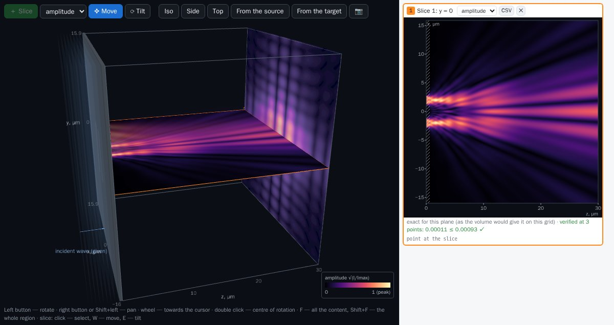</a> | **[u38 · Волна в 3D: дифракция на отверстии](visualizations/u38_wave_3d/README.ru.md)**<br>Свет проходит через две щели конечной длины: поле за ними в 3D, срезы под любым углом, поток энергии.<br>*Курсы:* Холлидей, Резник, Уокер. Основы физики, гл. 36; Хехт. Оптика, гл. 10<br>▷ Смотреть на сайте: [Две щели конечной длины: весь объём](https://ildar-idrisov.github.io/lfphys/run.html?rec=u38_wave_3d/double&lang=ru)<br>Сценариев в плеере: 5<br>Та же тема на других уровнях: S38 · Интерференция и дифракция света; дифракционная решётка; поляризация (Школа, в планах) |
| <a href="docs/images/u43_optical_vortices.jpg">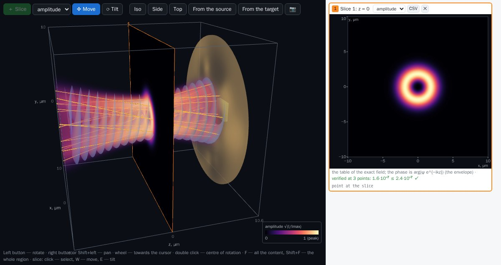</a> | **[u43 · Оптические вихри: пучки Лагерра–Гаусса, орбитальный момент импульса, вращательный эффект Доплера](visualizations/u43_optical_vortices/README.ru.md)**<br>Свет со спиральными фронтами: закрученный поток энергии, угловой момент на фотон и биения от вращающегося диска.<br>*Курсы:* Аллен, Бейерсберген, Спреу, Вурдман, Phys. Rev. A 45, 8185 (1992); Хехт. Оптика<br>▷ Смотреть на сайте: [LG₀³, σ = +1: три винтовых фронта, точная модель, вращающийся диск](https://ildar-idrisov.github.io/lfphys/run.html?rec=u43_optical_vortices/lg3&lang=ru) · [Острая фокусировка: l = 1, σ = −1, w0 = 0,6 λ — продольное поле и спин-орбитальное расщепление](https://ildar-idrisov.github.io/lfphys/run.html?rec=u43_optical_vortices/tight&lang=ru) · [Призма Дове вращается: сдвиг частоты 2\|l\|f у пучка l = 2](https://ildar-idrisov.github.io/lfphys/run.html?rec=u43_optical_vortices/dove&lang=ru)<br>Сценариев в плеере: 9 |
| <a href="docs/images/u44_mie_scattering.jpg">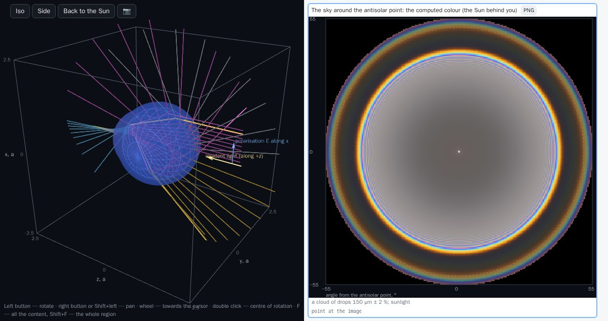</a> | **[u44 · Рассеяние Ми на капле: радуга и глория](visualizations/u44_mie_scattering/README.ru.md)**<br>Солнечный свет на каплях воды: радуга, её дополнительные дуги и глория из точного ряда Ми.<br>*Курсы:* Борен, Хафмен. Поглощение и рассеяние света малыми частицами; Хехт. Оптика<br>▷ Смотреть на сайте: [Радуга: капли радиусом 0,15 мм ± 2 % в солнечном свете — первичная и вторичная дуги, полоса Александра, дополнительные дуги](https://ildar-idrisov.github.io/lfphys/run.html?rec=u44_mie_scattering/rainbow&lang=ru) · [Дополнительные дуги: почти одинаковые капли радиусом 0,1 мм ± 0,5 %](https://ildar-idrisov.github.io/lfphys/run.html?rec=u44_mie_scattering/supernumerary&lang=ru) · [Глория: облачные капли радиусом 8 мкм ± 10 % — цветные кольца у антисолнечной точки](https://ildar-idrisov.github.io/lfphys/run.html?rec=u44_mie_scattering/glory&lang=ru)<br>Сценариев в плеере: 7<br>Та же тема на других уровнях: S37 · Дисперсия света, спектр, цвет; радуга (Школа, в планах) |

**Теория относительности** · 3

| | |
|---|---|
| <a href="docs/images/u31_light_travel.jpg">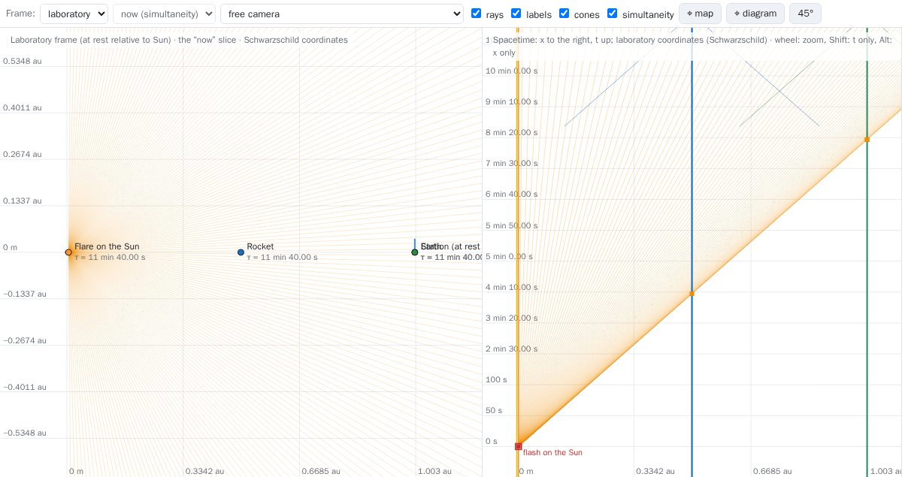</a> | **[u31 · Свет на больших расстояниях](visualizations/u31_light_travel/README.ru.md)**<br>Свет уходит от Солнца и примерно через 8 минут доходит до Земли; световые конусы, отклонение света, одновременность.<br>*Курсы:* Тейлор, Уилер. Физика пространства-времени; Хартл. Гравитация: введение в общую теорию относительности Эйнштейна; Холлидей, Резник, Уокер. Основы физики, гл. 37; Сивухин. Общий курс физики, т. IV: Оптика, гл. IX<br>▷ Смотреть на сайте: [Солнце → Земля (стандартная физика)](https://ildar-idrisov.github.io/lfphys/run.html?rec=u31_light_travel/sun_earth&lang=ru) · [Измерение c: покой, по ходу света, навстречу (СТО)](https://ildar-idrisov.github.io/lfphys/run.html?rec=u31_light_travel/measure_c&lang=ru) *(модифицированная физика)* · [Чёрная дыра 10 M☉: отклонение, тень, два изображения](https://ildar-idrisov.github.io/lfphys/run.html?rec=u31_light_travel/lensing&lang=ru)<br>Сценариев в плеере: 10<br>Та же тема на других уровнях: S39 · Основы СТО: относительность одновременности, замедление времени, сокращение длины, E = mc² (Школа, в планах) |
| <a href="docs/images/u34_orbits.jpg">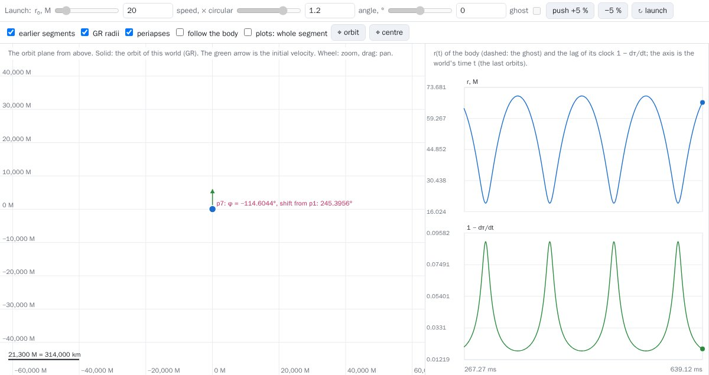</a> | **[u34 · Орбиты и часы: ОТО и Ньютон](visualizations/u34_orbits/README.ru.md)**<br>Орбита у чёрной дыры превращается в розетку, а часы тела идут медленнее часов далёкого наблюдателя.<br>*Курсы:* Хартл. Гравитация: введение в общую теорию относительности Эйнштейна, гл. 9, 10; Тейлор, Уилер, Бертшингер. Исследуя чёрные дыры<br>▷ Смотреть на сайте: [Чёрная дыра 10 M☉: розетка (перицентр 20M)](https://ildar-idrisov.github.io/lfphys/run.html?rec=u34_orbits/rosette&lang=ru) · [Меркурий у Солнца (слабое поле, 43″ за век)](https://ildar-idrisov.github.io/lfphys/run.html?rec=u34_orbits/mercury&lang=ru) · [Падение внутри ISCO (5,5M, скорость −0,5 %)](https://ildar-idrisov.github.io/lfphys/run.html?rec=u34_orbits/plunge&lang=ru)<br>Сценариев в плеере: 7<br>Та же тема на других уровнях: S11 · Всемирное тяготение, спутники, первая космическая скорость (Школа, в планах); [p01 · Космос и гравитация](visualizations/p01_gravity/README.ru.md) (Лаборатории) |
| <a href="docs/images/u39_fast_observer.jpg"></a> | **[u39 · Что видит быстрый наблюдатель](visualizations/u39_fast_observer/README.ru.md)**<br>Шар, пролетающий со скоростью 0,9 c, по-прежнему выглядит круглым: куб поворачивается, цвета смещаются, картина сгущается вперёд.<br>*Курсы:* Террелл (1959) и Пенроуз (1959): невидимость лоренцева сокращения; Фейнмановские лекции по физике, т. I, гл. 34<br>▷ Смотреть на сайте: [Пролёт куба и шара при β = 0,9: поворот Террелла, шар остаётся кругом](https://ildar-idrisov.github.io/lfphys/run.html?rec=u39_fast_observer/terrell&lang=ru) · [Полёт по улице при β = 0,9: аберрация, синий цвет впереди, яркость](https://ildar-idrisov.github.io/lfphys/run.html?rec=u39_fast_observer/city&lang=ru)<br>Сценариев в плеере: 7<br>Та же тема на других уровнях: S39 · Основы СТО: относительность одновременности, замедление времени, сокращение длины, E = mc² (Школа, в планах) |

**Квантовая физика** · 3

| | |
|---|---|
| <a href="docs/images/u32_double_slit.jpg"></a> | **[u32 · Двухщелевой опыт](visualizations/u32_double_slit/README.ru.md)**<br>Частицы попадают на экран по одной; полосы набираются попадание за попаданием и исчезают при метке пути.<br>*Курсы:* Фейнмановские лекции по физике, т. III, гл. 1; Гриффитс, Шретер. Введение в квантовую механику; Холлидей, Резник, Уокер. Основы физики, гл. 35, 38; Хехт. Оптика, гл. 9<br>▷ Смотреть на сайте: [Фотоны 633 нм, две щели (Юнг, по одному фотону)](https://ildar-idrisov.github.io/lfphys/run.html?rec=u32_double_slit/young&lang=ru) · [Квантовый ластик: метки H/V + анализатор 45°](https://ildar-idrisov.github.io/lfphys/run.html?rec=u32_double_slit/eraser&lang=ru) · [Электроны: эффект Ааронова–Бома (поток ½ h/e)](https://ildar-idrisov.github.io/lfphys/run.html?rec=u32_double_slit/aharonov_bohm&lang=ru)<br>Сценариев в плеере: 19<br>Та же тема на других уровнях: S38 · Интерференция и дифракция света; дифракционная решётка; поляризация (Школа, в планах); [r12 · Двухщелевой опыт (длинные щели, 3D): точное уравнение Шрёдингера и траектории Бома](visualizations/r12_double_slit_2d/README.ru.md) (Исследования); R01 · Зависящий от времени поток Ааронова–Бома в реальной двойной щели (Исследования, в планах); R02 · Отложенная метка пути и её стирание для массивных частиц в пространственной двойной щели (Исследования, в планах); R05 · Импульсный скалярный (электрический) эффект Ааронова–Бома: расчёты для проекта эксперимента (Исследования, в планах); R08 · Частичная метка пути и пересечение бомовских траекторий (Исследования, в планах); R09 · Щель, модулированная во времени (Исследования, в планах) |
| <a href="docs/images/u33_quantum_1d.jpg">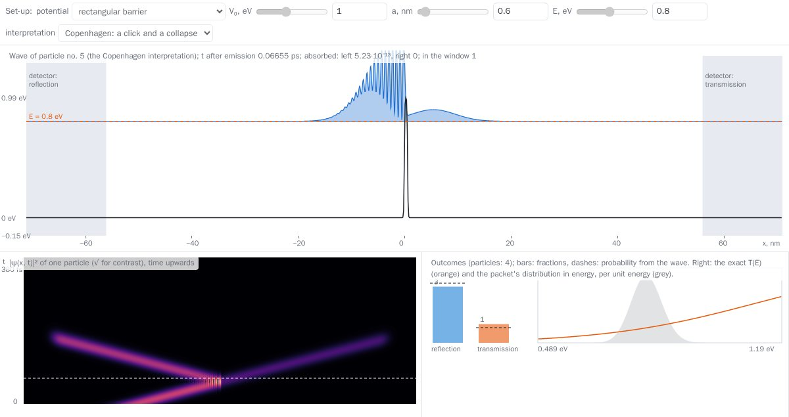</a> | **[u33 · Квантовая частица в одном измерении](visualizations/u33_quantum_1d/README.ru.md)**<br>Волна электрона встречает барьер: часть проходит сквозь него, а отдельные срабатывания детекторов следуют рассчитанным вероятностям.<br>*Курсы:* Гриффитс, Шретер. Введение в квантовую механику, гл. 2; Холлидей, Резник, Уокер. Основы физики, гл. 39; Янг, Фридман. Университетская физика, гл. 40<br>▷ Смотреть на сайте: [Туннелирование электрона через барьер 1 эВ × 0,6 нм](https://ildar-idrisov.github.io/lfphys/run.html?rec=u33_quantum_1d/tunnel&lang=ru) · [То же глазами Бома: траектории](https://ildar-idrisov.github.io/lfphys/run.html?rec=u33_quantum_1d/bohm&lang=ru)<br>Сценариев в плеере: 9 |
| <a href="docs/images/u37_bell_test.jpg"></a> | **[u37 · Тест Белла: запутанные пары](visualizations/u37_bell_test/README.ru.md)**<br>Запутанные пары приходят на две удалённые станции; параметр CHSH превышает 2 — предел любой локальной теории.<br>*Курсы:* Сакураи, Наполитано. Современная квантовая механика, гл. 3; Гриффитс, Шретер. Введение в квантовую механику, гл. 12; Белл. Говоримое и неговоримое в квантовой механике<br>▷ Смотреть на сайте: [Фотоны \|Φ+⟩, квантовая механика: оптимальные углы CHSH 0°, 45° / 22,5°, 67,5°, случайный выбор](https://ildar-idrisov.github.io/lfphys/run.html?rec=u37_bell_test/chsh&lang=ru) · [Фотоны, локальные скрытые параметры: поляризационная модель (модификация)](https://ildar-idrisov.github.io/lfphys/run.html?rec=u37_bell_test/local_model&lang=ru) *(модифицированная физика)* · [Кривая E(Δ): фотоны, фиксированные настройки a = b = 0° — двигайте b](https://ildar-idrisov.github.io/lfphys/run.html?rec=u37_bell_test/scan&lang=ru)<br>Сценариев в плеере: 6 |

**Атомная физика** · 1

| | |
|---|---|
| <a href="docs/images/u40_hydrogen_3d.jpg"></a> | **[u40 · Атом водорода в 3D: орбитали](visualizations/u40_hydrogen_3d/README.ru.md)**<br>Орбитали водорода в 3D: облака, узлы, кольцевые токи и суперпозиция, колеблющаяся с боровской частотой.<br>*Курсы:* Гриффитс, Шретер. Введение в квантовую механику, гл. 4; Янг, Фридман. Университетская физика, гл. 41; Сивухин. Общий курс физики, т. V: Атомная и ядерная физика<br>▷ Смотреть на сайте: [3d_z²: лепестки вдоль z и кольцо](https://ildar-idrisov.github.io/lfphys/run.html?rec=u40_hydrogen_3d/3dz2&lang=ru) · [2p, m = +1, комплексная: бублик и кольцевой ток](https://ildar-idrisov.github.io/lfphys/run.html?rec=u40_hydrogen_3d/ring_current&lang=ru) · [1s + 2p_z: облако качается вдоль z с частотой Бора (суперпозиция)](https://ildar-idrisov.github.io/lfphys/run.html?rec=u40_hydrogen_3d/superposition&lang=ru)<br>Сценариев в плеере: 10<br>Та же тема на других уровнях: S42 · Линейчатые спектры, уровни энергии, постулаты Бора (Школа, в планах) |

**Физика элементарных частиц** · 2

| | |
|---|---|
| <a href="docs/images/u36_qcd.jpg">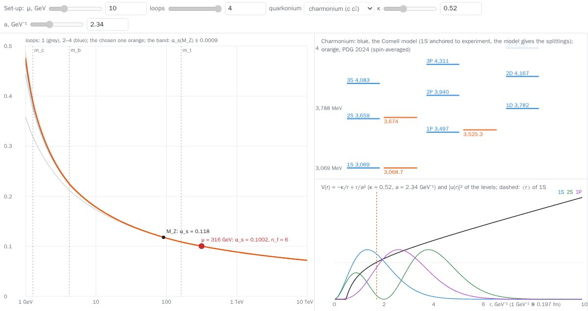</a> | **[u36 · КХД: асимптотическая свобода и кварконий](visualizations/u36_qcd/README.ru.md)**<br>Константа сильного взаимодействия слабеет на малых расстояниях; кварковая модель даёт уровни чармония, близкие к измеренным.<br>*Курсы:* Гриффитс. Введение в физику элементарных частиц; Обзор физики частиц (Particle Data Group)<br>▷ Смотреть на сайте: [Асимптотическая свобода и чармоний (PDG 2024, модель Корнелла)](https://ildar-idrisov.github.io/lfphys/run.html?rec=u36_qcd/charmonium&lang=ru) · [Боттомоний](https://ildar-idrisov.github.io/lfphys/run.html?rec=u36_qcd/bottomonium&lang=ru)<br>Сценариев в плеере: 4 |
| <a href="docs/images/u41_quarkonium_3d.jpg">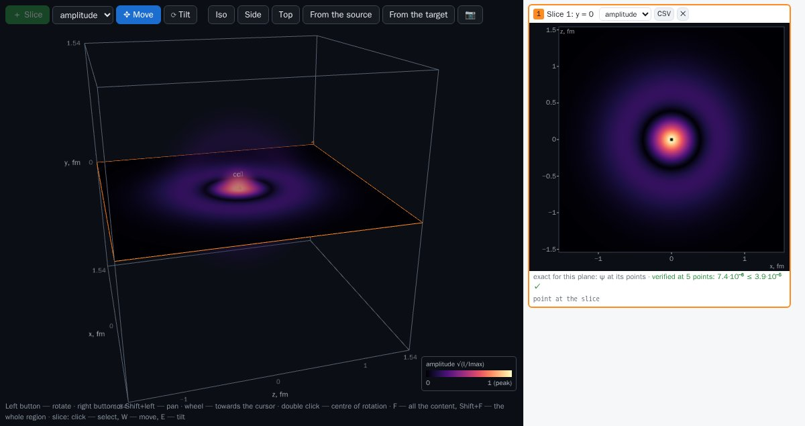</a> | **[u41 · Кварконий в 3D: волновые функции](visualizations/u41_quarkonium_3d/README.ru.md)**<br>Чармоний и боттомоний в 3D: облака пары кварков, их узлы и расщепления уровней в сравнении с экспериментом.<br>*Курсы:* Гриффитс. Введение в физику элементарных частиц, гл. 5<br>▷ Смотреть на сайте: [cc̄ 2S (ψ(2S)): один радиальный узел](https://ildar-idrisov.github.io/lfphys/run.html?rec=u41_quarkonium_3d/cc_2s&lang=ru) · [bb̄ 1S (Υ(1S)): облако теснее, кварки тяжелее](https://ildar-idrisov.github.io/lfphys/run.html?rec=u41_quarkonium_3d/bb_1s&lang=ru) · [cc̄ 1S + 1P_z: пара качается с частотой перехода (суперпозиция)](https://ildar-idrisov.github.io/lfphys/run.html?rec=u41_quarkonium_3d/superposition&lang=ru)<br>Сценариев в плеере: 10 |

**Астрофизика и космология** · 1

| | |
|---|---|
| <a href="docs/images/u42_kerr_shadow.jpg">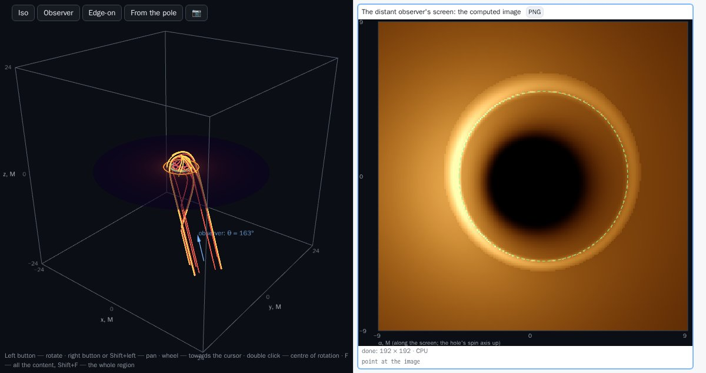</a> | **[u42 · Тень чёрной дыры Керра и её фотонные кольца](visualizations/u42_kerr_shadow/README.ru.md)**<br>Вращающаяся чёрная дыра с диском газа: тень и фотонные кольца, рассчитанные луч за лучом, в сравнении с EHT.<br>*Курсы:* Хартл. Гравитация: введение в общую теорию относительности Эйнштейна, гл. 15; Чандрасекар. Математическая теория чёрных дыр; Коллаборация Event Horizon Telescope, ApJ Letters 875 (2019)<br>▷ Смотреть на сайте: [M87*: a = 0,9, наклон 163° (как у EHT при a &gt; 0), диск Каннингема — тень, кольцо линзирования, фотонное кольцо](https://ildar-idrisov.github.io/lfphys/run.html?rec=u42_kerr_shadow/m87&lang=ru) · [Диск с ребра (θ = 90°), a = 0,99: тень сплюснута, кольца несимметричны](https://ildar-idrisov.github.io/lfphys/run.html?rec=u42_kerr_shadow/edge_on&lang=ru) · [Что, если: метрика Йоханнсена с α₁₃ = 3 — тень больше, сравнение с EHT](https://ildar-idrisov.github.io/lfphys/run.html?rec=u42_kerr_shadow/whatif&lang=ru) *(модифицированная физика)*<br>Сценариев в плеере: 6<br>Та же тема на других уровнях: R10 · Фотонные кольца вне метрики Керра: эталон для воспроизведения (Исследования, в планах) |

<details>
<summary>в плане 30</summary>

**Механика** · 3

* U01 · Лагранжева механика и хаос: двойной маятник, фазовый портрет, сечения Пуанкаре, показатель Ляпунова
* U02 · Твёрдое тело: уравнения Эйлера, эффект Джанибекова, прецессия и нутация гироскопа
* U03 · Неинерциальные системы отсчёта: маятник Фуко, сила Кориолиса

**Жидкости и газы** · 1

* U30 · Режимы течения: Пуазейль, Бернулли и Вентури, число Рейнольдса от ползущего течения до дорожки Кармана

**Колебания и волны** · 1

* U04 · Связанные осцилляторы, нормальные моды, биения, резонансная кривая и добротность

**Тепловые явления и молекулярная физика** · 3

* U05 · Кинетическая теория из атомов: распределение Максвелла–Больцмана, барометрическая формула, длина свободного пробега, перенос
* U06 · Тепловые машины и энтропия: циклы Карно и Отто из молекулярной динамики, диаграммы P–V и T–S, необратимость
* U08 · Излучение чёрного тела: моды полости, Рэлей–Джинс против Планка, Вин, Стефан–Больцман

**Электричество и магнетизм** · 6

* U09 · Электростатика: краевые задачи, метод изображений, мультиполи, ёмкость, диэлектрики
* U10 · Магнитостатика и индуктивность: закон Био–Савара, катушки Гельмгольца, теорема о циркуляции, взаимная индукция
* U11 · Заряженные частицы в полях: циклотрон, масс-спектрометр, дрейф E×B, магнитная ловушка, эффект Холла
* U12 · Цепи: переходные процессы в RLC, векторные диаграммы, резонанс, фильтры, длинная линия
* U13 · Излучение зарядов: поле ускоренного заряда (излом силовых линий), диполь, формула Лармора, синхротронное излучение
* U14 · Волны в веществе и волноводах: моды волновода, резонатор, затухающая волна, одномерный фотонный кристалл

**Оптика** · 3

* U15 · Интерферометры и когерентность: Майкельсон, Маха–Цендер, Фабри–Перо, фурье-спектроскопия
* U16 · Фурье-оптика: дифракция Фраунгофера как преобразование Фурье, 4f-фильтрация, разрешение решётки, теория Аббе
* U17 · Поляризация и кристаллооптика: формализмы Джонса и Мюллера, фазовые пластинки, двулучепреломление

**Теория относительности** · 1

* U27 · Диаграммы Минковского и парадокс близнецов. Уже есть на другом уровне: [r11 · Прецессия Томаса–Вигнера в 3D](visualizations/r11_thomas_3d/README.ru.md) (Исследования)

**Квантовая физика** · 2

* U18 · Опыт Штерна–Герлаха и спин: последовательные приборы, прецессия Лармора
* U20 · Фотоны: фотоэффект (h/e по Милликену), эффект Комптона

**Атомная физика** · 3

* U19 · Двухуровневый атом: осцилляции Раби, метод Рамси, сфера Блоха, оптические уравнения Блоха, спонтанное излучение, квантовые скачки
* U22 · Атом: серии водорода, тонкая структура, эффект Зеемана, правила отбора
* U24 · Резерфордовское рассеяние и сечение

**Физика конденсированного состояния** · 3

* U07 · Модель Изинга и фазовые переходы
* U21 · Дифракция электронов на кристалле: опыт Дэвиссона–Джермера, кольца Дебая–Шеррера, закон Брэгга
* U23 · Энергетические зоны: модель Кронига–Пенни, сильная связь, блоховские осцилляции

**Ядерная физика** · 1

* U25 · Ядро: цепочки распадов (Бейтман), α-распад как туннелирование (Гамов), формула Вайцзеккера

**Физика элементарных частиц** · 1

* U26 · Релятивистская кинематика: инвариантная масса, распады, пороги реакций

**Астрофизика и космология** · 2

* U28 · Гравитационные волны от двойной системы: чирп, h₊ и h×, пульсар Халса–Тейлора
* U29 · Космология: история расширения, диаграмма Хаббла, расстояния, возраст, горизонты

</details>

### Исследования

Постановки, которых ещё никто не рассчитывал, — для изучения сложных законов; всякая новизна — гипотеза.

**Теория относительности** · 1

| | |
|---|---|
| <a href="docs/images/r11_thomas_3d.jpg">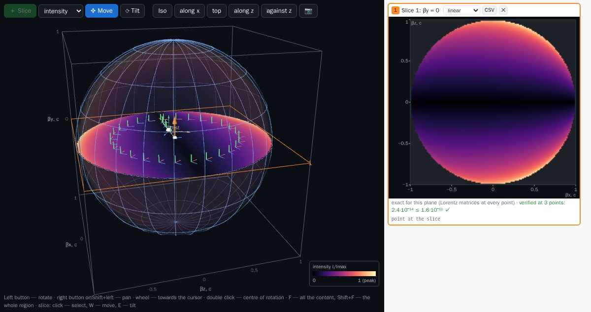</a> | **[r11 · Прецессия Томаса–Вигнера в 3D](visualizations/r11_thomas_3d/README.ru.md)**<br>Манёвр аппарата в 3D: вернувшись к покою, он находит свои гироскопы повёрнутыми — это голономия петли.<br>*Вопрос:* Как поворот гироскопов аппарата зависит от формы его петли в пространстве скоростей — за пределами плоских манёвров и в расчёте на единицу затраченной быстроты? · **Статус: гипотеза**<br>*Предшествующие работы:* Aravind, Am. J. Phys. 65, 634 (1997); [Rhodes & Semon, Am. J. Phys. 72, 943 (2004)](https://arxiv.org/abs/gr-qc/0501070); [O'Donnell & Visser, Eur. J. Phys. 32, 1033 (2011)](https://arxiv.org/abs/1102.2001); [Berry & Visser (2020)](https://arxiv.org/abs/2002.10659); [Palge & Pfeifer, Phys. Rev. A 109, 032206 (2024)](https://arxiv.org/abs/2310.08121); Osserman, Bull. Amer. Math. Soc. 84, 1182 (1978)<br>▷ Смотреть на сайте: [Прецессия Томаса: равномерное движение по окружности, γ = 1,34](https://ildar-idrisov.github.io/lfphys/run.html?rec=r11_thomas_3d/thomas&lang=ru) · [Шов мяча на сфере скоростей (неплоский, 96 разгонов)](https://ildar-idrisov.github.io/lfphys/run.html?rec=r11_thomas_3d/seam&lang=ru) · [Обычное пространство: траектория и гироскопы при прецессии Томаса](https://ildar-idrisov.github.io/lfphys/run.html?rec=r11_thomas_3d/lab&lang=ru)<br>Сценариев в плеере: 8<br>Та же тема на других уровнях: U27 · Диаграммы Минковского и парадокс близнецов (Университет, в планах) |

**Квантовая физика** · 2

| | |
|---|---|
| <a href="docs/images/r12_double_slit_2d.jpg">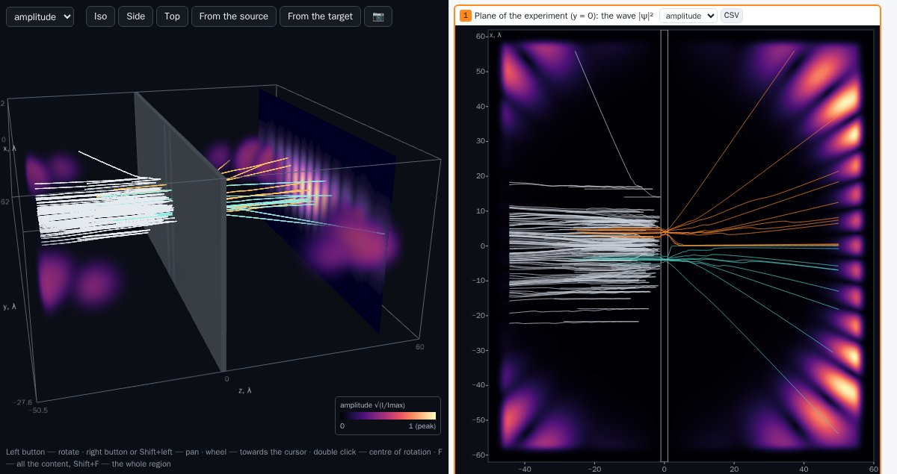</a> | **[r12 · Двухщелевой опыт (длинные щели, 3D): точное уравнение Шрёдингера и траектории Бома](visualizations/r12_double_slit_2d/README.ru.md)**<br>Точная волна проходит две толстые щели; траектории Бома, окрашенные по своей щели, складывают картину.<br>*Вопрос:* Где параксиальная теория двухщелевого опыта перестаёт работать для настоящих щелей конечной толщины и как метка пути и поток Ааронова–Бома меняют картину и траектории Бома? · **Статус: гипотеза**<br>*Предшествующие работы:* [Das, Deckert, Kellers, Krekels & Struyve, Ann. Phys. 479, 170054 (2025)](https://arxiv.org/abs/2211.13362); [Sanz & Borondo, Eur. Phys. J. D 44, 319 (2007)](https://arxiv.org/abs/quant-ph/0310096); [Xiao, Wiseman et al., Sci. Adv. 5, eaav9547 (2019)](https://arxiv.org/abs/1805.02059); Dürr, Nonn & Rempe, Phys. Rev. Lett. 81, 5705 (1998); [Macdougall, Singleton & Vagenas, Phys. Lett. A 379, 1689 (2015)](https://arxiv.org/abs/1505.01510)<br>▷ Смотреть на сайте: [Узкие щели a = 2λ: дифракция на большие углы, параксиальная теория не годится](https://ildar-idrisov.github.io/lfphys/run.html?rec=r12_double_slit_2d/narrow&lang=ru) · [Метка пути: спин в щели B повёрнут на 180° — полосы почти гаснут, траектории пересекают ось](https://ildar-idrisov.github.io/lfphys/run.html?rec=r12_double_slit_2d/mark180&lang=ru)<br>Сценариев в плеере: 7<br>Та же тема на других уровнях: [u32 · Двухщелевой опыт](visualizations/u32_double_slit/README.ru.md) (Университет); S38 · Интерференция и дифракция света; дифракционная решётка; поляризация (Школа, в планах) |
| <a href="docs/images/r13_arrival_times_2d.jpg"></a> | **[r13 · Время прихода частицы: правила в 2D](visualizations/r13_arrival_times_2d/README.ru.md)**<br>Несколько правил времени прибытия на одном запуске: вдали от источника они согласны, вблизи расходятся.<br>*Вопрос:* Когда частица прибывает на детектор? Где правила времени прибытия согласны и где расходятся: вблизи источника, для цепочки пакетов, при обратном потоке, за двумя щелями? · **Статус: гипотеза**<br>*Предшествующие работы:* [Ayatollah Rafsanjani et al., Commun. Phys. 6, 195 (2023)](https://arxiv.org/abs/2301.02641); [Das & Struyve, Phys. Rev. A 104, 042214 (2021)](https://arxiv.org/abs/2105.14744); [Das, Deckert, Kellers, Krekels & Struyve, Ann. Phys. 479, 170054 (2025)](https://arxiv.org/abs/2211.13362); [Cavendish & Das, Phys. Rev. A 112, 062217 (2025)](https://journals.aps.org/pra/abstract/10.1103/332p-4nl1); [Jozani & Tumulka, Phys. Rev. Research 8, 033072 (2026)](https://arxiv.org/abs/2603.22044); [Paterek & Goussev, Phys. Rev. Lett. 136, 090202 (2026)](https://arxiv.org/abs/2511.10155)<br>▷ Смотреть на сайте: [Один пакет: все правила почти совпадают вдали от источника](https://ildar-idrisov.github.io/lfphys/run.html?rec=r13_arrival_times_2d/gauss&lang=ru) · [Близко к источнику (σz = 1λ, L = 5λ): правила расходятся](https://ildar-idrisov.github.io/lfphys/run.html?rec=r13_arrival_times_2d/near&lang=ru)<br>Сценариев в плеере: 5 |

<details>
<summary>в плане 10</summary>

**Теория относительности** · 1

* R07 · Поворот Томаса–Вигнера на единицу бюджета быстроты · *гипотеза*

**Квантовая физика** · 8

* R01 · Зависящий от времени поток Ааронова–Бома в реальной двойной щели · *гипотеза*. Уже есть на другом уровне: [u32 · Двухщелевой опыт](visualizations/u32_double_slit/README.ru.md) (Университет)
* R02 · Отложенная метка пути и её стирание для массивных частиц в пространственной двойной щели · *гипотеза*. Уже есть на другом уровне: [u32 · Двухщелевой опыт](visualizations/u32_double_slit/README.ru.md) (Университет)
* R03 · Интерференция высших порядков в реальных щелях: параметр Соркина κ для волн материи в толстых щелях и туннелирование сквозь стенку как третий путь · *гипотеза*
* R04 · Различение правил времени прибытия за реальной пластиной · *гипотеза*
* R05 · Импульсный скалярный (электрический) эффект Ааронова–Бома: расчёты для проекта эксперимента · *гипотеза*. Уже есть на другом уровне: [u32 · Двухщелевой опыт](visualizations/u32_double_slit/README.ru.md) (Университет)
* R06 · Щель с отдачей (Эйнштейн–Бор) как точная задача двух тел · *гипотеза*
* R08 · Частичная метка пути и пересечение бомовских траекторий · *гипотеза*. Уже есть на другом уровне: [u32 · Двухщелевой опыт](visualizations/u32_double_slit/README.ru.md) (Университет)
* R09 · Щель, модулированная во времени · *гипотеза*. Уже есть на другом уровне: [u32 · Двухщелевой опыт](visualizations/u32_double_slit/README.ru.md) (Университет)

**Астрофизика и космология** · 1

* R10 · Фотонные кольца вне метрики Керра: эталон для воспроизведения · *гипотеза*. Уже есть на другом уровне: [u42 · Тень чёрной дыры Керра и её фотонные кольца](visualizations/u42_kerr_shadow/README.ru.md) (Университет)

</details>

### Лаборатории

Свободные стенды: соберите сцену, и движок рассчитает её вживую.

*Работает только с локальным сервером* ([Быстрый старт](#быстрый-старт)).

**Жидкости и газы** · 1

| | |
|---|---|
| <a href="docs/images/p04_fluids.jpg">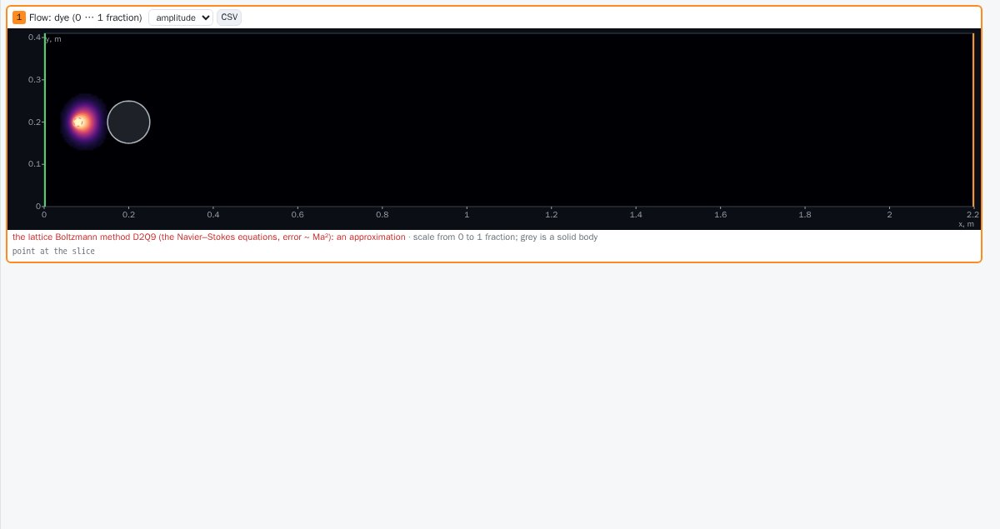</a> | **[p04 · Жидкости](visualizations/p04_fluids/README.ru.md)**<br>Соберите течение вокруг тел и крыльев и посмотрите на вихри, подъёмную силу и сопротивление.<br>Сценариев в плеере: 7 |

**Тепловые явления и молекулярная физика** · 1

| | |
|---|---|
| <a href="docs/images/p03_molecules.jpg">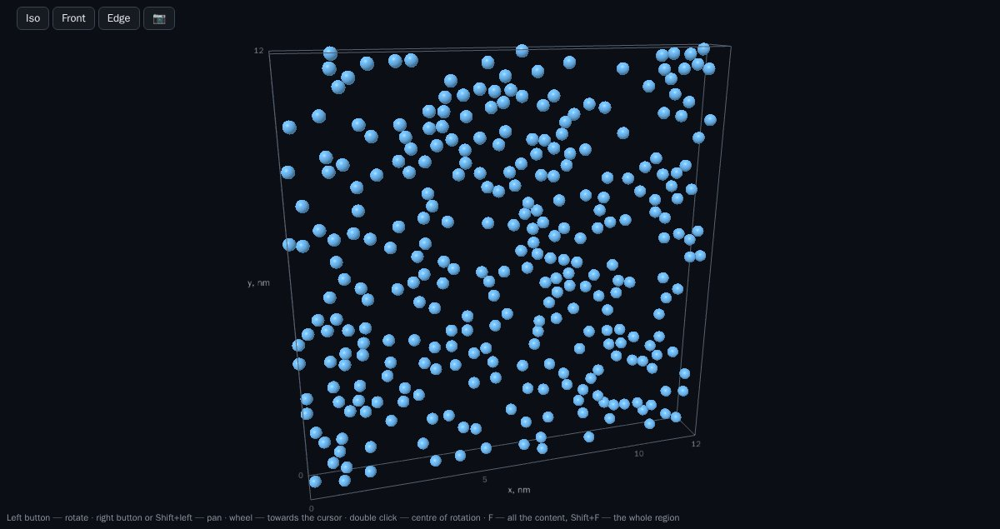</a> | **[p03 · Частицы и молекулы](visualizations/p03_molecules/README.ru.md)**<br>Соберите вещество из атомов и посмотрите, как возникают температура, давление и фазы.<br>Сценариев в плеере: 6 |

**Квантовая физика** · 1

| | |
|---|---|
| <a href="docs/images/p02_quantum.jpg"></a> | **[p02 · Квантовые частицы](visualizations/p02_quantum/README.ru.md)**<br>Соберите опыт из волновых пакетов, барьеров, щелей и полей и посмотрите на волну.<br>Сценариев в плеере: 7 |

**Астрофизика и космология** · 1

| | |
|---|---|
| <a href="docs/images/p01_gravity.jpg"></a> | **[p01 · Космос и гравитация](visualizations/p01_gravity/README.ru.md)**<br>Соберите систему из звёзд, планет и чёрных дыр и посмотрите, как её движет тяготение.<br>Сценариев в плеере: 7<br>Та же тема на других уровнях: [u34 · Орбиты и часы: ОТО и Ньютон](visualizations/u34_orbits/README.ru.md) (Университет); S11 · Всемирное тяготение, спутники, первая космическая скорость (Школа, в планах) |

*Запланированные стенды:*

* p05 · Оптика и волны: источники, щели, линзы, зеркала, решётки, экраны (пакет B9)
* p06 · Электричество и магнетизм: заряды, токи, магниты, проводники; поля и излучение (пакет B9)
* p07 · Относительность: наблюдатели, часы, стержни, ракеты: что видит каждый (пакет B9)

<!-- END generated -->

В лаборатории сцена не подготовлена заранее: вы собираете её из палитры, меняете в любой момент, а мир считает
последствия в реальном времени. Лаборатории открываются плиткой **Лаборатории** на начальной странице; каждая
начинается со сценария (**▶ Начать**) или с сохранённого ранее файла сцены (**📂 Из файла сцены…**). Лабораториям нужен
запущенный сервер: на публичном сайте они показаны серыми.

* **Палитра и объекты**: тела, пакеты, атомы, стенки, препятствия, детекторы и датчики добавляются в текущий момент
  мира; их можно копировать и удалять; инспектор меняет параметры объекта на ходу и показывает его посчитанное
  состояние.
* **Законы на ходу**: то, что движок умеет менять в текущий момент (вязкость, шаг по времени, модель взаимодействия,
  сетку), меняется сразу; остальные законы начинают новый мир, который может забрать с собой сцену и её состояние.
* **Перетаскивание и бросок**: объект перетаскивается мышью; Shift + перетащить — бросок со скоростью руки.
* **Приборы**: каждая измеряемая величина со значением на момент бегунка; отметьте её — появится график по записи;
  выгрузка в CSV.
* **Перебор параметра**: тот же опыт от текущего момента повторяется для списка значений закона или параметра объекта в
  отдельном процессе; результат — таблица, график и CSV.
* **Файл сцены и запись**: сцену можно сохранить в файл и начать из него новый мир; запись держит последние 10 минут
  счёта (не больше 1 ГБ), а после «● Сохранять запись» — всё дальнейшее.
* Законы сохранения проверяются по ходу счёта.

## Что считается и как проверяется

* **Слои.** В ядре движка — только общепринятая физика; приближения, интерпретации, феноменологические модели и
  объявленные альтернативы лежат вне ядра, и каждая говорит, где расходится с ним
  ([`lfphys/LAYERS.md`](lfphys/LAYERS.md)). У каждого модуля есть паспорт (слой, утверждение, область применимости,
  основание, расхождения); панель плеера «Физика этого мира» перечисляет модули, которыми пользуется мир, в ядре и
  вне его.
* **Посчитано, а не нарисовано.** Всё видимое — результат счёта самого запуска; замкнутые формулы известной теории
  появляются только как эталоны в проверках. Следствие появляется, когда до него доходит время мира.
* **Проверки в каждом запуске.** Панель «Проверки: вычислено ↔ эталон» показывает каждую посчитанную в запуске величину
  рядом с её эталоном (✓ или ✗): замкнутой формулой, независимым методом или измеренным значением. Мир с изменённым
  законом помечен в верхней строке плеера плашкой «МОДИФИЦИРОВАННАЯ ФИЗИКА: …», приближение — «ПРИБЛИЖЕНИЕ: …».
* **Тесты.** Около 1600 тестовых функций: каждая функция движка сверяется с замкнутой формулой или вторым методом, для
  ключевых величин — строгие интервальные эталоны (шаровая арифметика Arb); каждая визуализация и сервер.
* **Ревью.** Новую физику проверяет рецензент, который её не писал, и на каждое замечание дан ответ: исправлено,
  отклонено с причиной или отложено в `STATUS.md`. Все 32 обработанных ревью пока внутренние (проведены в рамках
  проекта) и хранятся вместе с ответами в [`reviews/archive/`](reviews/archive/).
* **Сторонние библиотеки — только для сравнения.** 2961 сравнение с CRunDec (rundec), KerrGeoPy, tmm, QuTiP, Astropy и
  miepython: расхождений сверх допуска нет, 19 известных расхождений записаны с числами
  ([`lfphys/tests/external/RESULTS.md`](lfphys/tests/external/RESULTS.md)); разовое сравнение с решателем FDTD Meep
  ([`lfphys/sources/comparison_2026-11-04_meep.md`](lfphys/sources/comparison_2026-11-04_meep.md)).

Это исследовательский инструмент: тесты проверяют заявленные случаи в заявленных пределах, а не любую задачу. Открытые
проблемы собраны в [`STATUS.md`](STATUS.md).

## Охват и планы

Сильнее всего набор в оптике, квантовой физике и теории относительности: там он ведёт от школьных тем до
исследовательских вопросов. Для первой половины школьного курса демонстраций пока нет. Главные пробелы — по их весу в
школьных и вузовских программах — и то, что для них уже есть в движке:

| раздел | сейчас | главные пробелы | что уже есть в движке |
|---|---|---|---|
| механика | орбиты (p01, u34) | кинематика и бросок тела, законы Ньютона с трением, энергия, столкновения, вращение | точные упругие столкновения дисков и шаров (`core.md.hard`), N тел со слияниями (`core.gravity.nbody`); для твёрдых тел нужен новый модуль |
| колебания и волны | дифракция (u32, u38, r12), квантовый осциллятор (u33) | маятник и пружина, затухающие и вынужденные колебания, резонанс; стоячие волны, звук, эффект Доплера | решатель уравнений Максвелла в 2D и 3D (`core.em.fdtd`), ещё не используемый визуализациями |
| электричество и магнетизм | нет | силовые линии и потенциал, конденсаторы, цепи постоянного и переменного тока, поля токов, индукция | поля и излучение движущихся точечных зарядов (`core.em.charges`, ещё не используется); лаборатория запланирована (`lfphys/PLAN.md`, P15.5); для цепей нужен новый решатель |
| оптика | u32, u35, u38, u43, u44 | линзы, зеркала и построение изображений, призмы, решётки, поляризация | закон Снеллиуса и лучевые матрицы (`theories.approx.ray_optics`); лаборатория запланирована (P15.2) |
| тепловые явления | p03 | отдельные сценарии газовых законов и тепловой машины с P–V-диаграммой | поршень, термостаты, счётчики теплоты и работы и свипы p03 |
| теория относительности | u31, u34, r11, u39, u42, p01 | замедление времени и парадокс близнецов, диаграммы пространства-времени, релятивистские столкновения | `core.relativity`, `core.worldlines`, `core.lorentz`; лаборатория запланирована (P15.6) |
| квантовая и атомная физика | u32, u33, u37, r12, r13, u40, p02 | фотоэффект, эффект Комптона, спектр чёрного тела, линейчатые спектры, опыт Штерна–Герлаха, осцилляции Раби | эффект Комптона (`core.quantum.compton`) и двухуровневый атом (`core.quantum.two_level`) — оба ещё не используются; закон Планка, уровни водорода и дипольные матричные элементы |
| ядерная физика | нет | распад и период полураспада, энергия связи, деление и синтез | нет |
| астрофизика и космология | u31, u42, p01 | закон Хаббла и история расширения | фон FLRW с параметрами Planck 2018 (`core.cosmology.flrw`), ещё не используется |

Даже там, где модуль есть, демонстрацию ещё нужно придумать, собрать, проверить и отдать на ревью; порядок работ решает
автор. Планы — [`lfphys/PLAN.md`](lfphys/PLAN.md), открытые вопросы — [`STATUS.md`](STATUS.md).

## Документация

* [`visualizations/README.ru.md`](visualizations/README.ru.md) — руководство по серверу и плееру: все миры, сценарии и
  управление.
* README каждого мира — модель, проверки, приближения и тесты: u31–u44, r11–r13 и p01–p04, ссылки в таблицах выше.
* Документы для разработчиков (на английском):
  * [`visualizations/RULES.md`](visualizations/RULES.md) — правила для всех визуализаций (физика, причинность,
    изменённые законы, 3D-среда, лаборатории, языки интерфейса, аудитории, записи и сайт) и API сервера;
    [`visualizations/site/README.md`](visualizations/site/README.md) — запись демонстраций и сборка публичного сайта;
  * [`lfphys/README.md`](lfphys/README.md) — каталог модулей движка, CPU и GPU, строгие эталоны;
    [`lfphys/LAYERS.md`](lfphys/LAYERS.md) — слои; [`lfphys/PLAN.md`](lfphys/PLAN.md) — план разработки;
  * [`STATUS.md`](STATUS.md) — открытые проблемы и планы; [`reviews/`](reviews/README.md) — ревью и ответы на них;
    [`AGENTS.md`](AGENTS.md) — правила работы в репозитории; [`LANGUAGES.md`](LANGUAGES.md) — языки проекта.

## Лицензия и цитирование

Коротко:
* **Разрешено:** учёба, преподавание, академическое и исследовательское использование — бесплатно, для частных лиц,
  школ, университетов и других некоммерческих организаций.
* **Обязательно:** ссылка на lfphys при любом публичном использовании и цитирование в публикациях. Скриншоты,
  изображения и видео его запусков, материалы его сайта, учебные материалы, сайты, презентации, видео и посты несут
  строку `lfphys — Ildar Idrisov — https://github.com/ildar-idrisov/lfphys` (подойдёт и адрес сайта; на уроке — один
  раз на материале, который вы показываете или раздаёте). Любая публикация полученных с lfphys результатов цитирует его
  с версией ([`CITATION.cff`](CITATION.cff); версию показывает страница плеера «Лицензия»). Когда вы передаёте lfphys
  или его документацию, сохраняйте уведомления автора.
* **Запрещено:** любое коммерческое использование кем бы то ни было без отдельного письменного соглашения
  ([`COMMERCIAL.md`](COMMERCIAL.md)); название своего продукта, сервиса, курса или сайта по имени lfphys так, будто
  они исходят от проекта.
* **На свой риск:** lfphys — исследовательский инструмент, предоставляется «как есть», без каких-либо гарантий. Вы
  используете его и его результаты на свой риск; автор не отвечает за последствия ([`LICENSE.md`](LICENSE.md) §8).

Полные условия: код — по [lfphys Research Licence 1.0](LICENSE.md), редакция от 14 ноября 2026 года (исходный код
открыт для чтения, но это не open source); документация, рисунки автора и материалы публичного сайта — по
CC BY-NC-SA 4.0 ([`LICENSE-DOCS.txt`](LICENSE-DOCS.txt)), с дополнительными разрешениями для научных публикаций
([`PUBLICATIONS.md`](PUBLICATIONS.md)); сторонние компоненты — по своим лицензиям ([`NOTICE`](NOTICE)). Участие в
разработке: [`CONTRIBUTING.md`](CONTRIBUTING.md) и [`CLA.md`](CLA.md).

Вопросы и коммерческое использование: [idrisov.sci@gmail.com](mailto:idrisov.sci@gmail.com).

Copyright (c) 2026 Ildar Idrisov.
